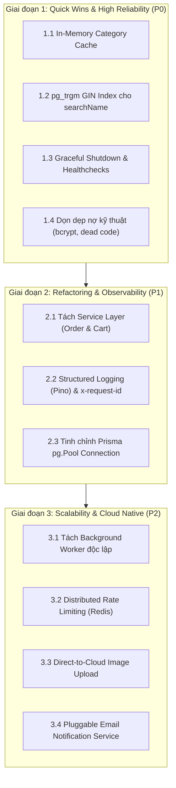
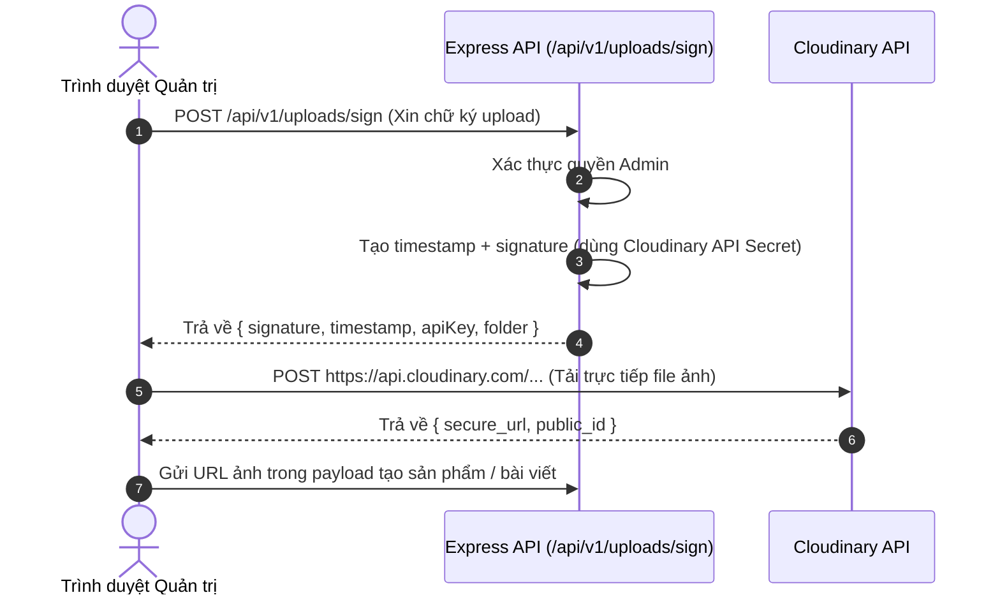

# Bản Đặc Tả Kỹ Thuật: Nâng Cấp Kiến Trúc & Hạ Tầng Backend (Technical Specification / RFC)

- **Dự án:** Petshop E-Commerce Backend (Express 5, Node.js, Prisma 7, PostgreSQL)
- **Trạng thái:** Proposed (Sẵn sàng triển khai)
- **Phiên bản:** 1.0.0
- **Mục tiêu:** Tối ưu hóa hiệu năng I/O, củng cố tính sẵn sàng cao (High Availability), chuẩn hóa cấu trúc phân tầng, tăng cường giám sát (Observability) và chuẩn bị hạ tầng mở rộng (Scale-out).

---

## 1. Bối cảnh & Mục tiêu (Context & Objectives)

### 1.1. Hiện trạng
Hệ thống backend hiện tại sở hữu nền tảng kiểm soát giao dịch và chống tranh chấp đồng thời (Concurrency Control & Idempotency) rất xuất sắc. Tuy nhiên, khi đối mặt với tải lưu lượng cao và yêu cầu scale-out đa tiến trình (multi-instances), hệ thống bộc lộ các điểm nghẽn:
1. **Lãng phí I/O Database:** Mỗi request đều thực hiện quét toàn bộ bảng `Category` để tính toán cây danh mục.
2. **Tìm kiếm chưa tối ưu:** Câu truy vấn `LIKE '%term%'` trên `Product.searchName` không có index, dẫn đến Full Table Scan.
3. **Độ tin cậy khi triển khai:** Thiếu Graceful Shutdown và Readiness Probe khiến container bị ngắt kết nối đột ngột khi deploy.
4. **Tiến trình chạy ngầm:** Worker dọn dẹp đơn quá hạn chạy lồng trong tiến trình web bằng `setInterval`.
5. **Cấu trúc phân tầng:** Controller còn ôm đồm nhiều logic nghiệp vụ nặng.
6. **Giám sát:** Log dạng văn bản không có cấu trúc, thiếu Request Correlation ID xuyên suốt.

### 1.2. Mục tiêu kỹ thuật
- Giảm ít nhất **80% số lượng truy vấn lặp lại** tới bảng `Category`.
- Giảm độ phức tạp thời gian tìm kiếm sản phẩm từ $O(N)$ (Seq Scan) xuống $O(\log N)$ (Index Scan).
- Đảm bảo **Zero Downtime Deployments** qua Graceful Shutdown và Readiness Healthcheck.
- Tách biệt hoàn toàn trách nhiệm giữa Web Server và Background Workers.
- Cấu trúc lại mã nguồn theo chuẩn **Controller -> Service -> Data Access**, giữ vững 100% các bài test hiện có.

---

## 2. Lộ trình Triển khai Tổng thể (Phased Roadmap)



---

## 3. Giai đoạn 1: Quick Wins & Độ Tin Cậy Cốt Lõi (Priority P0)

### 3.1. Module Caching Cây Danh mục (In-Memory Category Cache)

#### Vấn đề
Mỗi request đi qua middleware [`resolveBrand`](backend/middlewares/resolveBrand.ts) hoặc gọi hàm [`categoryScopeIds`](backend/services/categoryScope.service.ts) đều chạy 2 truy vấn DB:
1. `findUnique({ where: { slug } })`
2. `findMany({ select: { id: true, parentId: true } })` (quét toàn bộ bảng danh mục)

#### Thiết kế giải pháp
Tạo singleton module [`backend/services/categoryCache.service.ts`](backend/services/categoryCache.service.ts) lưu trữ cây danh mục trong bộ nhớ RAM của tiến trình với cơ chế:
- **TTL mặc định:** 10 phút (tự động làm mới khi hết hạn).
- **Event Invalidation:** Xóa cache ngay lập tức khi có thao tác ghi trên danh mục (`POST /categories`, `PATCH /categories/:id`, `DELETE /categories/:id`, `PUT /categories/reorder`).

#### Mã nguồn thiết kế (Specification Code)

```typescript
// backend/services/categoryCache.service.ts
import prisma from './prisma';
import { categorySubtreeIds } from '../utils/categoryTree';

interface CachedCategory {
  id: string;
  slug: string;
  parentId: string | null;
}

interface BrandScope {
  slug: string;
  categoryIds: string[];
}

let cachedCategories: CachedCategory[] | null = null;
let lastFetchedAt = 0;
const CACHE_TTL_MS = 10 * 60 * 1000; // 10 phút

export async function getAllCategoriesCached(): Promise<CachedCategory[]> {
  const now = Date.now();
  if (!cachedCategories || now - lastFetchedAt > CACHE_TTL_MS) {
    cachedCategories = await prisma.category.findMany({
      select: { id: true, slug: true, parentId: true },
    });
    lastFetchedAt = now;
  }
  return cachedCategories;
}

export async function getBrandScopeCached(brandSlug: string): Promise<BrandScope | null> {
  const all = await getAllCategoriesCached();
  const root = all.find((c) => c.slug === brandSlug && c.parentId === null);
  if (!root) return null;

  return {
    slug: root.slug,
    categoryIds: categorySubtreeIds(all, root.id),
  };
}

export async function getCategoryScopeIdsCached(slug: string): Promise<string[] | null> {
  const all = await getAllCategoriesCached();
  const target = all.find((c) => c.slug === slug);
  if (!target) return null;

  return categorySubtreeIds(all, target.id);
}

export function invalidateCategoryCache(): void {
  cachedCategories = null;
  lastFetchedAt = 0;
}
```

#### Áp dụng vào hệ thống:
1. Sửa [`resolveBrand.ts`](backend/middlewares/resolveBrand.ts): gọi `getBrandScopeCached(slug)`.
2. Sửa [`categoryScope.service.ts`](backend/services/categoryScope.service.ts): gọi `getCategoryScopeIdsCached(slug)`.
3. Gắn `invalidateCategoryCache()` vào [`category.controller.ts`](backend/controllers/category.controller.ts) sau mỗi thao tác tạo/sửa/xóa/đổi vị trí danh mục.

---

### 3.2. Đánh GIN Trigram Index cho `Product.searchName`

#### Vấn đề
Tìm kiếm sản phẩm sử dụng điều kiện:
`where.searchName = { contains: escapeLike(toSearchText(q)) }` (tương đương `LIKE '%q%'`). Cột `searchName` chưa có index, buộc PostgreSQL thực hiện quét toàn bộ bảng.

#### Thiết kế giải pháp
Tạo migration mới bổ sung extension `pg_trgm` và GIN Index trên `searchName`.

#### Migration Script: `prisma/migrations/20261105000000_add_search_name_trigram_index/migration.sql`

```sql
-- Kích hoạt extension pg_trgm nếu chưa có
CREATE EXTENSION IF NOT EXISTS pg_trgm;

-- Tạo GIN index tối ưu hóa cho LIKE '%...%' và ILIKE
CREATE INDEX "Product_searchName_trgm_idx" 
ON "Product" USING gin ("searchName" gin_trgm_ops);
```

#### Kiểm chứng hiệu năng
Chạy truy vấn `EXPLAIN (ANALYZE, BUFFERS)` trước và sau migration:
```sql
EXPLAIN ANALYZE 
SELECT "id", "name", "minPrice" 
FROM "Product" 
WHERE "status" = 'active' AND "searchName" LIKE '%pate%';
```
- **Trước:** `Seq Scan on Product (cost=0.00..XX.XX rows=... Filter: ...)`.
- **Sau:** `Bitmap Index Scan on Product_searchName_trgm_idx (cost=... Bitmap Heap Scan)`.

---

### 3.3. Graceful Shutdown & Healthcheck Hai Tầng (Liveness & Readiness)

#### Vấn đề
[`bin/www.ts`](backend/bin/www.ts) không lắng nghe tín hiệu `SIGTERM`/`SIGINT`. Khi deploy hoặc restart, container tắt đột ngột làm đứt ngang các transaction. Endpoint `/health` tĩnh không phản ánh được trạng thái sống của cơ sở dữ liệu.

#### Thiết kế giải pháp
1. Thêm endpoint `/health/live` (kiểm tra tiến trình còn chạy) và `/health/ready` (kiểm tra kết nối DB phản hồi).
2. Xây dựng hàm `gracefulShutdown` tiếp nhận `SIGTERM`/`SIGINT`, dừng nhận request mới, đợi các request đang chạy hoàn tất (drain), dừng background sweeper, ngắt kết nối Prisma, và exit tiến trình.

#### Mã nguồn thiết kế (Specification Code)

```typescript
// backend/bin/www.ts
#!/usr/bin/env node
import app from '../app';
import { port } from '../config/env';
import prisma from '../services/prisma';
import { startExpiredOrderSweeper } from '../workers/releaseExpiredOrders';

const server = app.listen(port, () => {
  console.log(`[server] Đang lắng nghe tại cổng ${port}`);
});

const sweeperTimer = startExpiredOrderSweeper();

let isShuttingDown = false;

export function getShutdownStatus(): boolean {
  return isShuttingDown;
}

async function shutdown(signal: string) {
  if (isShuttingDown) return;
  isShuttingDown = true;
  console.log(`[server] Nhận tín hiệu ${signal}. Bắt đầu Graceful Shutdown...`);

  // 1. Dừng nhận request mới
  server.close(async (err) => {
    if (err) {
      console.error('[server] Lỗi khi đóng HTTP server:', err);
      process.exit(1);
    }
    console.log('[server] Đã đóng cổng nhận HTTP request.');

    try {
      // 2. Hủy timer của background worker
      clearInterval(sweeperTimer);
      console.log('[server] Đã dừng background worker.');

      // 3. Đóng pool Prisma kết nối tới Database
      await prisma.$disconnect();
      console.log('[server] Đã ngắt kết nối Database an toàn.');

      process.exit(0);
    } catch (dbErr) {
      console.error('[server] Lỗi khi ngắt kết nối Database:', dbErr);
      process.exit(1);
    }
  });

  // Fail-safe: Buộc dừng nếu sau 15 giây các request cũ chưa hoàn tất
  setTimeout(() => {
    console.error('[server] Quá thời gian chờ (15s). Buộc dừng tiến trình (force exit).');
    process.exit(1);
  }, 15000).unref();
}

process.on('SIGTERM', () => shutdown('SIGTERM'));
process.on('SIGINT', () => shutdown('SIGINT'));
```

```typescript
// Bổ sung vào backend/app.ts
app.get('/health/live', (_req: Request, res: Response) => {
  res.status(200).json({ status: 'ok', timestamp: new Date().toISOString() });
});

app.get('/health/ready', async (_req: Request, res: Response) => {
  try {
    await prisma.$queryRaw`SELECT 1`;
    res.status(200).json({ status: 'ready', database: 'connected' });
  } catch (error) {
    res.status(503).json({ status: 'unready', database: 'disconnected' });
  }
});
```

---

### 3.4. Dọn Dẹp Nợ Kỹ Thuật (Dead Code & Redundant Dependencies)

1. **Gỡ bỏ gói `bcrypt` (C++ native binding):**
   - Trong [`package.json`](backend/package.json): Gỡ bỏ `"bcrypt": "^6.0.0"`.
   - Giữ lại `"bcryptjs": "^3.0.3"` và `"@types/bcryptjs": "^2.4.6"` (vốn đang được toàn bộ mã nguồn sử dụng ổn định).
   - Lợi ích: Loại bỏ hoàn toàn công đoạn biên dịch C++ (`node-gyp-build`) trong Docker/CI, giảm kích thước image và tốc độ cài đặt `npm install`.
2. **Dọn dẹp mã chết trong [`jwt.service.ts`](backend/services/jwt.service.ts):**
   - Xóa bỏ 2 hàm `signRefreshToken` (dòng 29-32) và `verifyRefreshToken` (dòng 34-37).
   - Loại bỏ export tương ứng tại dòng 39.

---

## 4. Giai đoạn 2: Tái Cấu Trúc Kiến Trúc & Giám Sát (Priority P1)

### 4.1. Chuẩn Hóa Kiến Trúc: Controller -> Service Layer

#### Vấn đề
[`order.controller.ts`](backend/controllers/order.controller.ts) và [`cart.controller.ts`](backend/controllers/cart.controller.ts) đang trực tiếp thực hiện transaction, raw lock, logic tính tiền và tạo snapshot. Điều này khiến mã nguồn khó tái sử dụng và khó viết unit test độc lập.

#### Thiết kế giải pháp
1. Trích xuất logic nghiệp vụ của đơn hàng sang [`backend/services/order.service.ts`](backend/services/order.service.ts).
2. Trích xuất logic giỏ hàng sang [`backend/services/cart.service.ts`](backend/services/cart.service.ts).
3. Controller chỉ đóng vai trò Adapter: Validate request -> Gọi Service -> Trả về `sendSuccess`.

#### Kiến trúc `order.service.ts`

```typescript
// backend/services/order.service.ts
import prisma from './prisma';
import ApiError from '../utils/ApiError';
import { generateOrderCode } from '../utils/orderCode';
import { ORDER_STATUS, PAYMENT_METHOD, PAYMENT_STATUS, PAYMENT_WINDOW_HOURS } from '../constants/order';
import { claimForSale, recordSale } from './inventory.service';

export interface CreateOrderInput {
  userId: string;
  brandSlug: string;
  paymentMethod: string;
  shippingAddress: { fullName: string; phone: string; addressLine: string; city: string };
  note?: string | null;
  idempotencyKey?: string | null;
}

export interface CreateOrderResult {
  order: any;
  replayed: boolean;
}

export async function placeOrder(input: CreateOrderInput): Promise<CreateOrderResult> {
  const { userId, brandSlug, paymentMethod, shippingAddress, note, idempotencyKey } = input;
  const isCod = paymentMethod === PAYMENT_METHOD.COD;

  return prisma.$transaction(
    async (tx) => {
      // 1. Pessimistic lock row giỏ hàng
      const locked = await tx.$queryRaw<{ id: string }[]>`
        SELECT "id" FROM "Cart" WHERE "userId" = ${userId} AND "brandSlug" = ${brandSlug} FOR UPDATE`;

      // 2. Kiểm tra Idempotency Replay
      if (idempotencyKey) {
        const existing = await tx.order.findUnique({
          where: { userId_idempotencyKey: { userId, idempotencyKey } },
          include: { items: true },
        });
        if (existing) return { order: existing, replayed: true };
      }

      const cartItems = locked.length
        ? await tx.cartItem.findMany({
            where: { cartId: locked[0].id },
            include: { variant: { include: { product: true } } },
          })
        : [];

      if (cartItems.length === 0) {
        throw new ApiError(422, 'CART_EMPTY', 'Giỏ hàng đang trống');
      }

      // 3. Xác thực tồn kho và tính tiền
      let subtotal = 0;
      const items = cartItems.map((item) => {
        const lineTotal = item.variant.price * item.quantity;
        subtotal += lineTotal;
        return item;
      });

      // 4. Trừ kho COD / Giữ kho
      if (isCod) {
        for (const item of items) {
          const claimed = await claimForSale(tx, item.variantId, item.quantity);
          if (!claimed) {
            throw new ApiError(409, 'OUT_OF_STOCK', `Sản phẩm "${item.variant.product.name}" không đủ hàng`);
          }
        }
      }

      const shippingFee = 0;

      // 5. Tạo Order và snapshots
      const created = await tx.order.create({
        data: {
          code: generateOrderCode(),
          userId,
          brandSlug,
          orderStatus: isCod ? ORDER_STATUS.CONFIRMED : ORDER_STATUS.PENDING_PAYMENT,
          paymentMethod,
          paymentStatus: isCod ? PAYMENT_STATUS.UNPAID : PAYMENT_STATUS.PENDING,
          subtotal,
          shippingFee,
          grandTotal: subtotal + shippingFee,
          shippingAddress,
          note: note || null,
          expiresAt: isCod ? null : new Date(Date.now() + PAYMENT_WINDOW_HOURS * 3600 * 1000),
          idempotencyKey,
          items: {
            create: items.map((i) => ({
              variantId: i.variantId,
              productName: i.variant.product.name,
              sku: i.variant.sku,
              unitPrice: i.variant.price,
              quantity: i.quantity,
              lineTotal: i.variant.price * i.quantity,
            })),
          },
        },
        include: { items: true },
      });

      if (isCod) {
        for (const item of items) await recordSale(tx, item.variantId, item.quantity, created.id);
      }

      await tx.cartItem.deleteMany({ where: { cartId: locked[0].id } });

      return { order: created, replayed: false };
    },
    { timeout: 15000 }
  );
}
```

---

### 4.2. Hệ Thống Logging Có Cấu Trúc (Structured JSON Logging với Pino) & Request ID

#### Vấn đề
Dự án dùng `morgan('dev')` và `console.error` rải rác. Khi xảy ra lỗi trên production, không thể trace được request đó từ đâu đến, user nào gọi, mất bao nhiêu ms và ngữ cảnh lỗi là gì.

#### Thiết kế giải pháp
1. Sử dụng thư viện **Pino** (chuẩn hiệu năng cao nhất trong hệ sinh thái Node.js) và `pino-http`.
2. Middleware tự động gắn `x-request-id` (nếu client hoặc BFF đã gửi thì giữ nguyên, nếu chưa có thì sinh UUID mới).
3. Đưa `x-request-id`, `userId`, `brandSlug` vào mọi log entry.

#### Kiến trúc Logging (`backend/utils/logger.ts`)

```typescript
// backend/utils/logger.ts
import pino from 'pino';

export const logger = pino({
  level: process.env.LOG_LEVEL || (process.env.NODE_ENV === 'production' ? 'info' : 'debug'),
  formatters: {
    level: (label) => ({ level: label }),
  },
  timestamp: pino.stdTimeFunctions.isoTime,
  redact: ['req.headers.authorization', 'req.headers.cookie', 'body.password', 'body.newPassword'],
});

export default logger;
```

```typescript
// Middleware gán Request ID: backend/middlewares/requestId.ts
import crypto from 'crypto';
import type { Request, Response, NextFunction } from 'express';

export function requestId(req: Request, res: Response, next: NextFunction) {
  const reqId = req.get('X-Request-Id') || crypto.randomUUID();
  req.id = reqId;
  res.setHeader('X-Request-Id', reqId);
  next();
}
```

---

### 4.3. Cấu hình Connection Pool cho Prisma 7 & pg.Pool

#### Vấn đề
[`services/prisma.ts`](backend/services/prisma.ts) khởi tạo `new PrismaPg({ connectionString: databaseUrl })`. Mặc định của `pg` driver mở pool 10 kết nối mà không có các cấu hình timeout an toàn. Khi deploy lên Supabase / Neon hoặc chạy nhiều replicas, dễ dẫn tới lỗi `sorry, too many clients already`.

#### Thiết kế giải pháp
Chủ động khởi tạo instance `pg.Pool` có cấu hình tường minh, rồi truyền vào `PrismaPg`:

```typescript
// backend/services/prisma.ts
import { Pool } from 'pg';
import { PrismaPg } from '@prisma/adapter-pg';
import { PrismaClient } from '@prisma/client';
import { databaseUrl } from '../config/env';

if (!databaseUrl) {
  throw new Error('Thiếu DATABASE_URL — server không thể khởi động.');
}

const pool = new Pool({
  connectionString: databaseUrl,
  max: Number(process.env.DB_POOL_MAX || 15),          // Số connection tối đa trên 1 instance
  idleTimeoutMillis: 30000,                          // Đóng kết nối nhàn rỗi sau 30s
  connectionTimeoutMillis: 5000,                     // Hết hạn chờ cấp kết nối sau 5s
});

pool.on('error', (err) => {
  console.error('[pg.Pool] Lỗi không mong muốn trong connection pool:', err.message);
});

const adapter = new PrismaPg(pool);
export const prisma = new PrismaClient({ adapter });

export default prisma;
```

---

## 5. Giai đoạn 3: Mở Rộng Hạ Tầng & Sẵn Sàng Scale-Out (Priority P2)

### 5.1. Tách Background Worker Thành Tiến Trình Độc Lập

#### Thiết kế giải pháp
1. Tạo entrypoint độc lập: [`backend/workers/sweeper.ts`](backend/workers/sweeper.ts).
2. Xóa lệnh gọi `startExpiredOrderSweeper()` khỏi tiến trình web [`bin/www.ts`](backend/bin/www.ts).
3. Thêm script trong `package.json`: `"worker:sweeper": "tsx workers/sweeper.ts"`.
4. Trong môi trường Docker / Cloud (Render/Heroku/Kubernetes):
   - Service Web: Chạy `npm start` (chỉ xử lý HTTP traffic).
   - Service Worker: Chạy `npm run worker:sweeper` (1 replica duy nhất hoặc chạy qua Cron Scheduler).

```typescript
// backend/workers/sweeper.ts
import { releaseExpiredOrders } from './releaseExpiredOrders';
import prisma from '../services/prisma';

const INTERVAL = Number(process.env.SWEEPER_INTERVAL_MS || 60000);

async function loop() {
  try {
    const released = await releaseExpiredOrders();
    if (released > 0) {
      console.log(`[worker:sweeper] Đã dọn dẹp ${released} đơn hết hạn và hoàn kho.`);
    }
  } catch (err: any) {
    console.error('[worker:sweeper] Lỗi thực thi sweep:', err.message);
  }
}

console.log('[worker:sweeper] Worker dọn dẹp đơn hết hạn đã khởi động.');
setInterval(loop, INTERVAL);

process.on('SIGTERM', async () => {
  console.log('[worker:sweeper] Dừng worker...');
  await prisma.$disconnect();
  process.exit(0);
});
```

---

### 5.2. Distributed Rate Limiting (Redis Store)

#### Vấn đề & Giải pháp
Khi hệ thống có từ 2 instance web trở lên, `express-rate-limit` lưu trong bộ nhớ tiến trình (RAM) sẽ mất tác dụng kiểm soát đồng bộ.
- Bổ sung cấu hình `rate-limit-redis`:
  - Môi trường `development` & `test`: Giữ nguyên `MemoryStore` (không yêu cầu cài đặt Redis).
  - Môi trường `production`: Kết nối `RedisStore` thông qua biến môi trường `REDIS_URL`.

---

### 5.3. Tối Ưu Tải Ảnh: Chuyển Sang Direct-to-Cloud Upload

#### Luồng hoạt động mới



**Lợi ích:** Máy chủ Node.js không còn phải đệm dữ liệu 15MB ảnh vào RAM, giải phóng hoàn toàn băng thông và bộ nhớ của Backend API.

---

### 5.4. Chuẩn Hóa Email Notification Service

Tạo interface trừu tượng [`backend/services/email.service.ts`](backend/services/email.service.ts):
- `sendPasswordResetEmail(email: string, resetLink: string)`
- `sendOrderConfirmationEmail(email: string, orderDetails: Order)`
- Môi trường `development`: In log ra console định dạng đẹp.
- Môi trường `production`: Cấu hình qua provider Resend/SendGrid với API Key.

---

## 6. Kế Hoạch Triển Khai & Kiểm Thử (Sprint Plan & Verification)

| Sprint | Hạng mục thực hiện | Tiêu chí nghiệm thu (Acceptance Criteria) |
| :---: | :--- | :--- |
| **Sprint 1 (P0)** | 1. In-memory Category Cache<br>2. GIN Trigram Index trên `Product.searchName`<br>3. Graceful Shutdown & `/health/ready`<br>4. Gỡ `bcrypt` & dọn dead code trong `jwt.service.ts` | - Test suite hiện tại vượt qua 100% (`npm run test:all`).<br>- Query count trên `/api/v1/products` giảm 2 queries.<br>- `EXPLAIN ANALYZE` tìm kiếm sản phẩm xác nhận dùng GIN index.<br>- Gửi `SIGTERM` server đóng sạch sẽ sau khi trả lời xong request. |
| **Sprint 2 (P1)** | 1. Tách `order.service.ts` và `cart.service.ts`<br>2. Tích hợp Pino Logger & `x-request-id`<br>3. Tinh chỉnh `pg.Pool` cho Prisma 7 | - Controller không còn chứa câu lệnh SQL trực tiếp.<br>- Mọi log xuất ra định dạng JSON chuẩn mang `reqId`.<br>- Pool DB xử lý ổn định 50 request song song không bị timeout. |
| **Sprint 3 (P2)** | 1. Tách Worker độc lập `npm run worker:sweeper`<br>2. Distributed Rate Limiting (Redis)<br>3. Direct-to-Cloud Upload Signature | - Web server có thể chạy độc lập không phụ thuộc timer.<br>- Endpoint `/api/v1/uploads/sign` cấp chữ ký hợp lệ cho frontend. |

---

## 7. Đánh Giá Rủi Ro & Biện Pháp Giảm Thiểu (Risk Assessment)

1. **Rủi ro sai lệch dữ liệu Cache Danh mục:**
   - *Biện pháp:* Mọi mutation (tạo, sửa, xóa, reorder danh mục) đều gọi `invalidateCategoryCache()`. TTL fail-safe 10 phút đảm bảo dù miss event thì dữ liệu tự đồng bộ lại.
2. **Rủi ro Lock Contention khi tách Service:**
   - *Biện pháp:* Giữ nguyên thứ tự khóa dòng (`Cart FOR UPDATE` trước, `tx.order.findUnique` sau) đã được chứng minh an toàn tuyệt đối qua bộ test `order.race.test.ts` và `order.idempotency.test.ts`.
3. **Rủi ro tương thích Postgres Extension (`pg_trgm`):**
   - *Biện pháp:* `pg_trgm` là extension chuẩn mặc định có sẵn trên AWS RDS, Supabase, Neon và Docker Postgres chính thức. Script migration sử dụng `CREATE EXTENSION IF NOT EXISTS`.
