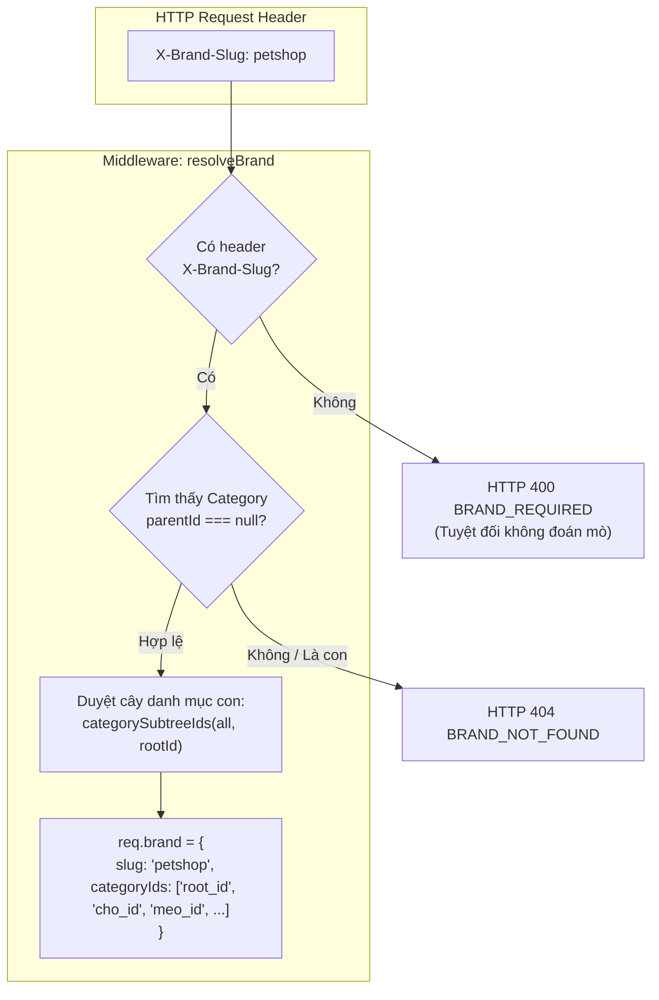
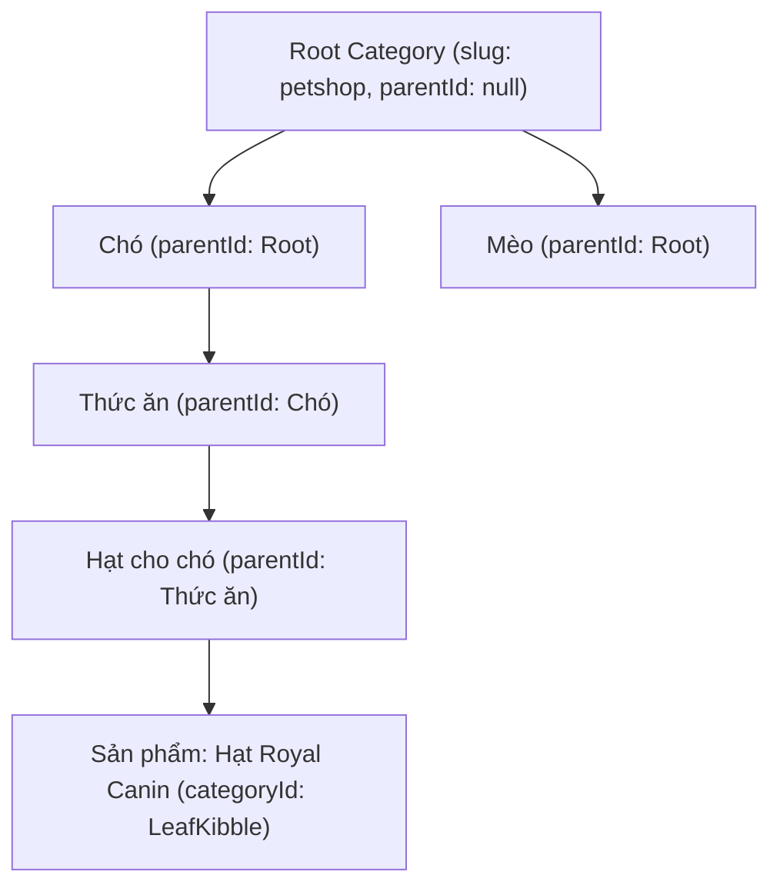
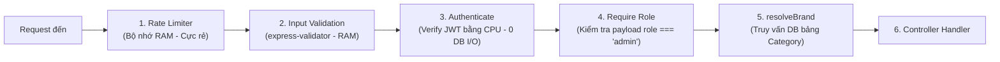

# Kiến Trúc Đa Thương Hiệu Cách Ly Triệt Để (Multi-Tenant by Brand - Trụ Cột 5)

> **Dự án:** Petshop E-Commerce (Express 5 + PostgreSQL 15+ / Prisma 7 + Next.js 14 App Router)  
> **Trụ Cột 5:** Phân lập logic đa thương hiệu (Multi-Tenancy by Brand Scope), Quản lý cây danh mục phân cấp (ADR-016 & ADR-018), Cách ly giỏ hàng / đơn hàng và Bảo vệ an ninh chống rò rỉ IDOR ("Stealth 404").

---

## Mục Lục
1. [Bản Chất Vấn Đề: Bài Toán Multi-Tenancy Trong E-Commerce](#1-bản-chất-vấn-đề-bài-toán-multi-tenancy-trong-e-commerce)
   - [So sánh 3 mô hình Multi-Tenant](#so-sánh-3-mô-hình-multi-tenant)
   - [Thách thức cách ly dữ liệu chéo (Cross-Tenant Data Leakage)](#thách-thức-cách-ly-dữ-liệu-chéo-cross-tenant-data-leakage)
2. [Cơ Chế Phân Giải Thương Hiệu: Root Category & `X-Brand-Slug`](#2-cơ-chế-phân-giải-thương-hiệu-root-category--x-brand-slug)
   - [Định danh qua Root Category](#định-danh-qua-root-category)
   - [Mã nguồn Middleware `resolveBrand`](#mã-nguồn-middleware-resolvebrand)
   - [Nguyên tắc thiết kế: Chống đoán mò (Fail-Fast)](#nguyên-tắc-thiết-kế-chống-đoán-mò-fail-fast)
3. [Phân Lập Danh Mục & Sản Phẩm (Catalog Isolation - ADR-016 & ADR-018)](#3-phân-lập-danh-mục--sản-phẩm-catalog-isolation---adr-016--adr-018)
   - [Cây danh mục 3 tầng phân cấp](#cây-danh-mục-3-tầng-phân-cấp)
   - [Bộ lọc cây con (`categorySubtreeIds`)](#bộ-lọc-cây-con-categorysubtreeids)
   - [Bảo vệ tầng Admin & Quy tắc an ninh "Stealth 404"](#bảo-vệ-tầng-admin--quy-tắc-an-ninh-stealth-404)
4. [Phân Lập Giỏ Hàng Tuyệt Đối (Cart Isolation)](#4-phân-lập-giỏ-hàng-tuyệt-đối-cart-isolation)
   - [Ràng buộc phức hợp `@@unique([userId, brandSlug])`](#ràng-buộc-phức-hợp-uniqueuserid-brandslug)
   - [Chặn thêm sản phẩm ngoại lai vào giỏ](#chặn-thêm-sản-phẩm-ngoại-lai-vào-giỏ)
   - [Chống tấn công IDOR trên từng dòng giỏ hàng](#chống-tấn-công-idor-trên-từng-dòng-giỏ-hàng)
5. [Phân Lập Đơn Hàng & Tìm Kiếm Đơn Hàng (Order Isolation)](#5-phân-lập-đơn-hàng--tìm-kiếm-đơn-hàng-order-isolation)
   - [Chốt chặn xem lịch sử đơn hàng khách hàng](#chốt-chặn-xem-lịch-sử-đơn-hàng-khách-hàng)
   - [Tìm kiếm và quản lý đơn hàng Admin độc lập](#tìm-kiếm-và-quản-lý-đơn-hàng-admin-độc-lập)
6. [Thứ Tự Pipeline Middleware Tối Ưu Chi Phí DB](#6-thứ-tự-pipeline-middleware-tối-ưu-chi-phí-db)
   - [Sắp xếp theo chi phí tài nguyên tăng dần](#sắp-xếp-theo-chi-phí-tài-nguyên-tăng-dần)
   - [Bảo vệ Database Connection Pool trước bão request rác](#bảo-vệ-database-connection-pool-trước-bão-request-rác)
7. [Kết Nối Frontend: Next.js BFF Injection](#7-kết-nối-frontend-nextjs-bff-injection)
8. [Minh Chứng Thực Nghiệm Từ Bộ Kiểm Thử Vitest](#8-minh-chứng-thực-nghiệm-từ-bộ-kiểm-thử-vitest)
9. [Bảng Tra Cứu Mã Nguồn Thành Phần Đa Thương Hiệu](#9-bảng-tra-cứu-mã-nguồn-thành-phần-đa-thương-hiệu)

---

## 1. Bản Chất Vấn Đề: Bài Toán Multi-Tenancy Trong E-Commerce

Doanh nghiệp thường vận hành đồng thời nhiều storefront bán lẻ khác nhau (ví dụ: `petshop` - Siêu thị thú cưng, và `gomsu` - Gốm sứ Bát Tràng).

### So sánh 3 mô hình Multi-Tenant:

| Mô hình | Ưu điểm | Nhược điểm | Đánh giá áp dụng |
| :--- | :--- | :--- | :--- |
| **Multi-Database**<br>*(Mỗi shop 1 DB riêng)* | Cách ly vật lý tuyệt đối. | Chi phí hạ tầng cao, cạn kiệt connection pool, chạy migration rất chậm và phức tạp. | Quá cồng kềnh cho các storefront vừa và nhỏ. |
| **Multi-Schema**<br>*(Chung DB, khác schema)* | Cách ly ở mức schema. | Phân quyền phức tạp, Prisma ORM hỗ trợ multi-schema chưa tối ưu. | Không phù hợp với ORM hiện tại. |
| **Shared DB with Discriminator Scope**<br>*(Lựa chọn của dự án)* | **Tiết kiệm tài nguyên tối đa**, dùng chung pool và computing, chạy migration tức thì trong 1 lần. | Phải đảm bảo **cách ly logic 100% không kẽ hở** ở mọi tầng code. | **Lựa chọn tối ưu nhất**, được bảo vệ bằng kiểm thử tự động. |

> **Thách thức an ninh cốt lõi:** Làm sao để khách hàng hoặc nhân viên quản trị của thương hiệu Petshop **không bao giờ nhìn thấy, sửa nhầm hoặc mua phải** sản phẩm của thương hiệu Gốm Sứ, đồng thời không bao giờ để lộ sự tồn tại của dữ liệu thương hiệu khác qua các lỗi truy vấn (Cross-Tenant Data Leakage / IDOR).

---

## 2. Cơ Chế Phân Giải Thương Hiệu: Root Category & `X-Brand-Slug`

Toàn bộ hệ thống định danh thương hiệu dựa trên một quy chuẩn thống nhất: **Mỗi thương hiệu chính là một Root Category (Danh mục gốc cấp cao nhất, có `parentId = null`) trong bảng `Category`**.



---

### Mã nguồn Middleware `resolveBrand`
Tại [`backend/middlewares/resolveBrand.ts`](file:///Users/tanghuynhtuantu/Programming/Project/Petshop-express-nextjs/backend/middlewares/resolveBrand.ts):

```typescript
export const resolveBrand = asyncHandler(async (req: Request, res: Response, next: NextFunction) => {
  const slug = req.get('X-Brand-Slug');
  if (!slug) {
    // 1. Chống đoán mò (Fail-Fast): Thiếu header lập tức ném lỗi 400
    throw new ApiError(400, 'BRAND_REQUIRED', 'Thiếu header X-Brand-Slug');
  }

  // 2. Đọc bảng Category và tìm Root Category trong RAM (1 DB round-trip)
  const all = await prisma.category.findMany({ select: { id: true, slug: true, parentId: true } });
  const category = all.find((c) => c.slug === slug);
  
  // 3. Bắt buộc phải là Root Category (parentId === null)
  if (!category || category.parentId !== null) {
    throw new ApiError(404, 'BRAND_NOT_FOUND', 'Không tìm thấy thương hiệu');
  }

  // 4. Gắn toàn bộ mảng ID của cây danh mục vào req.brand
  req.brand = {
    slug: category.slug,
    categoryIds: categorySubtreeIds(all, category.id),
  };

  next();
});
```

---

### Nguyên tắc thiết kế: Chống đoán mò (Fail-Fast)
1. **Tuyệt đối cấm giá trị mặc định (No Default Fallback):**  
   Hệ thống không bao giờ đặt kiểu `slug = req.get('X-Brand-Slug') || 'petshop'`. Việc đoán mò sẽ khiến một client mới viết quên gắn header bị gửi nhầm đơn hàng của thương hiệu này sang thương hiệu khác mà không hề hay biết. Thiếu header phải **báo lỗi to và ngay lập tức (`400 BRAND_REQUIRED`)**.
2. **Ràng buộc `parentId === null`:**  
   Một danh mục con (ví dụ: `slug: 'thuc-an-hat'`) dù có tồn tại cũng không bao giờ được phép đóng vai trò là một thương hiệu.
3. **Phân giải trước toàn bộ cây con (`categoryIds`):**  
   Hệ thống dùng thuật toán đệ quy trong bộ nhớ [`categorySubtreeIds`](file:///Users/tanghuynhtuantu/Programming/Project/Petshop-express-nextjs/backend/utils/categoryTree.ts) để thu thập toàn bộ ID của các danh mục con, cháu, chắt trực thuộc thương hiệu đó. Mọi phép kiểm tra quyền sở hữu sau này chỉ cần dùng toán tử `includes(categoryId)`.

---

## 3. Phân Lập Danh Mục & Sản Phẩm (Catalog Isolation - ADR-016 & ADR-018)

Theo quyết định kiến trúc [`ADR-016`](file:///Users/tanghuynhtuantu/Programming/Project/Petshop-express-nextjs/docs/DECISIONS.md#L202) và [`ADR-018`](file:///Users/tanghuynhtuantu/Programming/Project/Petshop-express-nextjs/docs/DECISIONS.md#L216):
- Cây danh mục gồm **3 tầng**: Root (Storefront) $\rightarrow$ Cấp 1 (Chó / Mèo) $\rightarrow$ Cấp 2 (Nhóm: Thức ăn / Phụ kiện) $\rightarrow$ Cấp 3 (Mục lá: Hạt cho chó / Pate mèo).
- Sản phẩm được lưu trữ tại các **danh mục lá (tầng 3)**.



---

### Bảo vệ tầng Admin & Quy tắc an ninh "Stealth 404"
Tại [`backend/services/productAdmin.service.ts`](file:///Users/tanghuynhtuantu/Programming/Project/Petshop-express-nextjs/backend/services/productAdmin.service.ts#L6-L35):

```typescript
export async function productInShop(s: Scope, id: string) {
  const product = await prisma.product.findUnique({ where: { id } });
  // Kiểm tra xem categoryId của sản phẩm có nằm trong cây của Brand hiện tại hay không
  if (!product || !s.shopIds.includes(product.categoryId)) {
    throw new ApiError(404, 'PRODUCT_NOT_FOUND', 'Không tìm thấy sản phẩm');
  }
  return product;
}

export async function variantInShop(s: Scope, variantId: string) {
  const owner = await prisma.productVariant.findUnique({
    where: { id: variantId },
    select: { product: { select: { categoryId: true } } },
  });
  if (!owner || !s.shopIds.includes(owner.product.categoryId)) {
    throw new ApiError(404, 'VARIANT_NOT_FOUND', 'Không tìm thấy biến thể');
  }
  return prisma.productVariant.findUniqueOrThrow({ where: { id: variantId } });
}
```

#### 🛡️ Quy tắc an ninh "Stealth 404" (Ẩn mình bằng mã 404):
Khi một Admin của shop Gốm Sứ cố tình gửi một request chỉnh sửa hoặc xóa sản phẩm có ID thuộc về shop Petshop:
- Hệ thống **trả về `HTTP 404 NOT FOUND`** thay vì `403 FORBIDDEN`.
- *Ý nghĩa an ninh:* Nếu trả về `403 Forbidden`, kẻ tấn công sẽ biết được ID đó thực sự tồn tại ở một shop khác (Information Disclosure). Việc trả về `404 Not Found` khiến kẻ xấu nghĩ rằng ID đó hoàn toàn vô giá trị trong hệ thống, triệt tiêu nguy cơ rà quét ID (ID Enumeration Attack).

---

## 4. Phân Lập Giỏ Hàng Tuyệt Đối (Cart Isolation)

Bảng `Cart` được thiết kế với ràng buộc định danh phức hợp độc nhất tại [`backend/prisma/schema.prisma`](file:///Users/tanghuynhtuantu/Programming/Project/Petshop-express-nextjs/backend/prisma/schema.prisma):

```prisma
model Cart {
  id        String     @id @default(uuid())
  userId    String
  brandSlug String
  items     CartItem[]
  createdAt DateTime   @default(now())
  updatedAt DateTime   @updatedAt

  user      User       @relation(fields: [userId], references: [id], onDelete: Cascade)

  @@unique([userId, brandSlug])
  @@index([brandSlug])
}
```

### Cách thức hoạt động:
1. **Mỗi người dùng có một giỏ hàng riêng cho từng thương hiệu:**
   - Cùng một khách hàng Nguyễn Văn A (`userId = "usr_123"`):
     - Mua sắm tại Petshop $\rightarrow$ Giỏ hàng mang khóa `(usr_123, 'petshop')`.
     - Mua sắm tại Gốm Sứ $\rightarrow$ Giỏ hàng mang khóa `(usr_123, 'gomsu')`.
   - Khách hàng không bao giờ bị tình trạng đang mua thức ăn cho chó lại thấy xuất hiện một chiếc bình gốm trong giỏ hàng.
2. **Chặn thêm sản phẩm ngoại lai vào giỏ:**
   Khi gọi API `POST /api/v1/cart/items`:
   - Controller kiểm tra biến thể đó có thuộc `req.brand.categoryIds` không.
   - Nếu ai đó cố tình gửi `variantId` của shop khác $\rightarrow$ Trả về `HTTP 404 NOT FOUND`.
3. **Chống tấn công IDOR:**
   Khi sửa hoặc xóa sản phẩm trong giỏ (`PATCH /cart/items/:id`), query luôn gộp điều kiện kiểm tra chủ sở hữu:
   `WHERE id = lineId AND cart.userId = req.user.id`. Khách hàng khác hoàn toàn không thể can thiệp vào giỏ hàng của nhau.

---

## 5. Phân Lập Đơn Hàng & Tìm Kiếm Đơn Hàng (Order Isolation)

Bảng `Order` ghi nhận thương hiệu ngay tại thời điểm tạo đơn:

```prisma
model Order {
  id          String      @id @default(uuid())
  code        String      @unique
  userId      String
  brandSlug   String
  orderStatus OrderStatus @default(PENDING_PAYMENT)
  ...

  @@unique([userId, idempotencyKey])
  @@index([brandSlug, orderStatus])
  @@index([brandSlug, createdAt])
}
```

### Các chốt chặn phân lập luồng đơn hàng:

1. **Khách hàng xem lịch sử mua sắm ([`listMyOrders`](file:///Users/tanghuynhtuantu/Programming/Project/Petshop-express-nextjs/backend/controllers/order.controller.ts#L213-L225)):**
   ```typescript
   const where: Prisma.OrderWhereInput = { 
     userId: req.user.id, 
     brandSlug: req.brand.slug 
   };
   ```
   Khách hàng đang lướt trang web Petshop sẽ chỉ nhìn thấy các đơn hàng đã đặt tại Petshop, lịch sử đơn hàng của các shop khác hoàn toàn vô hình.
2. **Admin quản lý và tìm kiếm đơn hàng ([`adminList`](file:///Users/tanghuynhtuantu/Programming/Project/Petshop-express-nextjs/backend/controllers/order.controller.ts#L244-L285)):**
   Màn hình danh sách đơn của nhân viên quản trị lọc nghiêm ngặt theo thương hiệu:
   ```typescript
   const where: Prisma.OrderWhereInput = { brandSlug: req.brand.slug };
   ```
   Khi tìm kiếm theo số điện thoại qua câu lệnh SQL trực tiếp:
   ```sql
   SELECT id FROM "Order"
   WHERE "brandSlug" = ${req.brand.slug}
     AND regexp_replace("shippingAddress"->>'phone', '[^0-9]', '', 'g') LIKE ${`%${digits}%`}
   ```
   Toán tử `WHERE "brandSlug" = ...` luôn là điều kiện tiên quyết, bảo đảm nhân viên trực tổng đài của shop này không bao giờ xem trộm được thông tin khách hàng hay đơn hàng của shop kia.

---

## 6. Thứ Tự Pipeline Middleware Tối Ưu Chi Phí DB

Một điểm sáng về mặt kiến trúc trong dự án là **thứ tự sắp xếp các middleware (Middleware Pipeline)**.

Trong các route admin tại [`backend/routes/product.route.ts`](file:///Users/tanghuynhtuantu/Programming/Project/Petshop-express-nextjs/backend/routes/product.route.ts#L12-L17) và [`quoteRequest.route.ts`](file:///Users/tanghuynhtuantu/Programming/Project/Petshop-express-nextjs/backend/routes/quoteRequest.route.ts#L12-L14):

```typescript
// The admin gate runs BEFORE resolveBrand: checking a token costs no database round-trip, while
// resolveBrand queries Category. In the reverse order every anonymous probe of /admin/* hit the
// database; with this order they stop at the 401.
router.get('/admin/list', rateLimiter, authenticate, requireRole('admin'), resolveBrand, ctrl.adminList);
```



#### Vì sao thứ tự này cứu nguy cho Database?
- Hàm `resolveBrand` cần thực hiện 1 truy vấn đọc bảng `Category` trong database.
- Trong khi đó, `authenticate` chỉ giải mã chữ ký JWT trong RAM (CPU bound, 0 I/O DB).
- Nếu đặt `resolveBrand` trước `authenticate`, một botnet gửi hàng triệu request rác (không có token hoặc token giả) vào các endpoint admin sẽ khiến **PostgreSQL bị nghẽn connection pool và sụp đổ**.
- Bằng cách đặt `authenticate` và `requireRole` chạy trước, 100% request rác bị chặn đứng ngay lập tức ở tầng CPU với mã `401/403`, database hoàn toàn không bị lay chuyển.

---

## 7. Kết Nối Frontend: Next.js BFF Injection

Tại tầng Frontend, khách hàng hoàn toàn không cần tự truyền `X-Brand-Slug`. Tầng Next.js BFF tự động tiêm header này vào mọi request gửi về backend:

Tại [`frontend-petshop/lib/site.ts`](file:///Users/tanghuynhtuantu/Programming/Project/Petshop-express-nextjs/frontend-petshop/lib/site.ts#L13):
```typescript
export const BRAND_SLUG = process.env.NEXT_PUBLIC_BRAND_SLUG || 'petshop';
```

Tại [`frontend-petshop/lib/bff/session.ts#L50`](file:///Users/tanghuynhtuantu/Programming/Project/Petshop-express-nextjs/frontend-petshop/lib/bff/session.ts#L50):
```typescript
async function callBackend(call: BackendCall, ctx: RequestContext): Promise<BffResult> {
  const headers = new Headers({ 
    Accept: 'application/json', 
    'X-Brand-Slug': BRAND_SLUG // Tự động đóng dấu thương hiệu
  });
  ...
}
```
Nhờ đó, khi triển khai một thương hiệu mới (ví dụ: `gomsu`), đội ngũ DevOps chỉ cần tạo một deployment Next.js mới với biến môi trường `NEXT_PUBLIC_BRAND_SLUG="gomsu"` trỏ về cùng một cụm Express backend mà không cần sửa đổi bất kỳ dòng code nào.

---

## 8. Minh Chứng Thực Nghiệm Từ Bộ Test Tự Động

Tính toàn vẹn của mô hình phân lập thương hiệu được kiểm thử chặt chẽ:

1. **Kiểm thử Cách ly Giỏ hàng ([`cart.test.ts#L178-L205`](file:///Users/tanghuynhtuantu/Programming/Project/Petshop-express-nextjs/backend/test/db/cart.test.ts#L178)):**
   - Thử thêm sản phẩm của thương hiệu Gốm Sứ vào giỏ hàng Petshop $\rightarrow$ Nhận `404 NOT FOUND`.
   - Một người dùng có giỏ hàng đầy tại Petshop, khi truy vấn giỏ hàng với `X-Brand-Slug: gomsu` $\rightarrow$ Nhận giỏ hàng rỗng (`items: []`).
2. **Kiểm thử Cây danh mục nhiều tầng ([`cart.test.ts#L70-L89`](file:///Users/tanghuynhtuantu/Programming/Project/Petshop-express-nextjs/backend/test/db/cart.test.ts#L70)):**
   - Sản phẩm nằm sâu ở tầng thứ 3 dưới cây Petshop vẫn được phép mua.
   - Sản phẩm nằm sâu ở tầng thứ 3 dưới cây Gốm Sứ hoàn toàn bị ẩn (`404 NOT FOUND`).
3. **Kiểm thử Truy vấn Tối ưu ([`category.scope.query.test.ts`](file:///Users/tanghuynhtuantu/Programming/Project/Petshop-express-nextjs/backend/test/db/category.scope.query.test.ts)):**
   - Đo đếm số lượng truy vấn SQL qua `pg_stat_statements`: Quá trình resolve thương hiệu chỉ thực hiện **chính xác 1 query duy nhất** vào bảng `Category` cho toàn bộ vòng đời request.

---

## 9. Bảng Tra Cứu Mã Nguồn Thành Phần Đa Thương Hiệu

| Thành phần | Đường dẫn file | Nhiệm vụ kỹ thuật chính |
|:---|:---|:---|
| **Brand Middleware** | [`backend/middlewares/resolveBrand.ts`](file:///Users/tanghuynhtuantu/Programming/Project/Petshop-express-nextjs/backend/middlewares/resolveBrand.ts) | Phân giải `X-Brand-Slug`, xác thực Root Category, gán `req.brand`. |
| **Category Tree Util** | [`backend/utils/categoryTree.ts`](file:///Users/tanghuynhtuantu/Programming/Project/Petshop-express-nextjs/backend/utils/categoryTree.ts) | Thuật toán duyệt cây con `categorySubtreeIds` trong bộ nhớ RAM. |
| **Admin Scope Guard** | [`backend/services/productAdmin.service.ts`](file:///Users/tanghuynhtuantu/Programming/Project/Petshop-express-nextjs/backend/services/productAdmin.service.ts) | Chốt chặn an ninh `productInShop`, `variantInShop` với quy tắc "Stealth 404". |
| **Order Controller** | [`backend/controllers/order.controller.ts`](file:///Users/tanghuynhtuantu/Programming/Project/Petshop-express-nextjs/backend/controllers/order.controller.ts) | Phân lập lịch sử đơn hàng khách và tìm kiếm đơn hàng Admin theo brand. |
| **Cart Controller** | [`backend/controllers/cart.controller.ts`](file:///Users/tanghuynhtuantu/Programming/Project/Petshop-express-nextjs/backend/controllers/cart.controller.ts) | Quản lý giỏ hàng tách biệt theo `(userId, brandSlug)` và chặn IDOR. |
| **Frontend Site Identity** | [`frontend-petshop/lib/site.ts`](file:///Users/tanghuynhtuantu/Programming/Project/Petshop-express-nextjs/frontend-petshop/lib/site.ts) | Cấu hình `BRAND_SLUG` từ biến môi trường `NEXT_PUBLIC_BRAND_SLUG`. |
| **BFF Proxy Session** | [`frontend-petshop/lib/bff/session.ts`](file:///Users/tanghuynhtuantu/Programming/Project/Petshop-express-nextjs/frontend-petshop/lib/bff/session.ts) | Tự động tiêm `X-Brand-Slug` vào header chuyển tiếp tới Express backend. |
| **Prisma Schema** | [`backend/prisma/schema.prisma`](file:///Users/tanghuynhtuantu/Programming/Project/Petshop-express-nextjs/backend/prisma/schema.prisma) | Ràng buộc `@@unique([userId, brandSlug])` trên `Cart` và index trên `Order`. |
| **Scope Query Test** | [`backend/test/db/category.scope.query.test.ts`](file:///Users/tanghuynhtuantu/Programming/Project/Petshop-express-nextjs/backend/test/db/category.scope.query.test.ts) | Kiểm chứng hiệu năng 1 SQL query và từ chối brand giả / danh mục con. |
| **Cart Scope Test** | [`backend/test/db/cart.test.ts`](file:///Users/tanghuynhtuantu/Programming/Project/Petshop-express-nextjs/backend/test/db/cart.test.ts) | Kiểm chứng cách ly giỏ hàng giữa các brand và chặn sản phẩm ngoại lai. |
