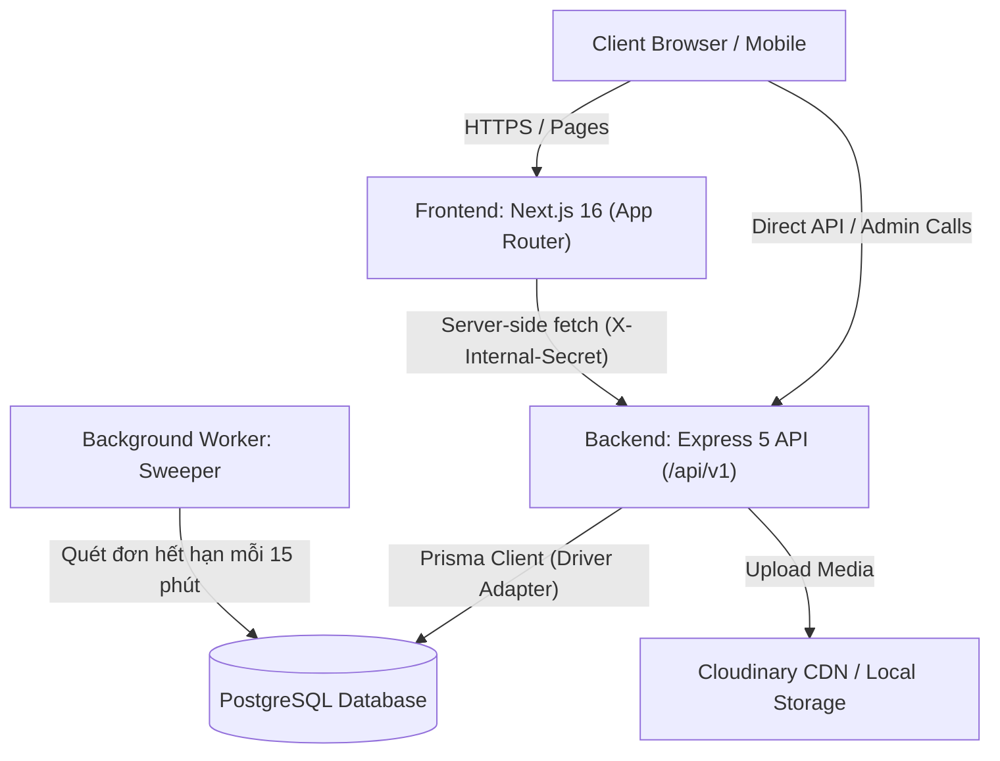

# TÀI LIỆU KIẾN TRÚC & CẤU TRÚC THƯ MỤC DỰ ÁN PETSHOP
> **Dự án:** Siêu thị của chó mèo (Petshop - Express + Next.js)  
> **Ngôn ngữ:** TypeScript Strict  
> **Mục tiêu tài liệu:** Giải thích chi tiết cấu trúc thư mục, nhiệm vụ của từng file và lý do tại sao phải có trong kiến trúc hệ thống.

---

## 1. TỔNG QUAN HỆ THỐNG & KIẾN TRÚC PHẦN MỀM

Dự án được xây dựng theo mô hình **Decoupled Architecture (Tách biệt Frontend và Backend)**:
- **Backend (`backend/`):** Xây dựng trên nền tảng **Node.js + Express 5 + TypeScript**, sử dụng **PostgreSQL** thông qua **Prisma ORM**. Đảm nhiệm toàn bộ nghiệp vụ cốt lõi: bảo mật, xác thực JWT (Rotation + Reuse detection), quản lý catalog sản phẩm, giỏ hàng, đặt hàng (COD / Chuyển khoản với cơ chế giữ hàng), quản lý kho theo mô hình sổ cái (Inventory Ledger), bài viết blog, gallery và CMS quản trị.
- **Frontend (`frontend-petshop/`):** Xây dựng trên **Next.js 16 (App Router) + React 19 + Tailwind CSS 4**, kết hợp tối ưu giữa **Server Components (SSR / SSG)** để đạt điểm SEO tối đa và **Client Components** cho các tương tác người dùng.



---

## 2. CHI TIẾT CẤU TRÚC THƯ MỤC BACKEND (`backend/`)

Toàn bộ mã nguồn backend tuân theo nguyên tắc phân tầng rõ ràng (Layered Architecture): **Route (Validate) ➔ Middleware ➔ Controller ➔ Service ➔ Prisma ORM ➔ Database**.

```
backend/
├── bin/                       # Điểm khởi chạy server
│   └── www.ts
├── config/                    # Quản lý cấu hình & biến môi trường
│   └── env.ts
├── app.ts                     # Cấu hình Express app và pipeline middleware
├── routes/                    # Định tuyến API & validation đầu vào
├── controllers/               # Điều phối request/response và logic giao tiếp
├── services/                  # Nghiệp vụ lõi (Prisma, JWT, Token, Sổ kho)
├── middlewares/               # Tiền/hậu xử lý request (Auth, Rate limit, Error...)
├── constants/                 # Hằng số hệ thống, state machine đơn hàng & kho
├── utils/                     # Tiện ích bổ trợ (Envelope response, ApiError...)
├── workers/                   # Background tasks chạy nền
├── types/                     # Khai báo TypeScript mở rộng
├── prisma/                    # Schema dữ liệu & lịch sử migration
│   ├── schema.prisma
│   └── migrations/
├── scripts/                   # Script tiện ích dòng lệnh (Seed DB)
├── test/                      # Hệ thống kiểm thử tự động (Unit & Integration)
├── public/uploads/            # Lưu trữ file tĩnh tải lên (local)
├── docker-compose.yml         # Container chạy PostgreSQL cục bộ
├── prisma.config.ts           # Cấu hình kết nối cho Prisma CLI
├── vitest.config.ts           # Cấu hình test DB-free
├── vitest.db.config.ts        # Cấu hình test tương tác DB thật
├── package.json               # Quản lý thư viện phụ thuộc
└── tsconfig.json              # Cấu hình biên dịch TypeScript
```

---

### 2.1. Thư mục `bin/` — Entrypoint khởi chạy ứng dụng
- **`bin/www.ts`**:
  - **Nhiệm vụ:** Là file thực thi chính khi chạy lệnh `npm start` hoặc `npm run dev`. File này import đối tượng `app` từ `app.ts`, đọc biến cổng `port` từ `config/env.ts`, gọi `app.listen()` để mở cổng lắng nghe HTTP request, đồng thời kích hoạt background worker `startExpiredOrderSweeper()`.
  - **Tại sao phải có?** Tách biệt việc "khởi chạy tiến trình lắng nghe cổng mạng" (`bin/www.ts`) ra khỏi việc "định nghĩa và cấu hình ứng dụng" (`app.ts`). Điều này cho phép các file test (`supertest`) có thể import trực tiếp `app` để kiểm thử API mà không làm mở cổng mạng thật, tránh xung đột cổng khi test.

---

### 2.2. Thư mục `config/` — Cổng đọc biến môi trường tập trung
- **`config/env.ts`**:
  - **Nhiệm vụ:** Đọc toàn bộ biến môi trường từ `process.env` (sử dụng thư viện `dotenv`), gán giá trị mặc định an toàn nếu cần (như `port: 4000`), và xuất (export) ra các hằng số typed rõ ràng: `port`, `databaseUrl`, `jwtAccessSecret`, `jwtRefreshSecret`, `internalApiSecret`, `cloudinary`.
  - **Tại sao phải có?** Đây là cổng duy nhất (Single Gateway) kết nối giữa biến môi trường và toàn bộ mã nguồn backend. 
    1. Giúp tránh việc rải rác `process.env.ABC` khắp dự án làm khó kiểm soát.
    2. Phát hiện lỗi sớm: nếu thiếu các secret quan trọng (như `DATABASE_URL` hay `JWT_ACCESS_SECRET`), hệ thống sẽ báo lỗi ngay khi khởi động thay vì chạy trong tình trạng bảo mật lỏng lẻo.

---

### 2.3. File `app.ts` — Lắp ráp ứng dụng Express
- **`app.ts`**:
  - **Nhiệm vụ:** Khởi tạo instance Express (`const app = express()`), thiết lập thứ tự thực thi chuẩn mực của các middleware toàn cục:
    1. `app.set('trust proxy', 1)`: Tin cậy reverse proxy (như Vercel/Render) để đọc chính xác IP thực của client từ header `X-Forwarded-For`.
    2. `compression()`: Gzip nén dữ liệu phản hồi giúp tối ưu băng thông.
    3. `helmet()`: Bổ sung các header bảo mật chuẩn (HSTS, chống clickjacking, XSS), cấu hình `crossOriginResourcePolicy: { policy: 'cross-origin' }` để frontend tải được ảnh từ backend.
    4. `cors(corsOptions)`: Kiểm soát whitelist tên miền được phép gọi API (`FRONTEND_URLS`), chặn triệt để tấn công CSRF.
    5. `rateLimit(apiLimiter)`: Giới hạn tần suất gọi API (100 req/15 phút), phân luồng theo User ID hoặc IP, và đặc biệt miễn trừ cho server Next.js thông qua `isTrustedServerRequest`.
    6. `X-Robots-Tag: noindex, nofollow`: Ngăn bot tìm kiếm index các API endpoint JSON thô.
    7. `express.json({ limit: '10mb' })`, `express.urlencoded`, `cookieParser()`: Parse body request (nâng mức 10MB cho phép lưu nội dung bài viết rich text có ảnh).
    8. `app.get('/health')`: Liveness probe phục vụ giám sát hạ tầng cloud (Docker, Kubernetes, Render).
    9. `express.static`: Phục vụ thư mục ảnh `uploads/`.
    10. `app.use('/api/v1', routes)`: Gắn toàn bộ router nghiệp vụ.
    11. `notFound` và `errorHandler`: Bắt lỗi 404 và chuẩn hoá định dạng lỗi trả về.
  - **Tại sao phải có?** Thứ tự middleware trong Express quyết định sống còn đến luồng xử lý và bảo mật. Đặt sai vị trí (ví dụ `notFound` nằm trước `routes` hoặc `errorHandler` nằm trước router) sẽ làm hệ thống hỏng toàn bộ.

---

### 2.4. Thư mục `routes/` — Định tuyến API & Xác thực đầu vào (Validation)
Mỗi module nghiệp vụ đều có một file route riêng, prefix đường dẫn theo chuẩn RESTful `/api/v1/...`:
- **`routes/index.ts`**: Router tổng, gộp tất cả các sub-router (`auth`, `categories`, `products`, `cart`, `orders`, `settings`, `quote-requests`, `blog`, `uploads`, `gallery`, `contact`).
- **`routes/auth.route.ts`**: Đăng ký, đăng nhập, refresh token, logout, yêu cầu cấp lại mật khẩu, đặt lại mật khẩu mới. Sử dụng `express-validator` để kiểm tra độ dài mật khẩu, định dạng email.
- **`routes/product.route.ts`**: Lấy danh sách sản phẩm (có lọc, phân trang, tìm kiếm), chi tiết sản phẩm theo slug, và các route quản trị viên: tạo, sửa, xoá sản phẩm, biến thể, ảnh và **điều chỉnh tồn kho / kiểm kê kho**.
- **`routes/category.route.ts`**: Danh mục phân cấp cha - con và quản lý thuộc tính động (`CategoryAttribute`).
- **`routes/cart.route.ts`**: Thao tác giỏ hàng của người dùng (yêu cầu đăng nhập và header `X-Brand-Slug`).
- **`routes/order.route.ts`**: Tạo đơn hàng (Checkout COD / Chuyển khoản với `Idempotency-Key`), tra cứu đơn hàng, huỷ đơn và chuyển trạng thái đơn (Admin).
- **`routes/quoteRequest.route.ts`**: Nhận yêu cầu tư vấn báo giá từ khách vãng lai (không bắt buộc đăng nhập, có rate-limit riêng chống spam).
- **`routes/blog.route.ts`**: Quản lý bài viết kiến thức thú cưng (SEO blog), danh mục bài viết, draft và publish.
- **`routes/gallery.route.ts`**: Quản lý thư viện hình ảnh thực tế của thú cưng / cửa hàng.
- **`routes/contact.route.ts`**: Tiếp nhận tin nhắn liên hệ từ khách hàng (chống spam bằng rate-limit).
- **`routes/setting.route.ts`**: Cấu hình các banner, hero image động cho trang chủ (CMS).
- **`routes/upload.route.ts`**: Endpoint upload file hình ảnh lên Cloudinary hoặc lưu trữ cục bộ.
- **Tại sao phải có tầng Routes riêng?** Tách biệt việc "đón nhận request + kiểm tra tính hợp lệ của dữ liệu (Validation)" ra khỏi "logic xử lý nghiệp vụ (Controller)". Nếu dữ liệu sai định dạng (ví dụ thiếu email, sai định dạng UUID), request sẽ bị chặn ngay tại route với mã `422 VALIDATION_ERROR` mà không tốn tài nguyên chạy vào tầng controller hay query database.

---

### 2.5. Thư mục `controllers/` — Tầng điều phối nghiệp vụ
Chứa các controller tương ứng với từng resource:
- **`controllers/auth.controller.ts`**: Mã hoá mật khẩu bằng `bcrypt`, cấp phát access token và refresh token, quản lý phiên đăng nhập, thu hồi token khi người dùng logout.
- **`controllers/product.controller.ts`**: Thực hiện truy vấn danh mục sản phẩm kết hợp sort, filter, phân trang; tạo mã SKU duy nhất, kết hợp với `inventory.service.ts` để ghi sổ kho ban đầu (`OPENING`) khi tạo biến thể mới.
- **`controllers/category.controller.ts`**: Quản lý cây danh mục (hỗ trợ mô hình đa thương hiệu root category).
- **`controllers/cart.controller.ts`**: Tính toán giỏ hàng, cập nhật số lượng từng biến thể theo người dùng và brand.
- **`controllers/order.controller.ts`**: Trọng tâm thương mại điện tử:
  - Tự động sinh mã đơn hàng thân thiện `NP-YYMMDD-XXXXXX`.
  - Tính toán lại toàn bộ đơn giá từ DB (không tin giá client gửi lên).
  - Áp dụng state machine kiểm tra chuyển trạng thái hợp lệ (`assertTransition`).
  - Hỗ trợ `Idempotency-Key` chống việc người dùng bấm đặt hàng 2 lần liên tiếp bị trừ kho hoặc tạo 2 đơn trùng nhau.
- **`controllers/quoteRequest.controller.ts`**: Lưu thông tin khách yêu cầu tư vấn gọi điện chốt đơn; quản lý trạng thái `NEW`, `CLOSED` và lưu số tiền chốt thực tế (`finalAmount`).
- **`controllers/blog.controller.ts` & `gallery.controller.ts`**: CRUD bài viết và ảnh thư viện phục vụ nội dung truyền thông và SEO.
- **`controllers/contact.controller.ts` & `setting.controller.ts`**: Quản lý phản hồi khách hàng và cấu hình CMS website.
- **`controllers/upload.controller.ts`**: Đẩy file lên Cloudinary thông qua stream hoặc ghi file vào thư mục `public/uploads`.
- **Tại sao phải có?** Đóng vai trò là cầu nối: nhận dữ liệu đã xác thực từ router, gọi các service tương ứng, bọc toàn bộ bằng `asyncHandler` để bắt ngoại lệ bất đồng bộ, và định dạng kết quả trả về qua `sendSuccess`.

---

### 2.6. Thư mục `services/` — Nghiệp vụ lõi phức tạp & Trừu tượng hoá
- **`services/prisma.ts`**:
  - Khởi tạo duy nhất một Prisma Client có tích hợp Driver Adapter `@prisma/adapter-pg`.
  - **Tại sao?** Tái sử dụng một connection pool duy nhất trong toàn ứng dụng, tránh rò rỉ kết nối (connection leak) vào PostgreSQL.
- **`services/jwt.service.ts`**:
  - Ký và xác thực Access Token (TTL ngắn: 15 phút) và Refresh Token JWT.
  - **Tại sao?** Access token sống ngắn để hạn chế rủi ro lộ token, nhúng `{ sub: userId, role }` trực tiếp vào payload để middleware phân quyền không cần truy vấn lại database mỗi request.
- **`services/token.service.ts`**:
  - Quản lý vòng đời Refresh Token trong Database: phát hành chuỗi ngẫu nhiên cryptographic 80 ký tự hex, lưu trữ dạng hash **SHA-256**, thực hiện **Rotation (Đổi token mới mỗi lần làm mới phiên)** và **Reuse Detection (Phát hiện dùng lại token cũ)**.
  - **Tại sao?** Nếu một refresh token cũ đã bị thu hồi mà lại được gửi lên, hệ thống phát hiện phiên này có thể đã bị đánh cắp và ngay lập tức thu hồi toàn bộ các session của tài khoản đó để bảo vệ người dùng.
- **`services/inventory.service.ts`**:
  - Dịch vụ quản lý kho chuyên biệt theo kiến trúc **Sổ cái tồn kho (Inventory Ledger - ADR-007)**.
  - Mọi thao tác đổi hàng tồn thực tế (`stockQuantity`) đều ghi một dòng lịch sử vào bảng `InventoryMovement` trong cùng transaction: `recordOpening`, `claimForSale` (trừ kho khi đặt COD), `recordSale`, `sellReserved` (khi đơn chuyển khoản hoàn tất), `restockCancelled` (khi đơn bị huỷ), `adjustStock` (admin tăng/giảm tồn do hư hỏng, nhập hàng), `recordStocktake` (kiểm kê kho).
  - **Tại sao?** Ngăn chặn hoàn toàn hiện tượng race condition (bán vượt số tồn khi nhiều người mua cùng lúc) bằng cách dùng SQL `UPDATE "ProductVariant" SET "stockQuantity" = "stockQuantity" - quantity WHERE id = ... AND "stockQuantity" - "reservedQuantity" >= quantity`, đồng thời đảm bảo nguyên tắc kiểm toán: tổng delta luôn bằng đúng tồn kho hiện tại.

---

### 2.7. Thư mục `middlewares/` — Các lớp lọc xử lý
- **`authenticate.ts`**: Kiểm tra header `Authorization: Bearer <token>`, giải mã JWT và gán `{ id, role }` vào `req.user`.
- **`optionalAuthenticate.ts`**: Tương tự `authenticate` nhưng không bắt buộc, nếu có token thì gán thông tin, nếu không có thì vẫn cho đi tiếp (dùng cho các route cho phép cả khách vãng lai lẫn người đăng nhập).
- **`requireRole.ts`**: Kiểm tra quyền truy cập (Role-Based Access Control - RBAC), chặn người dùng thông thường vào các API của `admin`.
- **`resolveBrand.ts`**: Đọc header `X-Brand-Slug`, xác thực danh mục gốc và phân giải cây danh mục con gán vào `req.brand` để phân tách dữ liệu đa thương hiệu (Gốm sứ / Petshop).
- **`rateLimitKeys.ts`**: Xác định bucket rate limit thông minh: nếu có JWT hợp lệ thì đếm theo `user:<id>`, nếu ẩn danh thì đếm theo IP. Đặc biệt có hàm `isTrustedServerRequest` kiểm tra `X-Internal-Secret` bằng mã hoá an toàn hằng thời gian (`timingSafeEqual`) để bỏ qua giới hạn cho server Next.js SSR.
- **`validate.ts`**: Đọc kết quả từ `express-validator`, nếu có lỗi thì gom lại và throw `ApiError(422, 'VALIDATION_ERROR')`.
- **`upload.ts`**: Cấu hình `multer` với memory storage (lưu buffer trong RAM) để sẵn sàng stream lên Cloudinary hoặc kiểm tra định dạng/kích thước ảnh.
- **`notFound.ts`**: Đón bắt mọi URL không khớp với bất kỳ router nào, ném ra lỗi 404 chuẩn.
- **`errorHandler.ts`**: Middleware bắt lỗi cuối cùng của Express. Chuyển đổi mọi lỗi (kể cả lỗi hệ thống không lường trước) về phong bì chuẩn `{ data: null, meta: null, error: { code, message, details } }`, ẩn hoàn toàn stack trace ở môi trường production.
- **Tại sao phải có?** Đảm bảo tính nhất quán (Consistency) và an toàn (Security) xuyên suốt mọi request. Các controller chỉ tập trung làm đúng nhiệm vụ nghiệp vụ mà không cần lặp lại logic xác thực, phân quyền hay bắt lỗi.

---

### 2.8. Thư mục `utils/` — Các tiện ích dùng chung
- **`ApiResponse.ts`**: Hàm `sendSuccess` định dạng chuẩn cấu trúc phản hồi API `{ data, meta, error: null }`.
- **`ApiError.ts`**: Class kế thừa `Error`, mang theo mã HTTP status, error code định danh (như `INVALID_CREDENTIALS`, `OUT_OF_STOCK`) và chi tiết mảng lỗi.
- **`asyncHandler.ts`**: Wrapper bọc ngoài các hàm async controller để tự động chuyển `catch(err)` sang `next(err)` cho Express, giúp code không phải viết `try/catch` lặp đi lặp lại.
- **`pagination.ts`**: Xử lý tham số phân trang `page`, `pageSize`, giới hạn trần an toàn (`maxLimit`), tính toán `skip` và `take` cho Prisma.
- **Tại sao phải có?** Tránh lặp code (DRY - Don't Repeat Yourself), đảm bảo chuẩn hoá format dữ liệu giao tiếp với Frontend.

---

### 2.9. Thư mục `constants/` — Hằng số & State Machine
- **`order.ts`**: Định nghĩa trạng thái đơn (`PENDING_PAYMENT`, `CONFIRMED`, `PROCESSING`, `COMPLETED`, `CANCELLED`), phương thức thanh toán (`COD`, `BANK_TRANSFER`, `VNPAY`), trạng thái thanh toán và **bản đồ chuyển dịch trạng thái hợp lệ (`ORDER_TRANSITIONS`)**. Khai báo thời hạn giữ hàng 24h (`PAYMENT_WINDOW_HOURS = 24`) và chu kỳ quét đơn (`SWEEP_INTERVAL_MINUTES = 15`).
- **`product.ts`**: Trạng thái sản phẩm (`active`, `draft`, `archived`), giới hạn số nguyên lớn nhất của DB.
- **`inventory.ts`**: Các lý do dịch chuyển kho (`OPENING`, `PURCHASE`, `DAMAGED`, `RETURN`, `OTHER`, `STOCKTAKE`, `SALE`, `CANCEL_RESTOCK`).
- **Tại sao phải có?** Tránh việc sử dụng chuỗi tự do (magic strings) gây lỗi chính tả âm thầm; đảm bảo toàn bộ hệ thống tuân thủ chặt chẽ cỗ máy trạng thái (state machine).

---

### 2.10. Thư mục `workers/` — Tác vụ chạy nền (Background Tasks)
- **`releaseExpiredOrders.ts`**:
  - **Nhiệm vụ:** Tìm các đơn hàng thanh toán chuyển khoản quá hạn 24 giờ mà khách chưa thanh toán (`orderStatus: PENDING_PAYMENT, expiresAt < now()`). Tự động huỷ đơn và hoàn trả số lượng giữ chỗ (`reservedQuantity`) về lại cho kho hàng vật lý.
  - Áp dụng kỹ thuật **Conditional UPDATE** (`UPDATE "Order" SET "orderStatus" = 'CANCELLED' WHERE id = ... AND "orderStatus" = 'PENDING_PAYMENT'`) để đảm bảo nếu hệ thống chạy nhiều tiến trình (multi-instance) thì cũng chỉ duy nhất 1 worker xử lý đơn đó, không bao giờ hoàn kho 2 lần làm sai lệch số tồn.
  - **Tại sao phải có?** Khi khách đặt đơn chuyển khoản, hàng sẽ bị giữ chỗ (`reservedQuantity`). Nếu khách đổi ý không thanh toán mà không có worker này giải phóng, hàng sẽ bị treo vĩnh viễn trên hệ thống và báo "hết hàng" với khách khác dù thực tế trong kho vẫn còn.

---

### 2.11. Thư mục `prisma/` — Mô hình dữ liệu & Migration
- **`schema.prisma`**:
  - File định nghĩa toàn bộ cấu trúc bảng (Models) và quan hệ: `User`, `Category`, `CategoryAttribute`, `Product`, `ProductVariant`, `ProductImage`, `RefreshToken`, `BlogPost`, `GalleryItem`, `ContactMessage`, `Cart`, `CartItem`, `Order`, `OrderItem`, `QuoteRequest`, `SiteSetting`, `PasswordResetToken`, `InventoryMovement`.
  - Khai báo các composite index chuyên biệt cho truy vấn tốc độ cao: ví dụ `@@index([status, createdAt, id])` cho trang catalog, `@@index([status, publishedAt, id])` cho trang blog.
- **`migrations/`**:
  - Lịch sử thay đổi cơ sở dữ liệu qua từng phiên bản, đảm bảo tính nhất quán giữa các môi trường phát triển (Dev) và sản xuất (Production). Có các migration quan trọng:
    + `20261012120000_baseline_schema_drift`: Đồng bộ toàn bộ các bảng vào hệ thống migration.
    + `20261012120100_add_stock_check_constraints`: Thêm CHECK constraint ở mức DB (`stockQuantity >= 0`, `reservedQuantity >= 0`, `reservedQuantity <= stockQuantity`) làm lưới an toàn vật lý chống lỗi race condition.
    + `20261012120200_add_list_indexes`: Bổ sung index tối ưu truy vấn danh sách.
    + `20261016120000_add_order_idempotency_key`: Bổ sung cột khóa chống lặp đơn hàng.
    + `20261018120000_add_inventory_movements`: Bảng sổ cái kiểm toán kho hàng.
- **`prisma.config.ts`**: File cấu hình cho Prisma CLI phiên bản 7 đọc biến `DATABASE_URL` và `DIRECT_URL`.
- **Tại sao phải có?** Cơ sở dữ liệu là trái tim của hệ thống thương mại điện tử. Quản lý schema bằng code và migration giúp kiểm soát chặt chẽ phiên bản, có thể tái lập môi trường mới chỉ bằng một lệnh và dễ dàng rollback khi có sự cố.

---

### 2.12. Thư mục `test/` — Hệ thống kiểm thử 2 tầng
- **Tầng DB-Free (chạy siêu nhanh với `vitest`):**
  - `http.basics.test.ts`, `api.public.test.ts`: Test các endpoint công khai.
  - `auth.validation.test.ts`: Test kiểm tra tính hợp lệ của dữ liệu đầu vào.
  - `authz.test.ts`: Test phân quyền truy cập và bảo vệ IDOR.
  - `jwt.property.test.ts`: Test thuộc tính sinh và giải mã JWT sử dụng `fast-check`.
  - `ratelimit.test.ts`, `ratelimit.keys.test.ts`: Kiểm tra cơ chế giới hạn tần suất gọi API.
- **Tầng DB Integration & Concurrency (`test/db/`):**
  - Chạy với cơ sở dữ liệu thật (Docker hoặc Testcontainers).
  - `order.checkout.test.ts`, `order.race.test.ts`: Giả lập hàng chục request mua hàng đồng thời để kiểm chứng không bị âm kho và không tạo thừa đơn.
  - `order.idempotency.test.ts`: Kiểm thử gửi lặp `Idempotency-Key`.
  - `inventory.test.ts`, `stock.isolation.test.ts`: Kiểm thử tính toàn vẹn của sổ kho ledger.
  - `cart.test.ts`, `commerce.query.test.ts`, `catalog.query.test.ts`, `content.admin.test.ts`.
- **Tại sao phải có?** Hệ thống e-commerce xử lý tiền bạc và tồn kho không thể kiểm thử bằng tay. Bộ test tự động bảo đảm hệ thống không bị hồi quy (regression) khi thêm tính năng mới.

---

### 2.13. Các file cấu hình khác ở Backend
- **`types/express.d.ts`**: Mở rộng kiểu TypeScript cho đối tượng `Express.Request` để nhận diện thuộc tính `req.user` và `req.brand`. Nếu không có file này, TypeScript sẽ báo lỗi khi truy cập các trường do middleware gắn vào.
- **`scripts/seedAdmin.ts`**: Script dòng lệnh tạo tài khoản quản trị viên đầu tiên (admin) với mật khẩu được băm an toàn, phục vụ khởi tạo môi trường ban đầu.
- **`docker-compose.yml`**: Định nghĩa container PostgreSQL 15 chạy cổng 5434, phục vụ môi trường lập trình độc lập dưới máy local.

---

## 3. CHI TIẾT CẤU TRÚC THƯ MỤC FRONTEND (`frontend-petshop/`)

Frontend được xây dựng bằng **Next.js 16 (App Router)** hướng đến chuẩn **Mobile-First** và tối ưu hoá toàn diện cho **Search Engines & AI Crawlers (SEO / AEO / GEO / AIO / SXO)**.

```
frontend-petshop/
├── app/                           # App Router: Các trang, layout, sitemap
│   ├── (marketing)/               # Route group trang tĩnh (About, Contact)
│   ├── admin/                     # Khu vực quản trị (Login, Posts, Gallery)
│   ├── blog/                      # Chuyên mục bài viết kiến thức thú cưng
│   ├── gallery/                   # Thư viện ảnh thực tế
│   ├── layout.tsx                 # Root layout bọc toàn website
│   ├── page.tsx                   # Trang chủ website
│   ├── globals.css                # CSS toàn cục (Tailwind v4)
│   └── sitemap.ts                 # Trình tạo XML Sitemap tự động
├── components/                    # Các UI Components tái sử dụng
│   ├── seo/                       # Component hỗ trợ SEO (JsonLd schema)
│   ├── ui/                        # Button, Input, Modal, Badge...
│   ├── layout/                    # Header, Footer, Navbar, Sidebar...
│   └── creative/                  # Các hiệu ứng hiển thị đặc biệt
├── lib/                           # Logic thư viện tiện ích phía client & server
│   ├── apiClient.ts               # Bộ gọi API chuẩn tích hợp cache Next.js
│   ├── adminAuth.ts               # Quản lý token & cơ chế chống xung đột refresh
│   ├── jsonLd.ts                  # Xử lý escape JSON-LD chống tấn công XSS
│   ├── markdown.ts                # Render Markdown bài viết an toàn với DOMPurify
│   └── types.ts                   # Định nghĩa TypeScript dùng chung cho toàn bộ UI
├── design/                        # Tài nguyên thiết kế, wireframes HTML & tokens
│   ├── wireframes/                # Bản mẫu giao diện tĩnh (HTML/CSS)
│   ├── tokens.css                 # Bảng biến màu sắc, typography, spacing
│   └── README.md
├── public/                        # Static assets (robots.txt, fonts, images)
├── test/                          # Unit test cho logic frontend
├── next.config.ts                 # Cấu hình Next.js
├── package.json                   # Thư viện phụ thuộc
└── tsconfig.json                  # Cấu hình TypeScript
```

---

### 3.1. Thư mục `app/` — Routing & Giao diện người dùng
Sử dụng kiến trúc App Router của Next.js, nơi cấu trúc thư mục phản ánh đường dẫn URL:
- **`app/layout.tsx`**:
  - **Nhiệm vụ:** Root Layout áp dụng cho toàn bộ ứng dụng. Thiết lập cấu trúc HTML chuẩn (`<html lang="vi">`, `<head>`, `<body>`), nạp phông chữ, liên kết file CSS toàn cục `globals.css` và chèn Organization Schema JSON-LD.
  - **Tại sao?** Đảm bảo tính đồng nhất về header, footer, phông chữ và siêu dữ liệu (metadata) trên mọi trang.
- **`app/page.tsx`**:
  - **Nhiệm vụ:** Trang chủ của website "Siêu thị của chó mèo". Chạy dưới dạng **Server Component**, fetch trực tiếp danh sách sản phẩm nổi bật, bài viết mới nhất và cấu hình banner từ backend thông qua `apiFetch`.
  - **Tại sao?** Giúp tải dữ liệu cực nhanh ngay từ server, HTML trả về đã có đầy đủ nội dung để Googlebot và AI Crawlers thu thập dữ liệu ngay lập tức mà không cần đợi render phía client.
- **`app/sitemap.ts`**:
  - **Nhiệm vụ:** Tự động tạo file `sitemap.xml` động. Tự động lấy danh sách slug của bài viết, danh mục, sản phẩm để cung cấp sơ đồ trang web chuẩn cho các công cụ tìm kiếm.
  - **Tại sao?** Tối ưu hoá SEO, giúp công cụ tìm kiếm lập chỉ mục các bài viết và sản phẩm mới nhanh nhất.
- **`app/globals.css`**:
  - **Nhiệm vụ:** Nhập Tailwind CSS phiên bản 4 (`@import "tailwindcss";`), thiết lập các biến CSS biến thiên cho màu sắc giao diện theo bảng thiết kế token.
- **`app/blog/` & `app/blog/[slug]/`**:
  - **Nhiệm vụ:** Trang danh sách bài viết blog chia sẻ kiến thức và trang chi tiết bài viết theo đường dẫn động `[slug]`. Tự động trích xuất metadata (OpenGraph, Twitter Cards, Article Schema) và render nội dung bài viết markdown an toàn.
- **`app/gallery/`**:
  - **Nhiệm vụ:** Trang trưng bày bộ sưu tập hình ảnh thực tế của thú cưng, sản phẩm và cửa hàng.
- **`app/(marketing)/`**:
  - **Nhiệm vụ:** Route group gom nhóm các trang thông tin tĩnh mà không làm biến đổi cấu trúc URL:
    + `about/page.tsx`: Giới thiệu về thương hiệu "Siêu thị của chó mèo".
    + `contact/page.tsx`: Form liên hệ trực tiếp cho khách hàng.
- **`app/admin/`**:
  - **Nhiệm vụ:** Phân hệ quản trị dành riêng cho chủ cửa hàng:
    + `admin/login/page.tsx`: Trang đăng nhập quản trị viên.
    + `admin/posts/`: Quản lý danh sách bài viết và tạo bài viết mới với trình soạn thảo.
    + `admin/gallery/`: Quản lý thư viện ảnh.
  - **Tại sao?** Tách biệt hoàn toàn luồng quản trị với giao diện của khách hàng, sử dụng các client component tương tác cao và kiểm tra quyền đăng nhập qua `adminAuth.ts`.

---

### 3.2. Thư mục `lib/` — Thư viện tiện ích lõi phía Frontend
- **`lib/apiClient.ts`**:
  - **Nhiệm vụ:** Hàm `apiFetch<T>` bọc quanh `fetch` gốc của trình duyệt/Node.js để giao tiếp với backend.
  - Tự động đính kèm header `X-Internal-Secret` nếu đang chạy ở môi trường **Server-side (Next.js SSR)**, giúp backend nhận diện đây là server tin cậy và bỏ qua rate limit.
  - **Tại sao không dùng Axios?** Vì Next.js App Router đã mở rộng (monkey-patch) hàm `fetch` gốc để tích hợp cơ chế caching thông minh (`revalidate`, `tags`). Dùng Axios sẽ làm mất toàn bộ tính năng cache hiệu năng cao của Next.js.
- **`lib/adminAuth.ts`**:
  - **Nhiệm vụ:** Quản lý lưu trữ Access Token và Refresh Token cho trang Admin, cung cấp hàm `authFetch` tự động gắn `Bearer token` vào request.
  - **Giải pháp gom request (`refreshPromise`):** Khi nhiều request API đồng thời gặp lỗi 401 (hết hạn access token), hàm này sẽ gom tất cả lại và chỉ gửi duy nhất **1 request** làm mới token.
  - **Tại sao phải có?** Nếu 2 request cùng gửi refresh token cũ lên cùng một lúc, request thứ nhất thành công làm token cũ bị thu hồi; request thứ hai sẽ bị backend coi là "kẻ tấn công đang dùng lại token đã revoke" (Reuse Detection) và lập tức khoá luôn toàn bộ phiên đăng nhập của admin. Biến `refreshPromise` triệt tiêu hoàn toàn lỗi oái oăm này.
- **`lib/markdown.ts`**:
  - **Nhiệm vụ:** Chuyển đổi cú pháp Markdown của bài viết thành HTML thông qua thư viện `marked`, đồng thời bọc qua `DOMPurify.sanitize` để lọc sạch các mã độc JavaScript (chống XSS). Cung cấp hàm `excerptFromContent` tự động tạo mô tả tóm tắt cho thẻ meta description.
  - **Tại sao?** Đảm bảo an toàn tuyệt đối khi hiển thị nội dung phong phú từ CMS mà không sợ bị chèn mã độc.
- **`lib/jsonLd.ts`**:
  - **Nhiệm vụ:** Hàm `serializeJsonLd` tuần tự hoá đối tượng schema thành chuỗi JSON và **mã hoá các ký tự `<, >, &, \u2028, \u2029` thành mã Unicode (`\uXXXX`)**.
  - **Tại sao?** Nếu bài viết có tiêu đề chứa chuỗi `</script><script>alert(1)</script>`, trình duyệt sẽ tưởng là thẻ đóng script và kích hoạt mã độc ngay lập tức. Việc escape sang Unicode vừa an toàn tuyệt đối trước XSS, vừa đảm bảo Googlebot đọc dữ liệu hoàn toàn chính xác.
- **`lib/types.ts`**:
  - **Nhiệm vụ:** Khai báo kiểu TypeScript dùng chung cho toàn bộ giao diện: `BlogPost`, `Product`, `Category`, `CartItem`, `Order`, `ApiEnvelope`, v.v. Giữ cho frontend có định nghĩa dữ liệu đồng nhất 100% với phản hồi từ backend.

---

### 3.3. Thư mục `components/` — Tái sử dụng giao diện
- **`components/seo/JsonLd.tsx`**:
  - Component chuyên dụng để render thẻ `<script type="application/ld+json">` an toàn bằng cách dùng `serializeJsonLd`. Giúp các trang nhúng schema Organization, WebSite, Article, Product một cách đơn giản, sạch sẽ.
- **`components/ui/`, `layout/`, `creative/`**:
  - Nơi chứa các khối giao diện được phân rã nhỏ: Button, Card, Header, Footer theo chuẩn tái sử dụng (Atomic Design).

---

### 3.4. Thư mục `design/` — Wireframes & Design System
- **`design/wireframes/`**:
  - Chứa toàn bộ các file HTML nguyên mẫu độc lập cho từng màn hình: `home.html`, `product.html`, `cart.html`, `checkout.html`, `admin-products.html`, `order-success.html`...
  - **Tại sao phải có?** Giúp hình dung trực quan toàn bộ trải nghiệm người dùng (UX) và kiểm tra layout mobile-first trên trình duyệt trước khi tốn công viết mã React/Next.js.
- **`design/tokens.css` & `palette.html`**:
  - Định nghĩa bảng màu chuẩn (màu chủ đạo, màu nền, màu chữ), khoảng cách và typography của thương hiệu "Siêu thị của chó mèo".

---

### 3.5. Thư mục `public/` & `test/` phía Frontend
- **`public/`**:
  - `robots.txt`: Khai báo quyền thu thập thông tin cho bot tìm kiếm và bot AI (cho phép quét toàn bộ trang public, chỉ chặn `/admin` và `/api`).
  - `fonts/`, `images/`: Phông chữ cục bộ và ảnh minh hoạ.
- **`test/`**:
  - Chứa các file unit test cho `apiClient.test.ts`, `adminAuth.test.ts`, `jsonLd.test.ts`, `markdown.test.ts` để kiểm chứng logic chạy đúng ở môi trường cô lập.

---

## 4. CÁC THƯ MỤC KHÁC TRONG DỰ ÁN

- **`docs/`**:
  - **`docs/DECISIONS.md` (Architecture Decision Records - ADR):** Lưu trữ toàn bộ các quyết định kiến trúc quan trọng kèm theo bối cảnh, lý do, các phương án đã loại bỏ và hệ quả (ADR-001 đến ADR-007). Giúp bất kỳ lập trình viên nào khi đọc vào cũng hiểu được căn nguyên vì sao hệ thống lại được thiết kế như vậy.
  - **`docs/PROGRESS.md`:** Nhật ký tiến độ công việc qua từng phiên làm việc.
- **`.claude/`**:
  - Chứa các quy tắc chuyên sâu: `.claude/rules/seo.md` (bộ tiêu chuẩn SEO/AEO/AIO) và `.claude/rules/mobile-ui.md` (bộ tiêu chuẩn giao diện mobile-first).
- **`CLAUDE.md` & `README.md`**:
  - Bản hướng dẫn quy chuẩn lập trình, phân loại task và quy trình kiểm thử bắt buộc của dự án.
- **`ecom-learning/` & `project-docs/`**:
  - Tài liệu bài học tham khảo và ghi chép trong quá trình nghiên cứu xây dựng hệ thống thương mại điện tử.

---

## 5. BẢNG TỔNG KẾT LUỒNG DỮ LIỆU CHÍNH (DATA FLOW)

| Nghiệp vụ | Luồng tương tác giữa Frontend và Backend | Điểm mấu chốt kiến trúc |
|---|---|---|
| **Xem sản phẩm / Blog (SEO)** | Client ➔ Next.js Server Component ➔ gọi backend qua `apiFetch` (kèm `X-Internal-Secret`) ➔ Backend lấy DB ➔ Trả HTML đầy đủ cho Client | Next.js Server không bị chặn Rate-limit; HTML có sẵn dữ liệu giúp bot AI/Googlebot lập chỉ mục ngay lập tức. |
| **Đặt hàng COD** | Client ➔ Gửi giỏ hàng + thông tin giao hàng lên `POST /orders` (kèm `X-Brand-Slug` & `Idempotency-Key`) ➔ Backend chạy Transaction | Trừ kho vật lý bằng delta, ghi nhận lịch sử vào sổ kho `InventoryMovement`, không bị trùng đơn khi click đúp. |
| **Đặt hàng Chuyển khoản** | Client ➔ Đặt hàng ➔ Backend tăng `reservedQuantity` (giữ hàng 24h) ➔ Khách thanh toán thì chuyển thành đơn bán, nếu quá hạn thì Worker tự huỷ | Đảm bảo khách có thời gian chuyển khoản mà không bị người khác mua mất; worker chạy nền tự động nhả kho nếu quá hạn. |
| **Tư vấn Báo giá** | Khách vãng lai gửi họ tên + SĐT tại form báo giá ➔ `POST /quote-requests` ➔ Nhân viên gọi điện chốt đơn | Không bắt buộc đăng nhập để tối đa tỷ lệ chuyển đổi; lưu đơn giá chốt thực tế (`finalAmount`) riêng biệt. |
| **Admin đăng nhập & CMS** | Admin login ➔ Nhận Access Token (15p) & Refresh Token (7 ngày) lưu ở `localStorage` ➔ Tự động làm mới khi hết hạn | Cơ chế `refreshPromise` gom request chống kích hoạt nhầm tính năng Reuse Detection. |

---
*Tài liệu được tổng hợp tự động dựa trên mã nguồn thực tế của dự án.*
