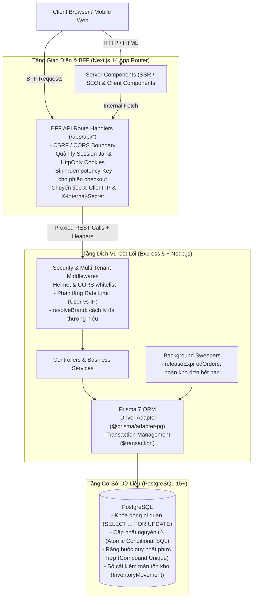
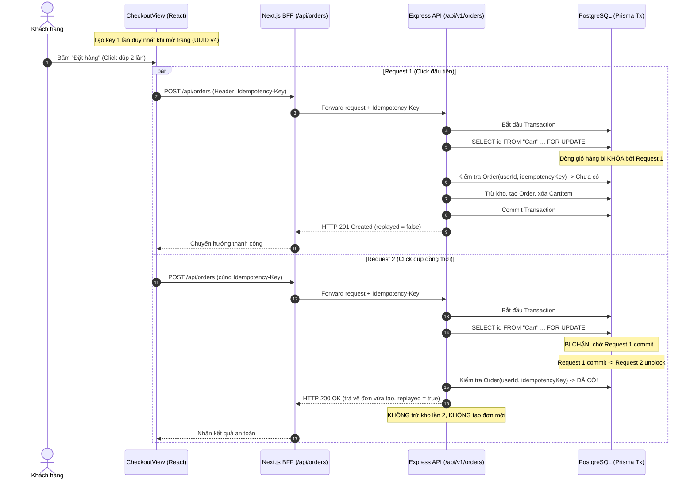

# Kiến Trúc Hệ Thống & Các Điểm Mạnh Cốt Lõi (System Architecture & Core Strengths)

> **Dự án:** Petshop E-Commerce Platform  
> **Ngôn ngữ & Nền tảng:** TypeScript, Next.js 14 (App Router), Express 5, PostgreSQL, Prisma 7  
> **Tài liệu liên quan:** [PROJECT_STRUCTURE.md](PROJECT_STRUCTURE.md) | [ORDER_IDEMPOTENCY.md](ORDER_IDEMPOTENCY.md) | [AUTHENTICATION.md](AUTHENTICATION.md) | [docs/BACKEND_IMPROVEMENT_SPEC.md](docs/BACKEND_IMPROVEMENT_SPEC.md)

---

## 1. Tổng Quan Kiến Trúc Hệ Thống (High-Level Architecture)

Hệ thống được thiết kế theo mô hình **phân tách Storefront / Backend-for-Frontend (BFF) và Core API RESTful**, đặt mục tiêu hàng đầu vào **tính toàn vẹn dữ liệu (Data Integrity)**, **kiểm soát tranh chấp đồng thời (Concurrency Control)** và **trải nghiệm người dùng mượt mà**.

### Sơ Đồ Kiến Trúc Tổng Thể



### Trách Nhiệm Từng Tầng:
1. **Frontend & Next.js BFF (`frontend-petshop/`):**
   - **Storefront:** Sử dụng React Server Components (RSC) render trang phía server, tối ưu Core Web Vitals (LCP, CLS) và SEO.
   - **BFF (Backend-for-Frontend):** Đóng vai trò lớp đệm an toàn giữa trình duyệt và Core API. BFF giữ token trong HttpOnly cookie (trình duyệt không tiếp cận được raw token, chống XSS), tự động kiểm tra CSRF bằng header checking, sinh mã `Idempotency-Key` và proxy request sang Express.
2. **Core API Server (`backend/`):**
   - Xây dựng trên Express 5, tập trung hoàn toàn vào xử lý nghiệp vụ bán hàng, quản lý đơn, kiểm soát kho, xác thực JWT, phân quyền RBAC và thực thi các giao dịch cơ sở dữ liệu.
3. **Database (`PostgreSQL 15+` & `Prisma 7`):**
   - Không chỉ là nơi lưu trữ mà là **chốt chặn cuối cùng bảo vệ tính toàn vẹn của dữ liệu**. Mọi quy tắc về số dư kho, chống trùng lặp đơn hàng, ràng buộc quan hệ đều được thực thi ở cấp độ engine cơ sở dữ liệu.

---

## 2. Sáu Trụ Cột Kỹ Thuật Mạnh Nhất & Cơ Chế Hoạt Động (Core Strengths)

Khác với các ứng dụng e-commerce thông thường chỉ dừng ở mức CRUD cơ bản, dự án này sở hữu **6 thế mạnh kỹ thuật vượt trội**:

---

### Trụ Cột 1: Kiểm Soát Tranh Chấp Đồng Thời & Chống Bán Khống Tuyệt Đối (Concurrency & Anti-Overselling)

#### Vấn đề giải quyết:
Trong các đợt Flash Sale hoặc khi nhiều khách hàng cùng tranh mua những sản phẩm cuối cùng, lỗi thường gặp nhất là **Race Condition** do lập trình viên dùng mô hình *Read-Modify-Write* (đọc số lượng từ DB -> kiểm tra trong code Node.js -> cập nhật lại). Khi nhiều request tới cùng lúc, tất cả đều đọc thấy hàng còn và cùng trừ kho, dẫn đến **bán âm kho (overselling)**.

#### Cơ chế kỹ thuật trong dự án:
1. **Cập nhật nguyên tử có điều kiện (Atomic Conditional Updates):**  
   Tại [`backend/services/inventory.service.ts`](backend/services/inventory.service.ts), hệ thống đẩy toàn bộ điều kiện trừ kho vào một câu lệnh SQL duy nhất:
   ```sql
   UPDATE "ProductVariant"
   SET "stockQuantity" = "stockQuantity" - ${quantity}
   WHERE "id" = ${variantId} 
     AND "stockQuantity" - "reservedQuantity" >= ${quantity}
   ```
   PostgreSQL thực thi lệnh này với khóa dòng nội bộ (Row-level lock). Request đầu tiên cập nhật thành công (`rowsAffected === 1`). Request thứ hai tới ngay sau đó sẽ nhận `rowsAffected === 0` và lập tức bị từ chối đơn hàng với lỗi `OUT_OF_STOCK`, hoàn toàn không có khoảng trống (gap) cho race condition xảy ra.
2. **Sắp xếp thứ tự khóa để triệt tiêu Deadlock:**  
   Khi khách hàng đặt đơn có nhiều món, các transaction song song có nguy cơ gây deadlock nếu khóa các dòng theo thứ tự ngẫu nhiên. Trong [`backend/controllers/order.controller.ts`](backend/controllers/order.controller.ts), dự án luôn **sắp xếp mảng sản phẩm theo variantId tăng dần** trước khi thực hiện thao tác khóa/trừ kho:
   ```typescript
   const items = [...cartItems].sort((a, b) => (a.variantId < b.variantId ? -1 : 1));
   ```

---

### Trụ Cột 2: Cơ Chế Idempotency Key Chống Tạo Đơn Trùng Đa Tầng (End-to-End Order Idempotency)

#### Vấn đề giải quyết:
Người dùng bấm liên tiếp nút "Đặt hàng" (double-click) hoặc mạng chập chờn khiến trình duyệt tự động retry request POST là nguyên nhân chính gây trùng đơn, trừ kho 2 lần và sinh tranh chấp thanh toán.

#### Cơ chế kỹ thuật trong dự án:
Toàn bộ quy trình diễn ra xuyên suốt từ UI -> BFF -> API -> DB:



- **Ràng buộc duy nhất tại DB:** Model `Order` khai báo `@@unique([userId, idempotencyKey])`. Việc gắn theo `userId` bảo đảm tính phân lập — hai khách hàng khác nhau nếu ngẫu nhiên sinh trùng key cũng không bị xung đột hay xem trộm đơn của nhau.

---

### Trụ Cột 3: Sổ Cái Biến Động Tồn Kho Bất Biến (Append-Only Inventory Ledger - ADR-007)

#### Vấn đề giải quyết:
Nếu chỉ có một cột `stockQuantity` và cập nhật đè giá trị, khi có sai lệch số lượng hàng thực tế, doanh nghiệp hoàn toàn không thể điều tra nguyên nhân do đơn nào, do nhân viên nào sửa hay do bug hệ thống.

#### Cơ chế kỹ thuật trong dự án:
- Bảng [`InventoryMovement`](backend/prisma/schema.prisma) hoạt động như một cuốn sổ cái kế toán bất biến:
  - Mọi thay đổi về tồn kho vật lý **bắt buộc** phải ghi 1 dòng ledger trong cùng transaction với câu lệnh đổi số lượng kho.
  - Phân loại rõ ràng lý do: `OPENING` (khởi tạo), `SALE` (bán hàng), `CANCEL_RESTOCK` (hoàn trả khi hủy đơn), `STOCKTAKE` (kiểm kê), `DAMAGED` (hư hỏng).
- **Quy tắc bất biến (Audit Invariant):**
  $$\sum (\text{delta}) \equiv \text{stockQuantity}$$
- Sử dụng trường `seq` tự tăng (`autoincrement`) để xác định đúng thứ tự commit thực tế của các giao dịch trong cơ sở dữ liệu thay vì dựa vào `createdAt` (vốn tính theo thời điểm bắt đầu transaction).

---

### Trụ Cột 4: Bảo Mật Phiên Với Refresh Token Rotation & Reuse Detection

#### Vấn đề giải quyết:
Access token dạng JWT có nhược điểm là không thể thu hồi tức thì trước khi hết hạn. Nếu dùng Refresh Token lưu plaintext trong DB hoặc không xoay vòng, kẻ tấn công đánh cắp được token sẽ duy trì quyền truy cập vĩnh viễn.

#### Cơ chế kỹ thuật trong dự án:
Tại [`backend/services/token.service.ts`](backend/services/token.service.ts):
1. **Opaque Token & SHA-256 Hash:** Token cấp cho client là chuỗi ngẫu nhiên 40-byte (`crypto.randomBytes(40)`). Cơ sở dữ liệu chỉ lưu bản hash SHA-256. Dù cơ sở dữ liệu có bị rò rỉ, kẻ tấn công cũng không thể biến hash thành token hợp lệ để chiếm đoạt phiên.
2. **Xoay vòng Token (Rotation):** Mỗi lần đổi token mới, token cũ bị thu hồi ngay lập tức (`revokedAt = now()`). Mỗi token chỉ có giá trị sử dụng đúng 1 lần duy nhất.
3. **Phát hiện tái sử dụng (Reuse Detection):** Nếu hệ thống nhận được một refresh token *đã bị thu hồi* (chứng tỏ token này đã bị lộ và kẻ tấn công đang cố phát lại), hệ thống lập tức **thu hồi toàn bộ mọi phiên đăng nhập còn lại của người dùng đó** và buộc đăng nhập lại từ đầu.
4. **Conditional Update chống Race Condition:** Thao tác thu hồi token sử dụng lệnh SQL có điều kiện:
   ```sql
   UPDATE "RefreshToken" 
   SET "revokedAt" = NOW() 
   WHERE "id" = ${record.id} AND "revokedAt" IS NULL
   ```
   Nếu 5 request refresh cùng gửi đồng thời một token, chỉ 1 request thực hiện thành công, 4 request còn lại bị coi là replay và kích hoạt cơ chế bảo vệ.

---

### Trụ Cột 5: Kiến Trúc Đa Thương Hiệu Cách Ly Triệt Để (Multi-Tenant by Brand)

#### Vấn đề giải quyết:
Một hệ thống phục vụ nhiều thương hiệu (ví dụ: `petshop` và `gomsu`) dùng chung cơ sở dữ liệu thường dễ gặp lỗi rò rỉ chéo dữ liệu sản phẩm, đơn hàng hoặc giỏ hàng.

#### Cơ chế kỹ thuật trong dự án:
- Middleware [`backend/middlewares/resolveBrand.ts`](backend/middlewares/resolveBrand.ts) yêu cầu header bắt buộc `X-Brand-Slug` và phân giải ra toàn bộ cây danh mục con thuộc về thương hiệu đó.
- Cột `brandSlug` được gắn chặt vào các bảng quan trọng:
  - `Cart`: `@@unique([userId, brandSlug])` (mỗi user có giỏ hàng độc lập cho từng thương hiệu).
  - `Order`: `@@index([brandSlug, orderStatus])`.
- Kiểm tra quyền sở hữu danh mục: Sản phẩm của thương hiệu này không thể bị đưa vào giỏ hàng của thương hiệu khác. Nếu client cố tình gửi ID sản phẩm của thương hiệu khác, hệ thống phản hồi `404 Not Found` (coi như không tồn tại) nhằm chống tấn công dò quét IDOR.

---

### Trụ Cột 6: Văn Hóa Kiểm Thử Khắc Nghiệt & Kỹ Thuật Hỗn Loạn (Extreme Testing & Chaos Engineering)

#### Vấn đề giải quyết:
Đa số dự án web chỉ viết test đơn giản với mock dữ liệu (unit test). Khi chạy trên môi trường thực tế với kết nối mạng trễ, connection pool cạn kiệt hoặc transaction bị đứt giữa chừng, hệ thống mới phát sinh lỗi nghiêm trọng.

#### Cơ chế kỹ thuật trong dự án:
Dự án sở hữu bộ test gồm **35 test files (320+ test cases)** chạy trên PostgreSQL thật qua Testcontainers:
- **Mô phỏng Flash Sale cực hạn ([`backend/test/db/order.race.test.ts`](backend/test/db/order.race.test.ts)):** Bắn 30 buyer đồng thời tranh mua 10 món hàng, kiểm chứng qua vòng lặp nhiều lần để đảm bảo không có bất kỳ sản phẩm nào bị bán âm.
- **Mô phỏng cạn kiệt Connection Pool:** Bắn 100 request checkout cùng lúc vào connection pool chỉ có 10 kết nối, kiểm chứng hệ thống xếp hàng chờ và trả về đúng `201` hoặc `409`, tuyệt đối không bao giờ sập lỗi `500`.
- **Mô phỏng đứt kết nối giữa chừng (Transaction Kill Mid-flight):** Cố tình ngắt kết nối database ngay giữa quá trình checkout, kiểm chứng transaction tự rollback sạch sẽ, không để lại đơn hàng rác hay khóa treo dòng.
- **Property-based Testing ([`backend/test/jwt.property.test.ts`](backend/test/jwt.property.test.ts)):** Sử dụng thư viện `fast-check` sinh hàng nghìn chuỗi payload ngẫu nhiên để chứng minh thuật toán xác thực token không bao giờ bị bypass bởi chuỗi bất kỳ.
- **Đo lường số câu lệnh SQL ([`backend/test/db/commerce.query.test.ts`](backend/test/db/commerce.query.test.ts)):** Sử dụng `pg_stat_statements` để đo trực tiếp số câu lệnh SQL, đảm bảo giỏ hàng có 1 món hay 20 món thì số câu query phát sinh vẫn bằng nhau (triệt tiêu lỗi N+1 Query).

---

## 3. Bảng Ma Trận Đánh Giá Trưởng Thành Kỹ Thuật (System Maturity Matrix)

| Tiêu Chí Kỹ Thuật | Đánh Giá | Hiện Trạng Triển Khai |
| :--- | :---: | :--- |
| **Toàn Vẹn Dữ Liệu (Data Integrity)** | 🟢 **Xuất Sắc (5/5)** | Khóa dòng bi quan, cập nhật nguyên tử, sổ cái kiểm toán tồn kho đạt tiêu chuẩn tài chính. |
| **Chống Trùng Đơn (Idempotency)** | 🟢 **Xuất Sắc (5/5)** | Chuẩn hóa header `Idempotency-Key` từ React -> BFF -> Express -> PostgreSQL. |
| **Bảo Mật & Phiên Làm Việc (Security)** | 🟢 **Xuất Sắc (5/5)** | Refresh Token rotation + reuse detection, HttpOnly cookies tại BFF, phân tầng rate limit. |
| **Chất Lượng Kiểm Thử (Test Rigor)** | 🟢 **Xuất Sắc (5/5)** | Kiểm thử trên Postgres thật qua Testcontainers, bao phủ race condition, deadlock và chaos tests. |
| **Trải Nghiệm Storefront & SEO** | 🟢 **Rất Tốt (4.5/5)** | Next.js 14 App Router, Server Components tối ưu SEO, hỗ trợ 308 permanent redirect cho slug cũ. |
| **Khả Năng Mở Rộng Ngang (Scale-Out)** | 🟡 **Khá (3.5/5)** | Cần thực hiện các hạng mục trong lộ trình: đưa Background Worker ra process riêng, dùng Redis cho Rate Limit phân tán. |

---

## 4. Định Hướng Nâng Cấp Kế Tiếp (Future Roadmap)

Để nâng cấp hệ thống từ mức **Production-ready** hiện tại lên **Enterprise Scale-Out (hàng triệu người dùng)**, kế hoạch chi tiết đã được chuẩn bị sẵn tại:

📄 **[docs/BACKEND_IMPROVEMENT_SPEC.md](docs/BACKEND_IMPROVEMENT_SPEC.md)**

### Tóm tắt các nâng cấp tiếp theo:
1. **Caching danh mục (In-Memory / Redis):** Loại bỏ 2 câu query đệ quy kiểm tra cây danh mục trên mỗi request.
2. **PostgreSQL Trigram GIN Index:** Tối ưu hóa tìm kiếm sản phẩm `LIKE '%q%'` từ $O(N)$ xuống $O(\log N)$.
3. **Graceful Shutdown & Healthcheck Readiness:** Xử lý `SIGTERM`/`SIGINT` giúp zero-downtime deployment.
4. **Tách Background Worker:** Chuyển tiến trình dọn dẹp đơn quá hạn ra worker độc lập hoặc hàng đợi BullMQ / pg-boss.
5. **Direct-to-Cloud Upload:** Tải ảnh trực tiếp từ trình duyệt lên Cloudinary qua presigned signature, giải phóng RAM server Node.js.

---

> **Kết luận:** Đây là một codebase mẫu mực về **lập trình phòng thủ (defensive programming)** và **kiểm soát tính nhất quán của dữ liệu**. Nền tảng này bảo đảm sự an toàn tuyệt đối cho kho hàng và tài chính doanh nghiệp khi vận hành thực tế.
