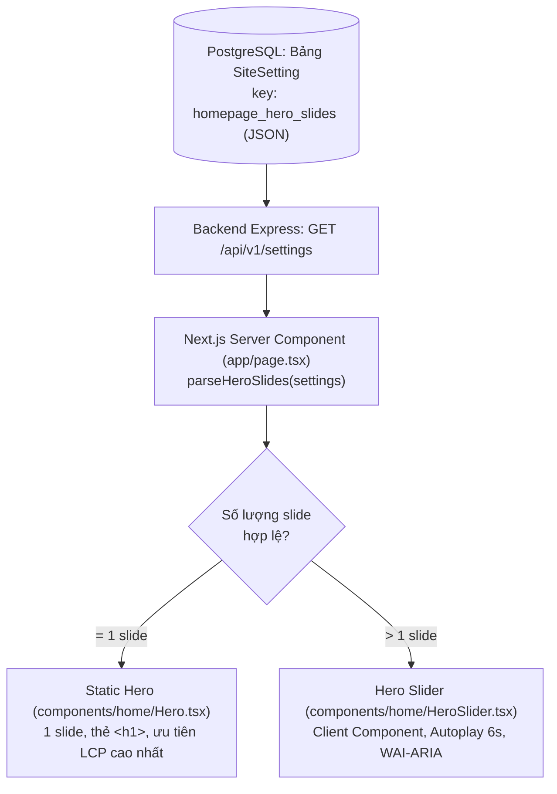

# TÀI LIỆU KIẾN TRÚC & CÁCH XÂY DỰNG HERO BANNER
> **Dự án:** Siêu thị của chó mèo (Petshop - Express + Next.js)  
> **Thành phần:** Hero Banner (Trang chủ)  
> **Công nghệ:** Next.js 16 (Server & Client Components) + Tailwind CSS 4 + PostgreSQL (Prisma)

---

## 1. TỔNG QUAN KIẾN TRÚC HERO BANNER

Hero Banner là khu vực nổi bật đầu tiên mà khách hàng nhìn thấy khi truy cập vào trang chủ ([`app/page.tsx`](file:///Users/tanghuynhtuantu/Programming/Project/Petshop-express-nextjs/frontend-petshop/app/page.tsx)). Nó được thiết kế theo mô hình **Lai linh hoạt (Hybrid Static / Slider)**:

- **Chế độ Static Hero ([`components/home/Hero.tsx`](file:///Users/tanghuynhtuantu/Programming/Project/Petshop-express-nextjs/frontend-petshop/components/home/Hero.tsx)):** Kích hoạt khi hệ thống chỉ có duy nhất 1 slide. Render HTML tĩnh ngay tại server, tối ưu tốc độ tải trang cao nhất.
- **Chế độ Hero Slider ([`components/home/HeroSlider.tsx`](file:///Users/tanghuynhtuantu/Programming/Project/Petshop-express-nextjs/frontend-petshop/components/home/HeroSlider.tsx)):** Kích hoạt khi có từ 2 đến tối đa 6 slides (`MAX_HERO_SLIDES = 6`). Bổ sung tính năng tự động chạy (autoplay), vuốt chạm cảm ứng (swipe), điều khiển dừng/tiếp tục.



---

## 2. TẦNG CƠ SỞ DỮ LIỆU & BACKEND (CMS)

### 2.1. Cấu trúc lưu trữ động trong Database
Thay vì tạo bảng cơ sở dữ liệu cứng nhắc, Hero Banner sử dụng bảng động **`SiteSetting`** (dạng Key - Value):

- **Key `homepage_hero_slides`:** Lưu trữ một mảng JSON các slide. Mỗi slide là một object chứa các trường:
  ```json
  [
    {
      "enabled": true,
      "badge": "♥ Yêu thương & chăm sóc",
      "title": "Lựa chọn tốt nhất",
      "accent": "cho bé cưng nhà bạn",
      "subtitle": "Thức ăn dinh dưỡng, pate, phụ kiện chất lượng...",
      "ctaLabel": "Mua ngay",
      "ctaHref": "/san-pham",
      "cta2Label": "Nhờ tư vấn",
      "cta2Href": "/tu-van-bao-gia",
      "image": "https://res.cloudinary.com/.../hero-dog.png",
      "startsAt": "2026-10-01T00:00:00Z",
      "endsAt": "2026-11-01T00:00:00Z"
    }
  ]
  ```
- **Các key legacy (tương thích ngược):** `homepage_hero_title`, `homepage_hero_accent`, `homepage_hero_image`... dùng làm giá trị dự phòng nếu chưa có cấu hình mới.

### 2.2. API Backend
- **Endpoint Public:** `GET /api/v1/settings?keys=homepage_hero_slides,...` phục vụ SSR phía Next.js lấy dữ liệu.
- **Endpoint Admin:** `PATCH /api/v1/settings` trong [`backend/controllers/setting.controller.ts`](file:///Users/tanghuynhtuantu/Programming/Project/Petshop-express-nextjs/backend/controllers/setting.controller.ts) cho phép chủ shop cập nhật banner qua transaction an toàn.

---

## 3. TẦNG PHÂN TÍCH & LỌC DỮ LIỆU TẠI SERVER ([`lib/heroSlides.ts`](file:///Users/tanghuynhtuantu/Programming/Project/Petshop-express-nextjs/frontend-petshop/lib/heroSlides.ts))

Trước khi HTML được render gửi về trình duyệt, hàm `parseHeroSlides` tại máy chủ Next.js thực hiện các bước kiểm tra nghiêm ngặt:

1. **Lọc trạng thái kích hoạt:** Chỉ giữ lại các slide có `enabled !== false` và có tiêu đề `title`.
2. **Hẹn giờ hiển thị tự động (`isWithinDates`):** Kiểm tra ngày hiện tại so với `startsAt` và `endsAt`. Tính năng này giúp chủ cửa hàng lên lịch trước các banner khuyến mãi (Tết, Black Friday) mà không cần canh giờ bật/tắt thủ công.
3. **Kiểm tra an toàn liên kết (`isSafeHref`):** Chỉ cho phép các đường link an toàn nội bộ hoặc HTTPS hợp lệ, loại trừ các chuỗi mã độc dạng `javascript:`.
4. **Cơ chế Fallback thông minh:** Nếu database trống hoặc chuỗi JSON bị lỗi, hệ thống tự động trả về slide mặc định theo đúng bản thiết kế: *"Lựa chọn tốt nhất cho bé cưng nhà bạn"*.

---

## 4. THIẾT KẾ GIAO DIỆN & BỐ CỤC (LAYOUT & STYLING)

Được định nghĩa tại component dùng chung [`HeroSlideView`](file:///Users/tanghuynhtuantu/Programming/Project/Petshop-express-nextjs/frontend-petshop/components/home/Hero.tsx#L12-L48). Bố cục chia thành 2 cột trên màn hình Desktop (`lg:grid-cols-2`) và xếp chồng trên Mobile:

```
+-----------------------------------------------------------------------+
|  NỀN CHỦ ĐẠO: MÀU XANH BẠC HÀ (var(--mint) / #D8EBEB)                 |
|                                                                       |
|  [CỘT TRÁI: NỘI DUNG / COPY]           [CỘT PHẢI: MẢNG NGHỆ THUẬT]    |
|  - Badge: "♥ Yêu thương & chăm sóc"    +----------------+------------+|
|  - Heading: "Lựa chọn tốt nhất"        | Nền Vàng ấm    | Nền Hồng   ||
|    Accent:  "cho bé cưng nhà bạn"      | (--yellow-hero)| (--coral)  ||
|  - Subtitle mô tả sản phẩm             |                |            ||
|  - Nút 1: [ Mua ngay ] (Màu đậm)       |     ( ẢNH THÚ CƯNG LCP )   ||
|  - Nút 2: [ Nhờ tư vấn ] (Viền rỗng)   +----------------+------------+|
+-----------------------------------------------------------------------+
```

### 4.1. Cột trái: Nội dung & Kêu gọi hành động (Copy & CTA)
- **Huy hiệu (Badge):** Bo góc tròn viên thuốc với màu hồng ngọt ngào (`bg-pink-bg text-pink-ink`), tạo cảm giác thân thiện với người yêu thú cưng.
- **Tiêu đề phân cấp:**
  - Slide đầu tiên luôn được gán thẻ **`<h1>`** (đảm bảo đúng 1 thẻ `<h1>` trên toàn trang cho chuẩn SEO).
  - Các slide tiếp theo trong slider tự động hạ xuống thẻ **`<h2>`** nhưng giữ nguyên kích thước font chữ `clamp(1.75rem, 1.2rem + 2.6vw, 3rem)`.
  - Dòng chữ phụ (`accent`) được bọc trong thẻ `span` đổi sang màu xanh thương hiệu (`text-brand-deep`).
- **Nút bấm hành động:**
  - Nút chính (`ctaLabel`): Bo tròn toàn phần, nền xanh đen đậm (`bg-brand-ink hover:bg-brand-deep text-white`).
  - Nút phụ (`cta2`): Viền đôi bo tròn (`border-2 border-brand-ink bg-surface text-brand-ink`).

### 4.2. Cột phải: Mảng nghệ thuật đôi (Visual Art Panels)
- **Hai khối màu tương phản:** Một nửa bên trái sử dụng màu vàng ấm áp (`bg-yellow-hero` / `#FCB636`), nửa bên phải dùng màu hồng san hô (`bg-coral` / `#FC9FA0`).
- **Hình ảnh thú cưng:** Sử dụng `next/image` với thuộc tính `fill` và `object-contain`, hình ảnh người ôm cún/mèo nổi bật đè lên trên hai khối màu và trải dài tràn sát mép phải màn hình Desktop.

---

## 5. CƠ CHẾ SLIDER TƯƠNG TÁC THÔNG MINH ([`components/home/HeroSlider.tsx`](file:///Users/tanghuynhtuantu/Programming/Project/Petshop-express-nextjs/frontend-petshop/components/home/HeroSlider.tsx))

Khi cấu hình có từ 2 slide trở lên, Hero chuyển thành Carousel tương tác với các tính năng cao cấp:

1. **Chu kỳ tự chuyển (Autoplay):** Tự động chuyển slide sau mỗi **6 giây** (`AUTOPLAY_MS = 6000`).
2. **Cảm biến ngữ cảnh (Context-aware Autoplay):** Slider tự động **tạm dừng chạy ngầm** khi:
   - Người dùng rê chuột vào banner (`hovered = true`).
   - Người dùng dùng phím Tab chuyển tiêu điểm vào các nút (`focused = true`).
   - Người dùng chuyển sang tab trình duyệt khác (`useDocumentHidden()`).
   - Người dùng bấm nút dừng/phát trực tiếp (`⏸ / ▶`).
3. **Hỗ trợ vuốt chạm cảm ứng (Mobile Swipe):** Lắng nghe sự kiện `onPointerDown` và `onPointerUp`, nếu người dùng vuốt ngón tay ngang quá 40px (`SWIPE_PX = 40`) sẽ tự động lật slide tương ứng.
4. **Điều hướng tiện ích:** Có đầy đủ nút bấm lùi/tiến (`‹`, `›`), hàng chấm tròn chỉ báo (dots indicator) trên máy tính và số đếm dạng số (`1 / 3`) trên điện thoại.

---

## 6. CÁC TỐI ƯU HIỆU NĂNG & TIÊU CHUẨN KỸ THUẬT NỔI BẬT

### 6.1. Tối ưu điểm số LCP (Largest Contentful Paint)
- Ảnh của slide đầu tiên chính là phần tử LCP của trang chủ.
- Code thiết lập `priority={true}` và `fetchPriority="high"` riêng cho ảnh slide 1, giúp trình duyệt ưu tiên tải ảnh này trước cả các tài nguyên khác.
- Các ảnh từ slide thứ 2 trở đi được đặt `loading="lazy"` để tiết kiệm băng thông.

### 6.2. Chống giật khung hình (Zero CLS - Cumulative Layout Shift)
- Trong chế độ Slider, tất cả các slide được đặt chồng lên nhau trong **cùng 1 ô Grid** thông qua class `[grid-area:1/1]`.
- Chiều cao của toàn bộ banner sẽ tự động khóa theo chiều cao của slide dài nhất. Khi chuyển slide, hệ thống chỉ đổi độ mờ `opacity-0` sang `opacity-100`, hoàn toàn không gây co giãn hay giật layout.

### 6.3. Tiêu chuẩn Trợ năng WAI-ARIA (Accessibility)
- Sử dụng đúng chuẩn WAI-ARIA Carousel:
  - Khối chứa có `aria-roledescription="carousel"`.
  - Slide đang ẩn được gắn cờ `inert` và `aria-hidden="true"` để trình đọc màn hình (Screen Reader) của người khiếm thị không đọc nhầm nội dung ẩn.
  - Vùng thông báo trạng thái có `aria-live="polite"`.
  - Hỗ trợ phím tắt mũi tên trái/phải (`ArrowLeft` / `ArrowRight`).

### 6.4. Tôn trọng tùy chọn hệ thống (prefers-reduced-motion)
- Tích hợp hook `usePrefersReducedMotion()`.
- Nếu khách hàng kích hoạt chế độ "Giảm hiệu ứng chuyển động" trong cài đặt Windows/macOS/iOS, slider sẽ tự động tắt hiệu ứng lướt và tắt tính năng tự động chuyển trang.

---

## 7. BẢNG TỔNG KẾT CÁC FILE LIÊN QUAN ĐẾN HERO BANNER

| File | Vai trò trong hệ thống |
|---|---|
| [`frontend-petshop/app/page.tsx`](file:///Users/tanghuynhtuantu/Programming/Project/Petshop-express-nextjs/frontend-petshop/app/page.tsx) | Server Component trang chủ, nạp settings và quyết định render Hero hay HeroSlider. |
| [`frontend-petshop/components/home/Hero.tsx`](file:///Users/tanghuynhtuantu/Programming/Project/Petshop-express-nextjs/frontend-petshop/components/home/Hero.tsx) | Component render Static Hero và định nghĩa giao diện chuẩn `HeroSlideView`. |
| [`frontend-petshop/components/home/HeroSlider.tsx`](file:///Users/tanghuynhtuantu/Programming/Project/Petshop-express-nextjs/frontend-petshop/components/home/HeroSlider.tsx) | Client Component xử lý vòng lặp slide, vuốt cảm ứng, nút dừng/phát và A11y. |
| [`frontend-petshop/lib/heroSlides.ts`](file:///Users/tanghuynhtuantu/Programming/Project/Petshop-express-nextjs/frontend-petshop/lib/heroSlides.ts) | Logic bóc tách mảng JSON, kiểm tra ngày hẹn giờ, URL an toàn và giá trị dự phòng. |
| [`frontend-petshop/lib/adminSettings.ts`](file:///Users/tanghuynhtuantu/Programming/Project/Petshop-express-nextjs/frontend-petshop/lib/adminSettings.ts) | Form quản trị tại `/admin/cau-hinh`, chuyển đổi dữ liệu giữa giao diện và JSON database. |
| [`frontend-petshop/design/wireframes/home.html`](file:///Users/tanghuynhtuantu/Programming/Project/Petshop-express-nextjs/frontend-petshop/design/wireframes/home.html) | Bản mẫu HTML/CSS gốc nơi ý tưởng thiết kế màu sắc và bố cục Hero được khởi tạo. |
| [`backend/controllers/setting.controller.ts`](file:///Users/tanghuynhtuantu/Programming/Project/Petshop-express-nextjs/backend/controllers/setting.controller.ts) | API Express phục vụ việc đọc và cập nhật các setting của trang chủ vào PostgreSQL. |
