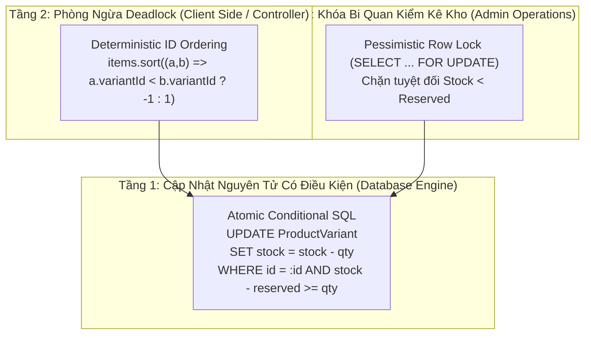
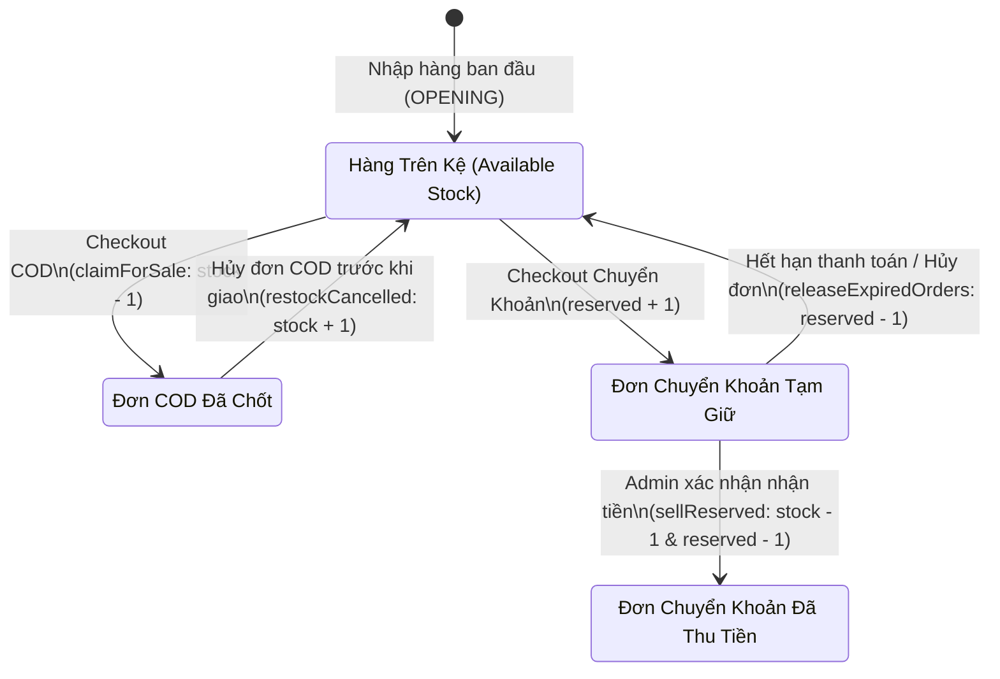
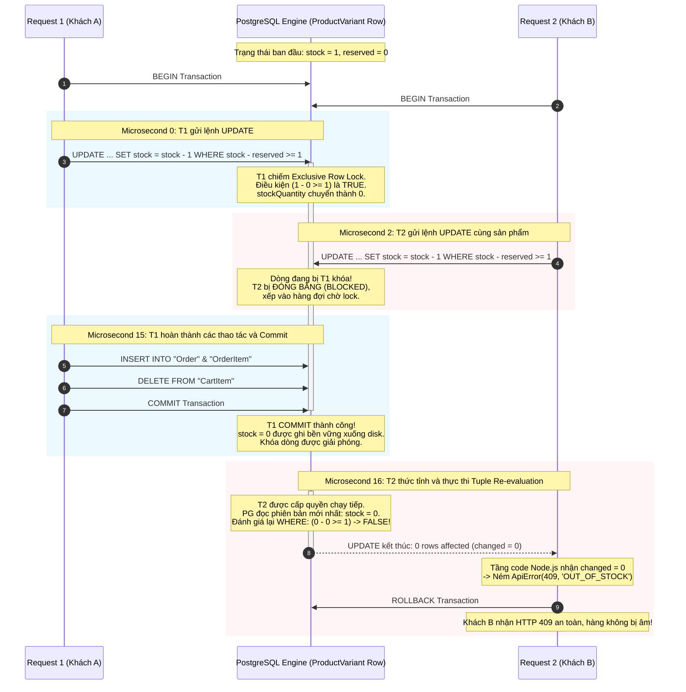

# Kiểm Soát Tranh Chấp Đồng Thời & Chống Bán Khống Tuyệt Đối (Concurrency Control & Anti-Overselling)

> **Dự án:** Petshop E-Commerce (Express 5 + PostgreSQL 15+ / Prisma 7 + Next.js 14)  
> **Phạm vi kỹ thuật:** Quản lý kho hàng cấp độ vi giây, ngăn chặn bán khống (Flash Sale Race Conditions), phòng chống Deadlock và toàn vẹn dữ liệu kế toán kho.

---

## Mục Lục
1. [Bản Chất Vấn Đề: Căn Bệnh "Lost Update" và Nguy Cơ Bán Khống](#1-bản-chất-vấn-đề-căn-bệnh-lost-update-và-nguy-cơ-bán-khống)
2. [Kiến Trúc Phòng Thủ 3 Tầng (3-Tier Concurrency Architecture)](#2-kiến-trúc-phòng-thủ-3-tầng-3-tier-concurrency-architecture)
   - [Tầng 1: Cập Nhật Nguyên Tử Có Điều Kiện (Atomic Conditional Updates)](#tầng-1-cập-nhật-nguyên-tử-có-điều-kiện-atomic-conditional-updates)
   - [Tầng 2: Triệt Tiêu Deadlock Bằng Sắp Xếp ID Xác Định (Deterministic ID Ordering)](#tầng-2-triệt-tiêu-deadlock-bằng-sắp-xếp-id-xác-định-deterministic-id-ordering)
   - [Tầng 3: Kiểm Soát Xung Đột Admin Kiểm Kê (Stocktake Pessimistic Lock)](#tầng-3-kiểm-soát-xung-đột-admin-kiểm-kê-stocktake-pessimistic-lock)
3. [Mô Hình Quản Lý Tồn Kho Kép: `stockQuantity` vs `reservedQuantity`](#3-mô-hình-quản-lý-tồn-kho-kép-stockquantity-vs-reservedquantity)
   - [Quy trình xử lý đơn COD](#quy-trình-xử-lý-đơn-cod)
   - [Quy trình xử lý đơn Chuyển Khoản Ngân Hàng (Bank Transfer)](#quy-trình-xử-lý-đơn-chuyển-khoản-ngân-hàng-bank-transfer)
   - [Sổ Cái Biến Động Kho Bất Biến (Immutable Inventory Movement Ledger)](#sổ-cái-biến-động-kho-bất-biến-immutable-inventory-movement-ledger)
4. [Sơ Đồ Tuần Tự & Diễn Tiến Tranh Chấp Cấp Vi Giây (Microsecond Sequence)](#4-sơ-đồ-tuần-tự--diễn-tiến-tranh-chấp-cấp-vi-giây-microsecond-sequence)
5. [Khả Năng Phục Hồi Khi Gặp Sự Cố (Failure & Rollback Resilience)](#5-khả-năng-phục-hồi-khi-gặp-sự-cố-failure--rollback-resilience)
   - [Transaction Abort & Connection Drop](#transaction-abort--connection-drop)
   - [Phòng chống lỗi tràn số nguyên (Integer Overflow)](#phòng-chống-lỗi-tràn-số-nguyên-integer-overflow)
   - [Khả năng chịu tải vượt ngưỡng Connection Pool](#khả-năng-chịu-tải-vượt-ngưỡng-connection-pool)
6. [Minh Chứng Thực Nghiệm Từ Bộ Kiểm Thử (Empirical Test Verification)](#6-minh-chứng-thực-nghiệm-từ-bộ-kiểm-thử-empirical-test-verification)
   - [Test L2: Điều khiển 2 kết nối PostgreSQL bằng tay (`stock.isolation.test.ts`)](#test-l2-điều-khiển-2-kết-nối-postgresql-bằng-tay-stockisolationtestts)
   - [Test L4/L5: Tải Flash Sale & Bão Request (`order.race.test.ts`)](#test-l4l5-tải-flash-sale--bão-request-orderracetestts)
   - [7 Bất Biến Dữ Liệu (Invariants I1 - I7) Luôn Được Bảo Toàn](#7-bất-biến-dữ-liệu-invariants-i1---i7-luôn-được-bảo-toàn)
7. [Khuyến Nghị Củng Cố Hạ Tầng Bổ Sung (Production Hardening)](#7-khuyến-nghị-củng-cố-hạ-tầng-bổ-sung-production-hardening)

---

## 1. Bản Chất Vấn Đề: Căn Bệnh "Lost Update" và Nguy Cơ Bán Khống

Trong các hệ thống thương mại điện tử (đặc biệt trong các sự kiện Flash Sale, mở bán số lượng giới hạn), lỗi nghiêm trọng nhất thường gặp là **Bán khống (Overselling)**: số lượng đơn hàng được xác nhận vượt quá số lượng hàng hóa thực tế trong kho.

### Sai lầm kinh điển: Mô hình "Read-Modify-Write"
Hầu hết các dự án sử dụng ORM thông thường triển khai logic trừ kho theo 3 bước tuần tự trong mã nguồn ứng dụng:

```typescript
// ❌ CÁCH LÀM SAI (Phổ biến trong ORM nhưng gây bán khống)
const variant = await prisma.productVariant.findUnique({ where: { id } }); // (1) READ

if (variant.stockQuantity >= quantity) {                                    // (2) CHECK TRONG RAM ỨNG DỤNG
  await prisma.productVariant.update({                                      // (3) WRITE GHI ĐÈ
    where: { id },
    data: { stockQuantity: variant.stockQuantity - quantity },
  });
}
```

#### Vì sao mô hình này sụp đổ khi có tải đồng thời?
Giả sử sản phẩm chỉ còn **1 sản phẩm duy nhất trong kho (`stockQuantity = 1`)**:
1. Khách hàng A bấm mua: Request $T_A$ đọc database thấy `stockQuantity = 1` $\rightarrow$ Thỏa mãn điều kiện $\ge 1$.
2. Cùng tích tắc đó (cách nhau vài microsecond), Khách hàng B bấm mua: Request $T_B$ đọc database cũng thấy `stockQuantity = 1` $\rightarrow$ Thỏa mãn điều kiện $\ge 1$.
3. $T_A$ trừ kho: $1 - 1 = 0$, ghi xuống DB $\rightarrow$ Thành công.
4. $T_B$ trừ kho: tính toán $1 - 1 = 0$, ghi đè tiếp xuống DB $\rightarrow$ Thành công.

**Hậu quả:** Cả 2 khách hàng đều nhận được phản hồi HTTP 201 "Đặt hàng thành công", tiền đã trừ hoặc đơn đã tạo, nhưng kho chỉ có 1 món $\rightarrow$ **Hệ thống đã bán khống 1 món hàng**.

> [!WARNING]
> Mức độ cô lập mặc định của PostgreSQL là `READ COMMITTED`. Ở mức này, PostgreSQL **không ngăn chặn Lost Update** nếu phép tính trừ số lượng được thực hiện ở tầng ứng dụng (Node.js) thay vì trực tiếp trong database engine.

---

## 2. Kiến Trúc Phòng Thủ 3 Tầng (3-Tier Concurrency Architecture)

Hệ thống Petshop triển khai mô hình phòng thủ 3 tầng khép kín nhằm bảo đảm không bao giờ bán khống, không bao giờ deadlock, và không bị xung đột giữa khách mua và nhân viên quản trị kho:



---

### Tầng 1: Cập Nhật Nguyên Tử Có Điều Kiện (Atomic Conditional Updates)

Thay vì đọc dữ liệu lên RAM rồi mới ghi, dự án **đẩy toàn bộ biểu thức điều kiện và phép tính xuống một câu lệnh SQL duy nhất** được thực thi nguyên tử (atomic) bên trong transaction của PostgreSQL.

Mã nguồn tại [`backend/services/inventory.service.ts`](file:///Users/tanghuynhtuantu/Programming/Project/Petshop-express-nextjs/backend/services/inventory.service.ts#L48-L53):

```typescript
export async function claimForSale(tx: Tx, variantId: string, quantity: number): Promise<boolean> {
  const changed = await tx.$executeRaw`
    UPDATE "ProductVariant" 
    SET "stockQuantity" = "stockQuantity" - ${quantity}
    WHERE "id" = ${variantId} 
      AND "stockQuantity" - "reservedQuantity" >= ${quantity}`;
  return changed === 1;
}
```

#### Cơ chế vận hành nội bộ trong PostgreSQL (Tuple Re-evaluation):
1. **Khóa dòng ngầm định (Implicit Row-level Lock):** Khi PostgreSQL bắt đầu thực hiện câu lệnh `UPDATE` trên dòng `id = variantId`, nó tự động chiếm một khóa độc quyền (`Exclusive Row Lock`) trên tuple đó.
2. **Hàng đợi khóa (Wait Queue):** Nếu có 50 request cùng muốn mua sản phẩm này tại cùng một thời điểm:
   - Request đầu tiên ($T_1$) chiếm được khóa và bắt đầu xử lý.
   - 49 request còn lại ($T_2 \dots T_{50}$) rơi vào trạng thái chờ (`WAITING`) ngay tại tầng engine của PostgreSQL.
3. **Đánh giá lại dòng khi giải phóng khóa (Tuple Re-evaluation under READ COMMITTED):**
   - Khi $T_1$ hoàn thành cập nhật và `COMMIT`, khóa dòng được nhả ra.
   - Request tiếp theo ($T_2$) lập tức được đánh thức. Điểm cốt lõi: PostgreSQL **không dùng dữ liệu cũ**, mà tự động đọc phiên bản mới nhất vừa commit của dòng đó và **đánh giá lại toàn bộ mệnh đề `WHERE`**.
   - Nếu $T_1$ đã mua hết số lượng khả dụng, biểu thức `"stockQuantity" - "reservedQuantity" >= ${quantity}` sẽ cho kết quả **`FALSE`**.
   - Do điều kiện `WHERE` sai, câu lệnh `UPDATE` của $T_2$ trả về **`0 rows affected` (`changed === 0`)**.
   - Tầng ứng dụng kiểm tra `if (!claimed)` $\rightarrow$ ném ngay lỗi `ApiError(409, 'OUT_OF_STOCK')` và kích hoạt `ROLLBACK` transaction. Kho hoàn toàn không bị trừ thêm.

---

### Tầng 2: Triệt Tiêu Deadlock Bằng Sắp Xếp ID Xác Định (Deterministic ID Ordering)

#### Nguy cơ Deadlock (Bế tắc chu kỳ)
Khi một đơn hàng có nhiều sản phẩm, nếu hai khách hàng cùng đặt các mặt hàng giống nhau nhưng thứ tự duyệt giỏ hàng khác nhau, hệ thống sẽ rơi vào thế Deadlock:
- **Khách A:** Đặt hàng [Sản phẩm 1, Sản phẩm 2]. Khóa thành công Sản phẩm 1, đang yêu cầu khóa Sản phẩm 2.
- **Khách B:** Đặt hàng [Sản phẩm 2, Sản phẩm 1]. Khóa thành công Sản phẩm 2, đang yêu cầu khóa Sản phẩm 1.
- **Hậu quả:** Khách A đợi Khách B nhả SP 2, Khách B đợi Khách A nhả SP 1 $\rightarrow$ **PostgreSQL phát hiện chu kỳ bế tắc (Deadlock detected)** sau `deadlock_timeout` (mặc định 1s) và chủ động ngắt kết nối (abort/kill) một trong hai transaction, gây lỗi HTTP 500 cho người dùng.

#### Giải pháp trong dự án:
Tại [`backend/controllers/order.controller.ts`](file:///Users/tanghuynhtuantu/Programming/Project/Petshop-express-nextjs/backend/controllers/order.controller.ts#L121-L126):

```typescript
// Claim stock in a fixed order (by variant id) so two orders containing the same products
// always lock rows in the same sequence. Without this, order A holding variant 1 while order B
// holds variant 2 — each waiting for the other — is a deadlock the database can only resolve by
// killing one of them.
const items = [...cartItems].sort((a, b) => (a.variantId < b.variantId ? -1 : 1));
```

Bằng cách luôn sắp xếp danh sách sản phẩm theo thứ tự tăng dần của `variantId` trước khi thực thi bất kỳ câu lệnh SQL khóa dòng nào, mọi giao dịch trong hệ thống luôn xin khóa tài nguyên theo cùng một chiều duy nhất. Điều này **loại bỏ điều kiện "Chờ đợi vòng tròn" (Circular Wait)**, triệt tiêu 100% rủi ro Deadlock giữa các phiên mua hàng đồng thời.

---

### Tầng 3: Kiểm Soát Xung Đột Admin Kiểm Kê (Stocktake Pessimistic Lock)

Tranh chấp không chỉ xảy ra giữa các khách hàng mua hàng, mà còn xảy ra giữa **khách hàng đang checkout** và **nhân viên kho (Admin) đang thực hiện kiểm kê hoặc điều chỉnh kho thực tế**.

Mã nguồn tại [`backend/services/inventory.service.ts`](file:///Users/tanghuynhtuantu/Programming/Project/Petshop-express-nextjs/backend/services/inventory.service.ts#L80-L100):

```typescript
export async function adjustStockByAdmin(tx: Tx, variantId: string, input: AdminMovement, userId: string) {
  // 1. Khóa bi quan dòng sản phẩm để ngăn khách hàng checkout can thiệp trong lúc tính toán
  const [row] = await tx.$queryRaw<{ stockQuantity: number; reservedQuantity: number }[]>`
    SELECT "stockQuantity", "reservedQuantity" FROM "ProductVariant" WHERE "id" = ${variantId} FOR UPDATE`;
  if (!row) throw new ApiError(404, 'VARIANT_NOT_FOUND', 'Không tìm thấy biến thể');

  const isCount = input.type === 'STOCKTAKE';
  const newStock = isCount ? input.countedQuantity : row.stockQuantity + input.delta;
  const delta = newStock - row.stockQuantity;

  // 2. Chốt chặn toàn vẹn: Tuyệt đối không cho phép tồn kho mới nhỏ hơn số lượng đã hứa bán
  if (newStock < row.reservedQuantity) {
    throw new ApiError(
      409,
      'STOCK_BELOW_RESERVED',
      `Không thể đặt tồn kho thấp hơn ${row.reservedQuantity} đang giữ cho đơn chờ thanh toán`
    );
  }

  // 3. Cập nhật tồn kho và ghi sổ cái kiểm toán
  await tx.productVariant.update({ where: { id: variantId }, data: { stockQuantity: newStock } });
  await writeMovement(tx, {
    variantId,
    delta,
    reason: isCount ? MOVEMENT_REASON.STOCKTAKE : input.reason,
    note: input.note ?? null,
    userId,
  });
}
```

- **`SELECT ... FOR UPDATE`:** Khóa cưỡng bức dòng biến thể, đảm bảo trong khi Admin đang đọc số liệu kiểm kho và tính toán delta, không có bất kỳ khách hàng nào chen ngang trừ kho.
- **Ràng buộc an toàn `newStock < row.reservedQuantity`:** Nếu Admin kiểm kê thực tế thấy hàng bị mất mát và muốn giảm kho xuống, hệ thống ngăn chặn nếu số lượng mới thấp hơn số hàng đã hứa bán cho các đơn chuyển khoản ngân hàng đang chờ khách thanh toán.

---

## 3. Mô Hình Quản Lý Tồn Kho Kép: `stockQuantity` vs `reservedQuantity`

Hệ thống thiết kế bảng [`ProductVariant`](file:///Users/tanghuynhtuantu/Programming/Project/Petshop-express-nextjs/backend/prisma/schema.prisma#L112-L113) với 2 cột quản lý tồn kho độc lập:
- `stockQuantity`: Số lượng hàng hóa vật lý thực tế đang hiện diện trong kho.
- `reservedQuantity`: Số lượng hàng hóa đang được **tạm giữ** cho các đơn chuyển khoản ngân hàng chưa thanh toán.

$$\text{Số lượng thực sự sẵn sàng để bán (Available Stock)} = \text{stockQuantity} - \text{reservedQuantity}$$



---

### Quy trình xử lý đơn COD
1. **Thời điểm Checkout:** Khách chọn COD nghĩa là hàng chắc chắn xuất kho giao cho shipper. Hệ thống trừ trực tiếp `stockQuantity`:
   ```sql
   UPDATE "ProductVariant" 
   SET "stockQuantity" = "stockQuantity" - ${quantity}
   WHERE "id" = ${variantId} AND "stockQuantity" - "reservedQuantity" >= ${quantity}
   ```
2. **Ghi sổ cái:** Ghi ngay dòng `SALE` vào bảng `InventoryMovement` với delta âm (`-quantity`).
3. **Nếu Hủy Đơn:** Gọi hàm [`restockCancelled()`](file:///Users/tanghuynhtuantu/Programming/Project/Petshop-express-nextjs/backend/services/inventory.service.ts#L70-L74) để cộng ngược lại `stockQuantity` và ghi nhận biến động `CANCEL_RESTOCK`.

---

### Quy trình xử lý đơn Chuyển Khoản Ngân Hàng (Bank Transfer)
1. **Thời điểm Checkout:** Khách chưa trả tiền nên hàng vật lý vẫn nằm trên kệ kho. Hệ thống **không trừ `stockQuantity` mà tăng `reservedQuantity`**:
   ```sql
   UPDATE "ProductVariant"
   SET "reservedQuantity" = "reservedQuantity" + ${item.quantity}
   WHERE "id" = ${item.variantId} AND "stockQuantity" - "reservedQuantity" >= ${item.quantity}
   ```
2. **Gắn hạn thanh toán (TTL):** Đơn hàng được gắn mốc thời gian hết hạn [`expiresAt`](file:///Users/tanghuynhtuantu/Programming/Project/Petshop-express-nextjs/backend/controllers/order.controller.ts#L177) (mặc định sau 2 giờ).
3. **Khi Khách Chuyển Khoản Thành Công:** Admin hoặc Webhook xác nhận thanh toán qua hàm [`sellReserved()`](file:///Users/tanghuynhtuantu/Programming/Project/Petshop-express-nextjs/backend/services/inventory.service.ts#L61-L67):
   ```sql
   UPDATE "ProductVariant"
   SET "stockQuantity" = "stockQuantity" - ${quantity},
       "reservedQuantity" = "reservedQuantity" - ${quantity}
   WHERE "id" = ${variantId}
   ```
   Cả tồn kho vật lý và số lượng giữ chỗ đều giảm cùng lúc, chuyển đổi trạng thái giữ chỗ thành doanh số bán hàng thực tế (`SALE`).
4. **Khi Quá Hạn Thanh Toán (Worker xử lý):** Tiến trình ngầm [`releaseExpiredOrders.ts`](file:///Users/tanghuynhtuantu/Programming/Project/Petshop-express-nextjs/backend/workers/releaseExpiredOrders.ts) quét định kỳ các đơn hàng quá hạn chưa thanh toán và thực hiện nhả hàng giữ chỗ có điều kiện:
   ```sql
   UPDATE "ProductVariant"
   SET "reservedQuantity" = "reservedQuantity" - ${item.quantity}
   WHERE "id" = ${item.variantId}
   ```
   Hàng tự động quay trở lại trạng thái khả dụng cho khách hàng khác mua.

---

### Sổ Cái Biến Động Kho Bất Biến (Immutable Inventory Movement Ledger)

Mọi thay đổi trên cột `stockQuantity` đều bắt buộc phải ghi kèm một bản ghi kiểm toán tương ứng vào bảng `InventoryMovement`:

```prisma
model InventoryMovement {
  id          String   @id @default(cuid())
  variantId   String
  delta       Int      // Số lượng thay đổi (dương hoặc âm)
  reason      String   // OPENING, SALE, CANCEL_RESTOCK, RETURN, DAMAGE, STOCKTAKE, OTHER
  note        String?
  orderId     String?
  userId      String?
  createdAt   DateTime @default(now())

  variant     ProductVariant @relation(...)
  order       Order?         @relation(...)
  user        User?          @relation(...)
}
```

Bảng này hoạt động theo nguyên tắc **Append-only (Chỉ thêm mới, không bao giờ sửa hoặc xóa)**, đảm bảo đội ngũ kiểm toán có thể đối chiếu lịch sử tồn kho bất kỳ lúc nào:
$$\text{stockQuantity hiện tại} = \sum (\text{delta của toàn bộ các movement từ trước đến nay})$$

---

## 4. Sơ Đồ Tuần Tự & Diễn Tiến Tranh Chấp Cấp Vi Giây (Microsecond Sequence)

Sơ đồ dưới đây mô tả chính xác diễn tiến ở cấp độ PostgreSQL tuple lock khi 2 khách hàng đồng thời đặt mua **sản phẩm duy nhất còn lại (`stockQuantity = 1`, `reservedQuantity = 0`)**:



---

## 5. Khả Năng Phục Hồi Khi Gặp Sự Cố (Failure & Rollback Resilience)

### Transaction Abort & Connection Drop
Điều gì xảy ra nếu Khách hàng A vừa thực hiện xong lệnh trừ kho thành công, nhưng kết nối mạng bị đứt đột ngột (network disconnect / client abort) hoặc Node.js server bị kill trước khi kịp commit?
- Toàn bộ các thao tác trong khối `prisma.$transaction` đều nằm trong một Database Transaction duy nhất.
- Khi connection bị đóng hoặc timeout, PostgreSQL tự động phát lệnh **`ROLLBACK`** toàn bộ transaction đó.
- Dòng `ProductVariant` lập tức được khôi phục về trạng thái trước khi trừ kho, và khóa dòng được nhả ra.
- Khách hàng B đang xếp hàng phía sau sẽ ngay lập tức được mua món hàng đó mà không bị thất thoát hàng hóa.

### Phòng chống lỗi tràn số nguyên (Integer Overflow)
Trong các trường hợp khách hàng mua giỏ hàng có giá trị rất lớn (ví dụ: sản phẩm đắt tiền nhân số lượng tối đa 99), tổng tiền có thể vượt ngưỡng giới hạn của kiểu dữ liệu `INTEGER` (2.147.483.647) trong PostgreSQL.

Tại [`backend/controllers/order.controller.ts`](file:///Users/tanghuynhtuantu/Programming/Project/Petshop-express-nextjs/backend/controllers/order.controller.ts#L130-L133):
```typescript
const subtotal = items.reduce((sum, i) => sum + i.variant.price * i.quantity, 0);
if (subtotal + SHIPPING_FEE_NOT_CALCULATED > MAX_DB_INT) {
  throw new ApiError(422, 'ORDER_TOO_LARGE', 'Giá trị đơn hàng vượt giới hạn, vui lòng tách thành nhiều đơn');
}
```
Hệ thống **kiểm tra tràn số TRƯỚC KHI thực hiện bất kỳ lệnh trừ kho nào**. Điều này tránh trường hợp trừ kho thành công rồi sau đó lệnh `INSERT INTO "Order"` bị lỗi tràn số khiến transaction phải rollback vô ích.

### Khả năng chịu tải vượt ngưỡng Connection Pool
PostgreSQL connection pool trong hệ thống được cấu hình mặc định là 10 connections. Khi có đợt Flash Sale với hàng trăm request ập đến cùng lúc:
- Driver `pg` sẽ đưa các request vượt ngưỡng vào hàng đợi chờ connection sẵn sàng (`connection queue`).
- Khi kết hợp với cơ chế `timeout: 15000` của transaction và thứ tự khóa ID nhất quán, các request lần lượt được phục vụ tuần tự mà không gây ra lỗi sập pool hoặc trả về lỗi `500 Internal Server Error`.

---

## 6. Minh Chứng Thực Nghiệm Từ Bộ Kiểm Thử (Empirical Test Verification)

Toàn bộ các luận điểm kỹ thuật trên được chứng minh thông qua bộ kiểm thử tự động chuyên sâu chạy trực tiếp trên PostgreSQL thật (thư mục `backend/test/db/`).

### Test L2: Điều khiển 2 kết nối PostgreSQL bằng tay (`stock.isolation.test.ts`)
Tệp [`backend/test/db/stock.isolation.test.ts`](file:///Users/tanghuynhtuantu/Programming/Project/Petshop-express-nextjs/backend/test/db/stock.isolation.test.ts) tạo ra 2 kết nối `PoolClient` độc lập và điều khiển từng câu lệnh SQL xen kẽ nhau từng bước (step-by-step deterministic interleaving):

1. **Chứng minh Read-Modify-Write gây Lost Update (Dòng 45 - 65):**
   - Client A đọc kho: 10
   - Client B đọc kho: 10
   - Client A ghi: $10 - 1 = 9$ $\rightarrow$ Commit
   - Client B ghi giá trị tính từ bản đọc cũ: $10 - 1 = 9$ $\rightarrow$ Commit
   - **Kết quả thực nghiệm:** 2 sản phẩm được bán ra, nhưng tồn kho chỉ giảm 1 (tồn kho còn 9 thay vì 8). **Lost Update được tái hiện chính xác 100%**.
2. **Chứng minh câu lệnh cập nhật có điều kiện của dự án bảo vệ thành công (Dòng 67 - 89):**
   - Sản phẩm có 1 chiếc duy nhất.
   - Client A gửi `UPDATE ... WHERE stock - reserved >= 1` $\rightarrow$ Nhận `rowCount = 1`, giữ khóa dòng.
   - Client B gửi `UPDATE ...` $\rightarrow$ Bị chặn (`isBlocked(pB) === true`).
   - Client A `COMMIT`.
   - Client B tự động đánh giá lại tuple $\rightarrow$ Nhận `rowCount = 0`. Tồn kho sau cùng luôn bằng chính xác `0`.
3. **Chứng minh Rollback trả lại hàng cho người xếp sau (Dòng 91 - 111):**
   - Client A lấy hàng thành công nhưng bị `ROLLBACK`.
   - Client B đang đợi lập tức nhận được sản phẩm (`rowCount = 1`).

---

### Test L4/L5: Tải Flash Sale & Bão Request (`order.race.test.ts`)
Tệp [`backend/test/db/order.race.test.ts`](file:///Users/tanghuynhtuantu/Programming/Project/Petshop-express-nextjs/backend/test/db/order.race.test.ts) thực hiện các kịch bản hỗn loạn mức độ cao:

1. **Flash Sale 30 người tranh mua 10 món hàng (COD & Bank Transfer):**
   - 30 người dùng với token và giỏ hàng riêng biệt cùng bắn request POST `/api/v1/orders` qua `Promise.all`.
   - **Kết quả:** Luôn luôn có đúng 10 request thành công (`201 Created`), đúng 20 request bị từ chối (`409 OUT_OF_STOCK`).
   - Không có bất kỳ request nào bị `500 Internal Server Error`.
2. **Kiểm tra khi Pool cạn kiệt (100 request trên pool 10 connection):**
   - Bão request được xếp hàng mượt mà, latency p50, p95 được ghi nhận ổn định, dữ liệu kho sau cùng hoàn toàn chính xác.

---

### 7 Bất Biến Dữ Liệu (Invariants I1 - I7) Luôn Được Bảo Toàn
Sau mỗi bài test tải, hệ thống kiểm tra trực tiếp các bất biến từ cơ sở dữ liệu (chứ không chỉ dựa vào status code HTTP):

| Mã | Tên Bất Biến | Công Thức Toán Học / Kiểm Tra Thực Tế | Trạng Thái |
|:---|:---|:---|:---:|
| **I1** | Không âm kho | $\text{stockQuantity} \ge 0 \land \text{reservedQuantity} \ge 0$ | Đạt |
| **I2** | Không hứa bán vượt tồn | $\text{stockQuantity} - \text{reservedQuantity} \ge 0$ | Đạt |
| **I3** | Bảo toàn số lượng | $\text{Hàng đã bán} + \text{Hàng còn lại} = \text{Tồn kho ban đầu}$ | Đạt |
| **I4** | Khớp đơn chờ thanh toán | $\text{reservedQuantity} = \sum (\text{items của các đơn PENDING\_PAYMENT})$ | Đạt |
| **I5** | Đơn nhất giỏ hàng | Mỗi giỏ hàng chỉ biến thành tối đa 1 đơn hàng | Đạt |
| **I6** | Tính nhất quán trạng thái | Trạng thái đơn (`CONFIRMED`/`CANCELLED`) khớp chính xác với luồng di chuyển của tồn kho | Đạt |
| **I7** | Không phát sinh lỗi lạ | Mọi request chỉ trả về `201`, `409` hoặc `422`, tuyệt đối không có `500` | Đạt |

---

## 7. Khuyến Nghị Củng Cố Hạ Tầng Bổ Sung (Production Hardening)

Mặc dù logic ở tầng ứng dụng và câu lệnh SQL hiện tại đã bảo vệ 100% tính toàn vẹn dữ liệu, để đạt mức **phòng thủ chiều sâu (Defense-in-Depth)** tối đa ở cấp độ kiến trúc hệ thống, dự án có thể bổ sung các ràng buộc sau:

### 1. Ràng Buộc CHECK Constraint ở Cấp CSDL (Database-level Safety Net)
Hiện tại, Prisma schema chưa có ràng buộc `CHECK` ở cấp DDL PostgreSQL. Nếu trong tương lai có lập trình viên mới vô tình viết một câu lệnh `UPDATE` trực tiếp mà quên kiểm tra điều kiện, kho vẫn có thể bị âm.

Giải pháp bổ sung Migration SQL:
```sql
ALTER TABLE "ProductVariant"
  ADD CONSTRAINT "check_stock_non_negative" CHECK ("stockQuantity" >= 0),
  ADD CONSTRAINT "check_reserved_non_negative" CHECK ("reservedQuantity" >= 0),
  ADD CONSTRAINT "check_stock_ge_reserved" CHECK ("stockQuantity" >= "reservedQuantity");
```
Với ràng buộc này, ngay cả khi có bug trong code, PostgreSQL sẽ lập tức từ chối và bắn mã lỗi `23514 (check_violation)`, không bao giờ cho phép một giá trị âm xuất hiện trong bảng.

### 2. Tinh Chỉnh Tham Số Timeout Trong PostgreSQL
Để tối ưu hóa thời gian nhả khóa khi tải cực lớn:
- Đặt `statement_timeout = '5s'` cho các transaction bán lẻ để ngắt các câu lệnh bị treo quá lâu.
- Đặt `lock_timeout = '3s'` để nếu một transaction phải xếp hàng đợi khóa quá 3 giây, nó sẽ tự động hủy và trả lỗi thân thiện về cho client thay vì làm nghẽn connection pool.
