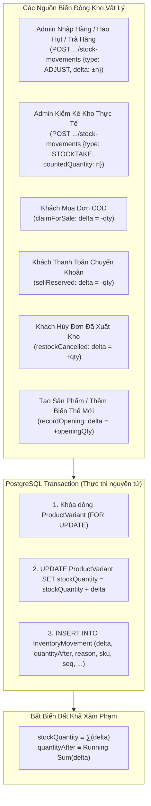

# Sổ Cái Biến Động Tồn Kho Bất Biến (Append-Only Inventory Ledger - ADR-007)

> **Dự án:** Petshop E-Commerce (Express 5 + PostgreSQL 15+ / Prisma 7 + Next.js 14)  
> **Trụ Cột 3:** Quản lý kho theo kiến trúc sổ cái kế toán kép (Double-Entry Ledger), bảo vệ vết kiểm toán (Audit Trail) bất biến và triệt tiêu lỗi mất cập nhật (Lost Update).

---

## Mục Lục
1. [Bối Cảnh Lịch Sử & Lỗ Hổng Chết Người Của Mô Hình Cũ](#1-bối-cảnh-lịch-sử--lỗ-hổng-chết-người-của-mô-hình-cũ)
   - [Kịch bản "Mất tích hàng hóa" (Lost Sales Anomaly)](#kịch-bản-mất-tích-hàng-hóa-lost-sales-anomaly)
   - [Hậu quả đối với kế toán và quản trị](#hậu-quả-đối-với-kế-toán-và-quản-trị)
2. [Quyết Định Kiến Trúc ADR-007 (Architecture Decision Record)](#2-quyết-định-kiến-trúc-adr-007-architecture-decision-record)
   - [3 Quy tắc vàng của ADR-007](#3-quy-tắc-vàng-của-adr-007)
   - [Sơ đồ luồng thay đổi kho và ghi sổ cái](#sơ-đồ-luồng-thay-đổi-kho-và-ghi-sổ-cái)
3. [Thiết Kế Cơ Sở Dữ Liệu: Bảng Sổ Cái `InventoryMovement`](#3-thiết-kế-cơ-sở-dữ-liệu-bảng-sổ-cái-inventorymovement)
   - [Cấu trúc bảng trong Prisma Schema](#cấu-trúc-bảng-trong-prisma-schema)
   - [Phân tích các chi tiết kỹ thuật cốt lõi](#phân-tích-các-chi-tiết-kỹ-thuật-cốt-lõi)
4. [Hệ Thống Phân Loại Lý Do Biến Động (Movement Reasons)](#4-hệ-thống-phân-loại-lý-do-biến-động-movement-reasons)
   - [Bảng tra cứu các loại biến động](#bảng-tra-cứu-các-loại-biến-động)
   - [Phân định ranh giới bảo mật giữa System và Admin](#phân-định-ranh-giới-bảo-mật-giữa-system-và-admin)
5. [Chi Tiết Triển Khai Mã Nguồn (Implementation Walkthrough)](#5-chi-tiết-triển-khai-mã-nguồn-implementation-walkthrough)
   - [Ghi sổ cái nguyên tử (`writeMovement`)](#ghi-sổ-cái-nguyên-tử-writemovement)
   - [Kiểm kê và điều chỉnh kho Admin (`adjustStockByAdmin`)](#kiểm-kê-và-điều-chỉnh-kho-admin-adjuststockbyadmin)
   - [Chốt chặn từ chối sửa kho trực tiếp (`updateVariant`)](#chốt-chặn-từ-chối-sửa-kho-trực-tiếp-updatevariant)
6. [Vì Sao Tạm Giữ Hàng (`reservedQuantity`) Không Ghi Sổ Cái?](#6-vì-sao-tạm-giữ-hàng-reservedquantity-không-ghi-sổ-cái)
7. [Bất Biến Kế Toán & Minh Chứng Thực Nghiệm](#7-bất-biến-kế-toán--minh-chứng-thực-nghiệm)
   - [Công thức toán học bất biến](#công-thức-toán-học-bất-biến)
   - [Kiểm chứng bằng PostgreSQL Window Functions](#kiểm-chứng-bằng-postgresql-window-functions)
   - [Kết quả từ bộ kiểm thử tự động (`inventory.test.ts`)](#kết-quả-từ-bộ-kiểm-thử-tự-động-inventorytestts)
8. [Tổng Kết Đánh Giá Chất Lượng Kỹ Thuật](#8-tổng-kết-đánh-giá-chất-lượng-kỹ-thuật)

---

## 1. Bối Cảnh Lịch Sử & Lỗ Hổng Chết Người Của Mô Hình Cũ

Trước khi ban hành quyết định kiến trúc [`ADR-007`](file:///Users/tanghuynhtuantu/Programming/Project/Petshop-express-nextjs/docs/DECISIONS.md#L66), hệ thống cho phép Admin cập nhật tồn kho bằng cách gửi trực tiếp số lượng tuyệt đối qua endpoint:

```http
PATCH /api/v1/products/variants/:id
Content-Type: application/json

{
  "stockQuantity": 25
}
```

### Kịch bản "Mất tích hàng hóa" (Lost Sales Anomaly)
Giả sử một biến thể thức ăn thú cưng đang có tồn kho hệ thống là **`stockQuantity = 10`**:
1. **09:00:00:** Nhân viên kho vừa xếp thêm 15 gói lên kệ. Admin mở màn hình quản trị, thấy tồn kho hiển thị là **10**, nhẩm tính $10 + 15 = 25$ và nhập số **25** vào form.
2. **09:00:02:** Trước khi Admin bấm "Lưu", có 3 khách hàng đặt mua thành công 3 gói qua hình thức COD. Hệ thống trừ kho hợp lệ: $10 - 3 = \mathbf{7}$.
3. **09:00:03:** Admin bấm "Lưu". Request `PATCH` gửi `{ stockQuantity: 25 }` ghi đè thẳng xuống database.
4. **Hậu quả:**
   - Tồn kho trên hệ thống lập tức biến thành **25**, thay vì con số đúng phải là $7 + 15 = \mathbf{22}$.
   - 3 gói hàng vừa bán cho khách đã **bị xóa sổ hoàn toàn** khỏi lịch sử tính toán kho.
   - Khi kế toán kiểm kho cuối tháng: Kho thực tế bị thiếu 3 gói, không có bất kỳ dấu vết nào ghi nhận ai đã can thiệp, biến động lúc nào và lý do chênh lệch là gì.

---

## 2. Quyết Định Kiến Trúc ADR-007 (Architecture Decision Record)

Để triệt tiêu vĩnh viễn rủi ro trên, hệ thống ban hành quyết định kiến trúc [`ADR-007 (2026-10-18)`](file:///Users/tanghuynhtuantu/Programming/Project/Petshop-express-nextjs/docs/DECISIONS.md#L66):

### 3 Quy tắc vàng của ADR-007:
1. **Cấm tuyệt đối việc ghi đè số lượng kho:** `PATCH /products/variants/:id` sẽ từ chối ngay lập tức với mã lỗi `HTTP 422` nếu payload chứa trường `stockQuantity`.
2. **Tồn kho vật lý chỉ được thay đổi bằng giá trị vi phân (Delta - $\Delta$):** Mọi sự tăng giảm phải được biểu diễn dưới dạng $+n$ hoặc $-n$.
3. **Nguyên tắc Sổ cái kế toán kép (Double-Entry Ledger Principle):** Bất kỳ lệnh cập nhật nào trên cột `ProductVariant.stockQuantity` đều bắt buộc phải ghi kèm **chính xác 1 dòng bất biến** vào bảng `InventoryMovement` trong cùng một Database Transaction.



---

## 3. Thiết Kế Cơ Sở Dữ Liệu: Bảng Sổ Cái `InventoryMovement`

### Cấu trúc bảng trong Prisma Schema
Tại [`backend/prisma/schema.prisma`](file:///Users/tanghuynhtuantu/Programming/Project/Petshop-express-nextjs/backend/prisma/schema.prisma#L351-L371):

```prisma
model InventoryMovement {
  id            String          @id @default(uuid())
  // Insertion order. Rows are written while the variant row is locked, so seq is the true order
  // of stock changes; createdAt is not (now() is the transaction START, at millisecond precision).
  seq           Int             @unique @default(autoincrement())
  variantId     String?
  variant       ProductVariant? @relation(fields: [variantId], references: [id], onDelete: SetNull)
  sku           String
  delta         Int             // Số lượng biến động (+ tăng, - giảm)
  quantityAfter Int             // Snapshot tồn kho ngay sau biến động này
  reason        String          // Lý do biến động
  note          String?         // Ghi chú giải trình của Admin
  userId        String?         // ID người thực hiện
  user          User?           @relation(fields: [userId], references: [id], onDelete: SetNull)
  orderId       String?         // ID đơn hàng liên kết (nếu có)
  order         Order?          @relation(fields: [orderId], references: [id], onDelete: SetNull)
  createdAt     DateTime        @default(now())

  @@index([variantId, seq])
  @@index([orderId])
  @@index([userId])
}
```

### Phân tích các chi tiết kỹ thuật cốt lõi:

1. **Cột `seq` (Autoincrement Sequence) thay vì dựa vào `createdAt`:**
   - Trong PostgreSQL, `createdAt` được gán bằng `now()`, tức là thời điểm **bắt đầu transaction**. Nếu có 2 transaction đồng thời, transaction $T_1$ bắt đầu trước nhưng commit sau $T_2$ sẽ có `createdAt` nhỏ hơn dù bản ghi của $T_1$ được chèn vào đĩa sau $T_2$.
   - Cột `seq` sử dụng PostgreSQL `SERIAL` được cấp phát tuần tự **ngay tại thời điểm chèn dòng trong lúc đang giữ Row Lock**. Nhờ đó, `seq` phản ánh **chính xác 100% thứ tự vật lý của các biến động kho**.
2. **Snapshot SKU độc lập (`sku String`):**
   - Nếu một biến thể hoặc sản phẩm bị xóa khỏi hệ thống trong tương lai, khóa ngoại `variantId` sẽ chuyển thành `NULL` (`onDelete: SetNull`), nhưng giá trị `sku` vẫn được bảo toàn nguyên vẹn.
   - *Nguyên tắc kiểm toán:* **Dấu vết sổ cái không bao giờ biến mất khi đối tượng bị xóa.**
3. **Snapshot `quantityAfter`:**
   - Lưu trữ số dư tồn kho tức thời sau mỗi giao dịch, cho phép kiểm toán viên đối chiếu nhanh số dư tại bất kỳ thời điểm nào trong quá khứ mà không cần tính tổng dồn từ đầu.
4. **Bảo toàn lịch sử khi xóa dữ liệu (`onDelete: SetNull`):**
   - Khi xóa User, xóa Order hoặc xóa Variant, dòng sổ cái tương ứng vẫn tồn tại vĩnh viễn (Append-Only), bảo đảm tính toàn vẹn của báo cáo thuế và kiểm toán doanh nghiệp.

---

## 4. Hệ Thống Phân Loại Lý Do Biến Động (Movement Reasons)

Mã nguồn tại [`backend/constants/inventory.ts`](file:///Users/tanghuynhtuantu/Programming/Project/Petshop-express-nextjs/backend/constants/inventory.ts#L3-L25):

```typescript
export const MOVEMENT_REASON = {
  OPENING: 'OPENING',               // Tồn kho khởi tạo ban đầu
  PURCHASE: 'PURCHASE',             // Nhập hàng từ nhà cung cấp
  DAMAGED: 'DAMAGED',               // Hàng vỡ, hỏng, hết hạn, mất mát
  RETURN: 'RETURN',                 // Khách trả hàng tại quầy
  OTHER: 'OTHER',                   // Lý do khác (bắt buộc kèm note)
  STOCKTAKE: 'STOCKTAKE',           // Điều chỉnh kiểm kê (đếm - hệ thống)
  SALE: 'SALE',                     // Xuất kho bán hàng (COD / Chuyển khoản xác nhận)
  CANCEL_RESTOCK: 'CANCEL_RESTOCK', // Hoàn hàng do hủy đơn đã xuất kho
} as const;

export const ADJUST_REASONS = [
  MOVEMENT_REASON.PURCHASE,
  MOVEMENT_REASON.DAMAGED,
  MOVEMENT_REASON.RETURN,
  MOVEMENT_REASON.OTHER,
] as const;
```

### Bảng tra cứu các loại biến động:

| Lý do (`reason`) | Phân loại | Ý nghĩa nghiệp vụ | Chiều biến động ($\Delta$) |
|:---|:---:|:---|:---:|
| **`OPENING`** | **Hệ thống** | Tồn kho ban đầu khi tạo sản phẩm hoặc thêm biến thể mới | $\ge 0$ |
| **`SALE`** | **Hệ thống** | Hàng xuất kho do khách mua COD hoặc Admin xác nhận chuyển khoản | Âm ($-qty$) |
| **`CANCEL_RESTOCK`** | **Hệ thống** | Hoàn hàng về kệ khi hủy một đơn hàng mà hàng đã xuất kho trước đó | Dương ($+qty$) |
| **`PURCHASE`** | **Admin** | Nhập thêm hàng mới từ nhà cung cấp | Dương ($+n$) |
| **`DAMAGED`** | **Admin** | Hàng bị hỏng, vỡ, hết hạn sử dụng, chuột cắn | Âm ($-n$) |
| **`RETURN`** | **Admin** | Khách trả hàng tại quầy ngoài luồng hủy đơn trực tuyến | Dương ($+n$) |
| **`OTHER`** | **Admin** | Điều chỉnh khác (bắt buộc nhập `note` giải trình) | $\pm n$ |
| **`STOCKTAKE`** | **Admin** | Điều chỉnh theo biên bản kiểm kê thực tế tại kho | $\Delta = \text{Đếm} - \text{Hệ thống}$ |

> [!CAUTION]
> **Phân định an ninh:** Admin khi gọi API `POST /products/variants/:id/stock-movements` **chỉ được phép chọn** 1 trong 4 lý do: `PURCHASE`, `DAMAGED`, `RETURN`, `OTHER`.  
> Các lý do `SALE`, `CANCEL_RESTOCK` và `OPENING` hoàn toàn do hệ thống kiểm soát. Việc này ngăn chặn tuyệt đối nhân viên kho gian lận bằng cách ghi giảm tồn kho dưới danh nghĩa "Bán hàng" nhằm biển thủ sản phẩm.

---

## 5. Chi Tiết Triển Khai Mã Nguồn (Implementation Walkthrough)

Toàn bộ logic thao tác kho tập trung duy nhất tại [`backend/services/inventory.service.ts`](file:///Users/tanghuynhtuantu/Programming/Project/Petshop-express-nextjs/backend/services/inventory.service.ts).

### Ghi sổ cái nguyên tử (`writeMovement`)
Hệ thống sử dụng câu lệnh `INSERT INTO ... SELECT` để ghi trực tiếp giá trị `stockQuantity` và `sku` từ dòng biến thể đang bị khóa:

```typescript
async function writeMovement(tx: Tx, m: MovementInput): Promise<void> {
  await tx.$executeRaw`
    INSERT INTO "InventoryMovement" ("id", "variantId", "sku", "delta", "quantityAfter", "reason", "note", "userId", "orderId")
    SELECT gen_random_uuid()::text, v."id", v."sku", ${m.delta}, v."stockQuantity", ${m.reason}, ${m.note ?? null}, ${m.userId ?? null}, ${m.orderId ?? null}
    FROM "ProductVariant" v WHERE v."id" = ${m.variantId}`;
}
```

### Kiểm kê và điều chỉnh kho Admin (`adjustStockByAdmin`)
Khi Admin kiểm kê thực tế (`STOCKTAKE`) hoặc điều chỉnh delta (`ADJUST`):

```typescript
export async function adjustStockByAdmin(tx: Tx, variantId: string, input: AdminMovement, userId: string) {
  // 1. Khóa bi quan dòng ProductVariant để ngăn khách hàng checkout chen ngang
  const [row] = await tx.$queryRaw<{ stockQuantity: number; reservedQuantity: number }[]>`
    SELECT "stockQuantity", "reservedQuantity" FROM "ProductVariant" WHERE "id" = ${variantId} FOR UPDATE`;
  if (!row) throw new ApiError(404, 'VARIANT_NOT_FOUND', 'Không tìm thấy biến thể');

  // 2. Tính toán delta an toàn
  const isCount = input.type === 'STOCKTAKE';
  const newStock = isCount ? input.countedQuantity : row.stockQuantity + input.delta;
  const delta = newStock - row.stockQuantity;

  // 3. Ràng buộc toàn vẹn: Tồn kho thực tế không thể thấp hơn số lượng đã hứa bán
  if (newStock < row.reservedQuantity) {
    throw new ApiError(
      409,
      'STOCK_BELOW_RESERVED',
      `Không thể đặt tồn kho thấp hơn ${row.reservedQuantity} đang giữ cho đơn chờ thanh toán`
    );
  }

  // 4. Kiểm tra giới hạn số nguyên PostgreSQL (chống tràn số)
  if (newStock > MAX_DB_INT) {
    throw new ApiError(422, 'VALIDATION_ERROR', 'Tồn kho vượt giới hạn cho phép');
  }

  // 5. Cập nhật tồn kho và ghi sổ cái trong cùng transaction
  await tx.productVariant.update({ where: { id: variantId }, data: { stockQuantity: newStock } });
  await writeMovement(tx, {
    variantId,
    delta,
    reason: isCount ? MOVEMENT_REASON.STOCKTAKE : input.reason,
    note: input.note ?? null,
    userId,
  });

  return tx.productVariant.findUniqueOrThrow({ where: { id: variantId } });
}
```

### Chốt chặn từ chối sửa kho trực tiếp (`updateVariant`)
Tại [`backend/controllers/product.controller.ts`](file:///Users/tanghuynhtuantu/Programming/Project/Petshop-express-nextjs/backend/controllers/product.controller.ts#L284-L294):

```typescript
export const updateVariant = asyncHandler(async (req: Request, res: Response) => {
  const variantId = req.params.variantId as string;
  const { price, compareAtPrice, label } = req.body;

  // Stock is NOT editable here any more (the route rejects stockQuantity): an absolute overwrite
  // erased every sale made between the admin reading the number and saving it. Stock changes go
  // through POST /products/variants/:id/stock-movements, by delta or by physical count (ADR-007).
  const data: Prisma.ProductVariantUpdateInput = {};
  if (price !== undefined) data.price = price;
  if (compareAtPrice !== undefined) data.compareAtPrice = compareAtPrice;
  if (label !== undefined) { ... }

  ...
});
```

---

## 6. Vì Sao Tạm Giữ Hàng (`reservedQuantity`) Không Ghi Sổ Cái?

Trong hệ thống, khi khách hàng chọn hình thức Chuyển khoản ngân hàng, hệ thống tăng `reservedQuantity` và giảm số lượng có sẵn để bán, nhưng **hoàn toàn không ghi dòng nào vào `InventoryMovement`**.

### Lý do kỹ thuật & kế toán:
1. **Bản chất tồn kho vật lý (Physical Stock):**  
   Hàng đang giữ chỗ bản chất **vẫn nằm nguyên vẹn trên giá kệ trong kho**. Chưa có nhân viên đóng gói lấy hàng, chưa có biên bản bàn giao cho shipper. Về mặt kế toán tài sản, số dư kho vật lý chưa hề thay đổi.
2. **Ngăn chặn rác dữ liệu sổ cái (Ledger Noise):**  
   Nếu mỗi đơn hàng chuyển khoản (với thời gian chờ thanh toán 2 giờ) đều ghi 2 dòng `HOLD` và `RELEASE_HOLD`, sổ cái sẽ bị phình to bởi hàng ngàn giao dịch tạm, làm chậm nghiêm trọng các truy vấn đối soát doanh thu.
3. **Thời điểm ghi nhận doanh số đích thực:**  
   Chỉ khi khách chuyển khoản thành công và Admin/Webhook xác nhận thanh toán, hàm [`sellReserved()`](file:///Users/tanghuynhtuantu/Programming/Project/Petshop-express-nextjs/backend/services/inventory.service.ts#L61-L67) mới kích hoạt:
   ```sql
   UPDATE "ProductVariant"
   SET "stockQuantity" = "stockQuantity" - ${quantity}, 
       "reservedQuantity" = "reservedQuantity" - ${quantity}
   WHERE "id" = ${variantId};
   ```
   Lúc này, hàng chính thức xuất kho và hệ thống ghi nhận đúng 1 dòng `SALE` vào sổ cái.

---

## 7. Bất Biến Kế Toán & Minh Chứng Thực Nghiệm

### Công thức toán học bất biến:

$$\text{stockQuantity}(\text{variant}) \equiv \sum_{i=1}^{N} \text{delta}_i$$

$$\text{quantityAfter}_k \equiv \sum_{i=1}^{k} \text{delta}_i \quad (\forall k \in [1, N] \text{ sắp xếp theo } \text{seq})$$

---

### Kiểm chứng bằng PostgreSQL Window Functions
Tại [`backend/test/db/inventory.test.ts`](file:///Users/tanghuynhtuantu/Programming/Project/Petshop-express-nextjs/backend/test/db/inventory.test.ts#L39-L53):

```typescript
async function expectLedgerMatchesStock(variantId: string) {
  const rows = await movements(variantId);
  const { stock } = await variantStock(variantId);
  
  // 1. Tổng toàn bộ delta phải bằng chính xác stockQuantity hiện tại
  const sum = rows.reduce((s, r) => s + r.delta, 0);
  expect({ ledgerSum: sum, stock }).toEqual({ ledgerSum: stock, stock });

  // 2. Dùng Window Function kiểm tra lũy kế từng dòng có khớp với quantityAfter không
  const { rows: ordered } = await pool.query<{ ok: boolean }>(
    `SELECT bool_and(running = "quantityAfter") AS ok FROM (
       SELECT "quantityAfter", sum(delta) OVER (ORDER BY seq) AS running
       FROM "InventoryMovement" WHERE "variantId" = $1) t`,
    [variantId],
  );
  expect(ordered[0].ok ?? true).toBe(true);
}
```

---

### Kết quả từ bộ kiểm thử tự động (`inventory.test.ts`)

| Kịch bản kiểm thử | Mô tả kịch bản | Kết quả thực nghiệm |
| :--- | :--- | :---: |
| **Opening Balance** | Tạo sản phẩm / biến thể mới ghi nhận dòng `OPENING` gắn với Admin ID. | Đạt |
| **Admin Purchase (+50)** | Nhập hàng tăng kho 50 đơn vị, ghi lý do `PURCHASE`, lưu ghi chú lô hàng. | Đạt |
| **Admin Damaged (-3)** | Xuất hủy hàng hỏng giảm kho 3 đơn vị, ghi lý do `DAMAGED`. | Đạt |
| **Below Reserved (409)** | Chặn Admin điều chỉnh kho xuống thấp hơn số lượng đang giữ cho đơn chờ. | Đạt |
| **Input Validation (422)** | Từ chối delta = 0, delta số thập phân, delta vượt ngưỡng số nguyên, lý do lạ. | Đạt |
| **Physical Stocktake** | Kiểm kê thực tế đếm được 7 (hệ thống là 10) $\rightarrow$ ghi delta = -3, `STOCKTAKE`. | Đạt |
| **COD Automatic Sale** | Khách checkout COD tự động trừ kho và ghi nhận dòng `SALE` kèm `orderId`. | Đạt |
| **Transfer Confirmation** | Giữ kho không ghi sổ; khi bấm duyệt thanh toán mới ghi nhận `SALE`. | Đạt |
| **Cancel Restock** | Hủy đơn COD hoàn lại hàng vào kho với lý do `CANCEL_RESTOCK`. | Đạt |
| **Race: Nhập hàng vs 20 Khách COD** | Admin nhập +50 chạy đua đồng thời cùng 20 khách mua COD (-1). Không mất 1 món hàng nào, $\sum(\text{delta}) \equiv \text{stockQuantity}$. | Đạt |
| **Race: 2 Admin cùng kiểm kê** | Hai lần kiểm kê đồng thời được tuần tự hóa theo `seq`, không xung đột. | Đạt |
| **Legacy Patch Refusal** | Gọi `PATCH /products/variants/:id` với `stockQuantity` bị từ chối với lỗi `422`. | Đạt |

---

## 8. Tổng Kết Đánh Giá Chất Lượng Kỹ Thuật

Kiến trúc **Sổ Cái Biến Động Tồn Kho Bất Biến (ADR-007)** đưa hệ thống quản lý kho của Petshop từ mức CRUD nghiệp dư lên đẳng cấp **ERP / Kế toán tài chính chuyên nghiệp**:
1. **Triệt tiêu hoàn toàn Lost Update:** Không một thao tác nào có thể vô tình xóa mất các giao dịch mua bán xen giữa.
2. **Khả năng kiểm toán 100% (Complete Audit Trail):** Mọi đơn vị hàng hóa tăng hoặc giảm đều trả lời được 5 câu hỏi: *Ai làm? Lúc nào? Số lượng bao nhiêu? Vì lý do gì? Sau đó kho còn lại mấy món?*
3. **Bền vững trước thao tác xóa dữ liệu:** Dữ liệu sổ cái tồn tại vĩnh viễn nhờ snapshot SKU và cơ chế `onDelete: SetNull`.
4. **Độ tin cậy được chứng minh bằng toán học:** Bất biến $\text{stockQuantity} = \sum(\text{delta})$ được xác minh liên tục bằng các hàm Window Function trong cơ sở dữ liệu.
