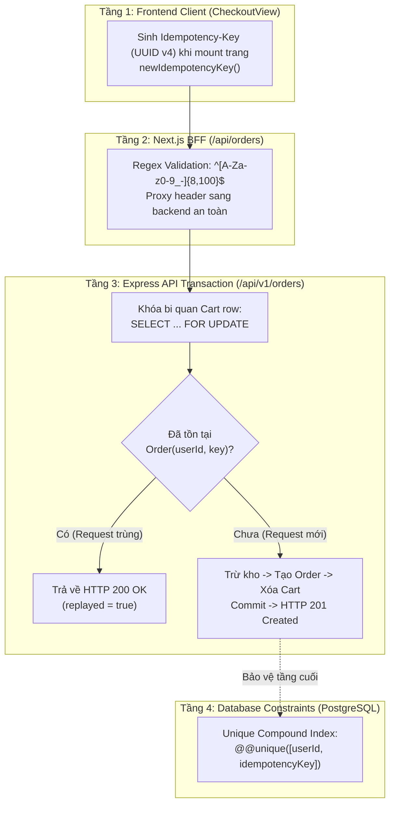
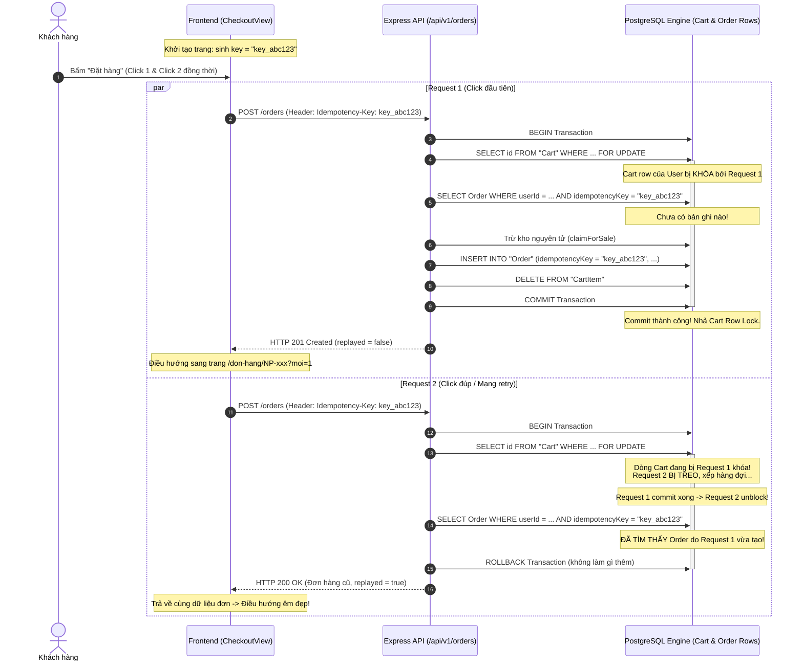

# Cơ Chế Idempotency Key Chống Tạo Đơn Trùng Đa Tầng (End-to-End Order Idempotency)

> **Dự án:** Petshop E-Commerce (Express 5 + Next.js 14 App Router + PostgreSQL 15+ / Prisma 7)  
> **Trụ Cột 2:** Chống tạo đơn hàng trùng lặp (Anti-duplicate Order Creation) & Kiểm soát tranh chấp đồng thời (Concurrency Control).

---

## Mục Lục
1. [Bản Chất Vấn Đề: Vì Sao Khóa Nút Ở Giao Diện Là Không Đủ?](#1-bản-chất-vấn-đề-vì-sao-khóa-nút-ở-giao-diện-là-không-đủ)
   - [3 Kịch bản lỗi kinh điển trong thực tế](#3-kịch-bản-lỗi-kinh-điển-trong-thực-tế)
   - [Lỗ hổng của cờ `disabled` trên giao diện](#lỗ-hổng-của-cờ-disabled-trên-giao-diện)
2. [Kiến Trúc Phòng Thủ Đa Tầng (End-to-End Multi-Tier Architecture)](#2-kiến-trúc-phòng-thủ-đa-tầng-end-to-end-multi-tier-architecture)
   - [Tầng 1: Client Component (React / Next.js)](#tầng-1-khởi-tạo-idempotency-key-duy-nhất-theo-phiên-đặt-hàng-client)
   - [Tầng 2: Next.js BFF Route Handler](#tầng-2-xác-thực--chuyển-tiếp-tại-nextjs-bff)
   - [Tầng 3: Express API Controller & Pessimistic Locking](#tầng-3-khóa-bi-quan-giỏ-hàng--xử-lý-tái-bản-express-api)
   - [Tầng 4: Database Engine & PostgreSQL Constraints](#tầng-4-định-danh-phức-hợp-độc-nhất-tại-csdl-postgresql-engine)
3. [Sơ Đồ Tuần Tự Vi Giây: Quá Trình Tái Bản (Idempotent Replay Sequence)](#3-sơ-đồ-tuần-tự-vi-giây-quá-trình-tái-bản-idempotent-replay-sequence)
4. [Phân Tích 2 Kịch Bản Tranh Chấp Cực Đoan (Edge Cases Analysis)](#4-phân-tích-2-kịch-bản-tranh-chấp-cực-đoan-edge-cases-analysis)
   - [Kịch bản A: Hai request cùng `Idempotency-Key` (Double-click / Retry)](#kịch-bản-a-hai-request-cùng-idempotency-key-double-click--retry)
   - [Kịch bản B: Hai request KHÁC `Idempotency-Key` (Mở 2 tab cùng checkout)](#kịch-bản-b-hai-request-khác-idempotency-key-mở-2-tab-cùng-checkout)
5. [Chi Tiết Triển Khai Mã Nguồn (Code Walkthrough)](#5-chi-tiết-triển-khai-mã-nguồn-code-walkthrough)
   - [Mã nguồn Client & BFF](#mã-nguồn-client--bff)
   - [Mã nguồn Transaction & Row Lock](#mã-nguồn-transaction--row-lock)
6. [Minh Chứng Thực Nghiệm Từ Bộ Kiểm Thử (Automated Test Verification)](#6-minh-chứng-thực-nghiệm-từ-bộ-kiểm-thử-automated-test-verification)
   - [Test L5 Chaos: Double-click đồng thời (`order.race.test.ts`)](#1-test-double-click-2-request-đồng-thời-từ-1-giỏ-hàng)
   - [Test L5 Chaos: Cơn bão Retry Storm 5 submits (`order.race.test.ts`)](#2-test-retry-storm-5-request-giống-hệt-nhau-gửi-tới-khi-request-đầu-đang-chạy)
   - [Test Suite Chuyên Biệt (`order.idempotency.test.ts`)](#3-bảng-tổng-hợp-các-kịch-bản-kiểm-thử-trong-bộ-test)
7. [Tổng Kết Đánh Giá Chất Lượng Kỹ Thuật](#7-tổng-kết-đánh-giá-chất-lượng-kỹ-thuật)

---

## 1. Bản Chất Vấn Đề: Vì Sao Khóa Nút Ở Giao Diện Là Không Đủ?

Trong các hệ thống thương mại điện tử, việc tạo đơn hàng trùng lặp là một trong những nguyên nhân hàng đầu gây ra tranh chấp thanh toán, hao hụt tồn kho ảo và sai lệch kế toán.

### 3 Kịch bản lỗi kinh điển trong thực tế:
1. **Double Submit / Multi-tap:** Người dùng nhấp đúp hoặc bấm liên tục vào nút "Đặt hàng" do mạng chập chờn hoặc thiết bị cảm ứng phản hồi chậm.
2. **Network Retry Storm:** Client đã gửi request và backend đã tạo đơn hàng thành công, nhưng kết nối mạng bị rớt trước khi gói tin HTTP Response kịp trả về cho trình duyệt. Trình duyệt, Service Worker hoặc thư viện HTTP client tự động thử lại (retry) cùng request đó.
3. **Multi-Tab / Multi-Device Race Condition:** Người dùng mở cùng lúc 2 tab trình duyệt cho một tài khoản và bấm "Đặt hàng" cùng một giây.

### Lỗ hổng của cờ `disabled` trên giao diện
Lập trình viên thường đặt cờ `submitting = true` để disable nút bấm. Tuy nhiên, cách làm này **hoàn toàn không bảo vệ được hệ thống**:
- Giữa thời điểm ngón tay người dùng chạm màn hình lần 1 và lần 2 có thể chỉ cách nhau **10 – 30 miligiây**, React state chưa kịp hoàn tất vòng đời re-render thì sự kiện click thứ hai đã bay vào Event Loop.
- Người dùng có thể ấn phím tắt `Enter` liên tục trên form.
- Tấn công replay request bằng Postman/curl hoặc lỗi tự động retry của tầng mạng (Mobile Carrier / Proxy) hoàn toàn bỏ qua giao diện frontend.

> [!IMPORTANT]
> **Yêu cầu bắt buộc:** Hệ thống phải có cơ chế **Bảo đảm tính bất biến (Idempotency)** xuyên suốt từ Frontend $\rightarrow$ Backend-For-Frontend (BFF) $\rightarrow$ Core API Controller $\rightarrow$ Engine Cơ sở dữ liệu.

---

## 2. Kiến Trúc Phòng Thủ Đa Tầng (End-to-End Multi-Tier Architecture)

Dự án thiết kế mô hình bảo vệ 4 tầng khép kín:



---

### Tầng 1: Khởi Tạo Idempotency-Key Duy Nhất Theo Phiên Đặt Hàng (Client)

Tại trang thanh toán [`CheckoutView.tsx`](file:///Users/tanghuynhtuantu/Programming/Project/Petshop-express-nextjs/frontend-petshop/components/checkout/CheckoutView.tsx#L28):
```typescript
// Một key duy nhất đại diện cho nỗ lực checkout này, giữ nguyên khi bấm lại hoặc retry
const [idempotencyKey] = useState(newIdempotencyKey);
```

Hàm tạo key tại [`frontend-petshop/lib/orders.ts`](file:///Users/tanghuynhtuantu/Programming/Project/Petshop-express-nextjs/frontend-petshop/lib/orders.ts#L30-L34):
```typescript
export function newIdempotencyKey(): string {
  // Ưu tiên crypto.randomUUID() chuẩn của trình duyệt hiện đại
  if (typeof crypto.randomUUID === 'function') return crypto.randomUUID();
  // Fallback an toàn cho trình duyệt cũ hoặc môi trường HTTP non-secure
  const bytes = crypto.getRandomValues(new Uint8Array(16));
  return Array.from(bytes, (b) => b.toString(16).padStart(2, '0')).join('');
}
```

#### Nguyên tắc thiết kế:
- Key được sinh **ngay khi trang Checkout được nạp (Component Mount)** và ghim vào React state.
- Nếu người dùng submit form nhưng bị lỗi mạng hoặc server phản hồi chậm, key **vẫn được giữ nguyên** trong các lần bấm tiếp theo.
- Chỉ khi đơn hàng đã tạo thành công và người dùng bắt đầu một giỏ hàng mới, key mới được sinh lại.

---

### Tầng 2: Xác Thực & Chuyển Tiếp Tại Next.js BFF

Tại Next.js Route Handler [`frontend-petshop/app/api/orders/route.ts`](file:///Users/tanghuynhtuantu/Programming/Project/Petshop-express-nextjs/frontend-petshop/app/api/orders/route.ts#L5-L21):

```typescript
const IDEMPOTENCY_KEY = /^[A-Za-z0-9_-]{8,100}$/;

export async function POST(request: Request) {
  const blocked = rejectCrossOrigin(request);
  if (blocked) return blocked;

  const key = request.headers.get('Idempotency-Key') ?? undefined;
  
  // Từ chối ngay nếu định dạng key không hợp lệ (ngăn header injection / rác dữ liệu)
  if (key !== undefined && !IDEMPOTENCY_KEY.test(key)) {
    return badRequest();
  }

  return toResponse(
    await proxy(await sessionJar(), { 
      path: '/orders', 
      method: 'POST', 
      body: payload, 
      idempotencyKey: key 
    }, await requestContext())
  );
}
```

BFF đóng vai trò là một reverse proxy thông minh:
1. Chống CSRF qua hàm `rejectCrossOrigin(request)`.
2. Kiểm tra độ dài (8 – 100 ký tự) và bảng ký tự an toàn trước khi forward header sang Express backend.

---

### Tầng 3: Khóa Bi Quan Giỏ Hàng & Xử Lý Tái Bản (Express API)

Đây là **trọng tâm kiến trúc** của toàn bộ cơ chế, nằm trong [`backend/controllers/order.controller.ts`](file:///Users/tanghuynhtuantu/Programming/Project/Petshop-express-nextjs/backend/controllers/order.controller.ts#L82-L103).

```typescript
const idempotencyKey = req.get('Idempotency-Key') || null;

const { order, replayed } = await prisma.$transaction(
  async (tx) => {
    // BƯỚC 1: KHÓA BI QUAN DÒNG GIỎ HÀNG CỦA USER
    const locked = await tx.$queryRaw<{ id: string }[]>`
      SELECT "id" FROM "Cart" WHERE "userId" = ${userId} AND "brandSlug" = ${brandSlug} FOR UPDATE`;

    // BƯỚC 2: TRA CỨU ĐƠN HÀNG ĐÃ TẠO THEO KEY TRONG PHẠM VI USER
    if (idempotencyKey) {
      const existing = await tx.order.findUnique({
        where: { userId_idempotencyKey: { userId, idempotencyKey } },
        include: { items: true },
      });
      if (existing) {
        return { order: existing, replayed: true };
      }
    }

    // BƯỚC 3: NẾU CHƯA CÓ, ĐỌC GIỎ HÀNG & TIẾN HÀNH TẠO ĐƠN
    const cartItems = locked.length
      ? await tx.cartItem.findMany({ where: { cartId: locked[0].id }, include: ... })
      : [];

    if (cartItems.length === 0) {
      throw new ApiError(422, 'CART_EMPTY', 'Giỏ hàng đang trống');
    }

    // Trừ kho nguyên tử (claimForSale)...
    // Tạo bản ghi Order gắn kèm idempotencyKey...
    // Xóa giỏ hàng...
    await tx.cartItem.deleteMany({ where: { cartId: locked[0].id } });

    return { order: created, replayed: false };
  },
  { timeout: 15000 }
);

// BƯỚC 4: TRẢ MÃ TRẠNG THÁI HTTP PHÙ HỢP
sendSuccess(res, order, null, replayed ? 200 : 201);
```

#### ❓ Câu hỏi kỹ thuật then chốt: Vì sao BẮT BUỘC phải thực hiện `SELECT ... FOR UPDATE` trên Cart trước khi tra cứu Idempotency Key?

Hãy hình dung nếu **không** khóa dòng `Cart`:
1. Hai request $R_1$ và $R_2$ có cùng `Idempotency-Key` bay vào server tại microsecond thứ 0.
2. Cả hai cùng chạy lệnh `findUnique({ userId, idempotencyKey })`. Vì chưa đơn hàng nào được commit, cả hai cùng nhận về **`null`**.
3. Cả hai request đều tưởng mình là request đầu tiên, cùng đi tiếp xuống bước trừ kho và cùng chạy lệnh `tx.order.create(...)`.
4. Lúc này, PostgreSQL gặp lỗi `Unique constraint violation (code 23505)` ở một trong hai request. Request thứ hai bị sập với lỗi `500 Internal Server Error`, khiến khách hàng hoang mang dù đơn hàng thực chất đã thành công!

**Nhờ có khóa dòng `SELECT "id" FROM "Cart" ... FOR UPDATE`:**
- Request $R_1$ bước vào, chiếm khóa độc quyền trên dòng giỏ hàng của user.
- Request $R_2$ đến ngay sau đó, buộc phải **dừng lại và xếp hàng đợi (Wait Queue)** ở tầng DB engine.
- Khi $R_1$ tạo đơn thành công và `COMMIT`, khóa được giải phóng.
- Request $R_2$ được đánh thức, bước vào kiểm tra `findUnique`: **Lập tức tìm thấy đơn hàng do $R_1$ vừa tạo**.
- $R_2$ trả về ngay đơn hàng cũ kèm cờ `replayed = true` và mã `HTTP 200 OK`, giỏ hàng không bị trừ lần 2 và không có bất kỳ ngoại lệ nào phát sinh!

---

### Tầng 4: Định Danh Phức Hợp Độc Nhất Tại CSDL (PostgreSQL Engine)

Tại [`backend/prisma/schema.prisma`](file:///Users/tanghuynhtuantu/Programming/Project/Petshop-express-nextjs/backend/prisma/schema.prisma#L249-L251):

```prisma
model Order {
  id              String      @id @default(cuid())
  code            String      @unique
  userId          String
  idempotencyKey  String?

  @@unique([userId, idempotencyKey])
}
```

#### Phân tích an ninh kiến trúc:
1. **Phân lập nhiều người dùng (Tenant Isolation):**  
   Hệ thống dùng chỉ mục phức hợp `@@unique([userId, idempotencyKey])` thay vì chỉ `@@unique([idempotencyKey])`.  
   *Ý nghĩa an ninh:* Ngăn ngừa kẻ tấn công cố tình gửi đoán trước key của người dùng khác để xem lén thông tin đơn hàng. Ngay cả khi Khách hàng B sử dụng trùng UUID với Khách hàng A, khóa vẫn không bị đụng độ vì thuộc 2 `userId` khác nhau.
2. **Hỗ trợ giá trị `NULL` trong PostgreSQL:**  
   PostgreSQL tuân thủ chuẩn SQL: **Nhiều dòng có `idempotencyKey = NULL` vẫn không vi phạm ràng buộc Unique constraint**. Nhờ đó, các đơn hàng tạo bởi Admin hoặc các kênh không truyền key vẫn hoạt động trơn tru.

---

## 3. Sơ Đồ Tuần Tự Vi Giây: Quá Trình Tái Bản (Idempotent Replay Sequence)

Dưới đây là sơ đồ chi tiết diễn biến khi khách hàng bấm nút "Đặt hàng" 2 lần liên tiếp:



---

## 4. Phân Tích 2 Kịch Bản Tranh Chấp Cực Đoan (Edge Cases Analysis)

### Kịch bản A: Hai request cùng `Idempotency-Key` (Double-click / Retry)
- **Request 1:** Đến trước, chiếm khóa, tạo đơn hàng thành công $\rightarrow$ Trả về `HTTP 201 Created` (`replayed: false`).
- **Request 2:** Đến sau, đợi khóa nhả ra, tìm thấy đơn vừa tạo $\rightarrow$ Trả về `HTTP 200 OK` (`replayed: true`) với đúng payload của đơn đó.
- **Kết quả:** Đúng 1 đơn hàng được tạo, tồn kho trừ đúng 1 lần, giỏ hàng được dọn sạch, người dùng không hề thấy thông báo lỗi.

### Kịch bản B: Hai request KHÁC `Idempotency-Key` (Mở 2 tab cùng checkout)
Nếu khách hàng mở 2 tab khác nhau, mỗi tab sẽ mang một `idempotencyKey` ngẫu nhiên riêng biệt:
- **Tab 1:** Chiếm khóa giỏ hàng trước, kiểm tra key thấy chưa có $\rightarrow$ Đọc giỏ hàng, trừ kho, tạo đơn hàng 1, xóa toàn bộ sản phẩm trong giỏ hàng và commit.
- **Tab 2:** Chờ Tab 1 commit xong mới được unblock. Kiểm tra key của Tab 2 không thấy đơn nào $\rightarrow$ Tiếp tục bước vào đọc giỏ hàng.
- **Điểm mấu chốt:** Giỏ hàng lúc này đã bị Tab 1 xóa sạch (`cartItems.length === 0`).
- **Kết quả:** Tab 2 ném lỗi `ApiError(422, 'CART_EMPTY', 'Giỏ hàng đang trống')`. Khách hàng không bao giờ bị trừ tiền hay tạo 2 đơn trùng cho cùng một giỏ hàng.

---

## 5. Chi Tiết Triển Khai Mã Nguồn (Code Walkthrough)

### Mã nguồn Client & BFF
Tại [`frontend-petshop/components/checkout/CheckoutView.tsx`](file:///Users/tanghuynhtuantu/Programming/Project/Petshop-express-nextjs/frontend-petshop/components/checkout/CheckoutView.tsx#L73-L92):
```typescript
setSubmitting(true);
const res = await bffFetch<Order>('/api/orders', {
  method: 'POST',
  headers: { 'Idempotency-Key': idempotencyKey }, // Gắn key vào header
  body: {
    paymentMethod: method,
    shippingAddress: { ... },
    note: values.note.trim() || null,
  },
});

if (res.ok) {
  await reload(); // Tải lại giỏ hàng (đã được làm rỗng)
  router.replace(`/tai-khoan/don-hang/${encodeURIComponent(res.data.code)}?moi=1`);
  return;
}
setSubmitting(false);
```

### Mã nguồn Transaction & Row Lock
Tại [`backend/controllers/order.controller.ts`](file:///Users/tanghuynhtuantu/Programming/Project/Petshop-express-nextjs/backend/controllers/order.controller.ts#L82-L208):
```typescript
const { order, replayed } = await prisma.$transaction(
  async (tx) => {
    const locked = await tx.$queryRaw<{ id: string }[]>`
      SELECT "id" FROM "Cart" WHERE "userId" = ${userId} AND "brandSlug" = ${brandSlug} FOR UPDATE`;

    if (idempotencyKey) {
      const existing = await tx.order.findUnique({
        where: { userId_idempotencyKey: { userId, idempotencyKey } },
        include: { items: true },
      });
      if (existing) return { order: existing, replayed: true };
    }

    // Xác thực giỏ hàng, trừ kho, tạo Order
    ...
    return { order: created, replayed: false };
  },
  { timeout: 15000 }
);

sendSuccess(res, order, null, replayed ? 200 : 201);
```

---

## 6. Minh Chứng Thực Nghiệm Từ Bộ Kiểm Thử (Automated Test Verification)

### 1. Test Double-click (2 request đồng thời từ 1 giỏ hàng)
File [`backend/test/db/order.race.test.ts`](file:///Users/tanghuynhtuantu/Programming/Project/Petshop-express-nextjs/backend/test/db/order.race.test.ts#L456-L472):
```typescript
it('the same customer double-clicking "Đặt hàng" gets ONE order, not two (I5)', async () => {
  for (let i = 0; i < ITER; i += 1) {
    const { variant } = await setupShop(10);
    const [u] = await customersWithCart(1, variant.id, 1);

    // Bắn 2 request checkout cùng một mili-giây
    const responses = await Promise.all([checkout(u.token), checkout(u.token)]);

    const orders = await countRows('Order', `"userId" = $1`, [u.id]);
    const { stock } = await variantStock(variant.id);

    // Bất biến: Đúng 1 đơn hàng và tồn kho chỉ giảm đúng 1
    expect(orders).toBe(1);
    expect(stock).toBe(9);
  }
});
```

### 2. Test Retry Storm (5 request giống hệt nhau gửi tới khi request đầu đang chạy)
File [`backend/test/db/order.race.test.ts`](file:///Users/tanghuynhtuantu/Programming/Project/Petshop-express-nextjs/backend/test/db/order.race.test.ts#L474-L483):
```typescript
it('a retry storm (5 identical submits while the first is still running) still yields one order', async () => {
  const { variant } = await setupShop(10);
  const [u] = await customersWithCart(1, variant.id, 2);

  // Giả lập 5 submits đồng thời do timeout retry bão hòa
  const responses = await Promise.all(Array.from({ length: 5 }, () => checkout(u.token)));

  expect(statusHistogram(responses)[201]).toBe(1); // Duy nhất 1 request nhận 201
  expect(await countRows('Order')).toBe(1);        // Đúng 1 đơn hàng tồn tại
  expect(await variantStock(variant.id)).toEqual({ stock: 8, reserved: 0 });
});
```

### 3. Bảng tổng hợp các kịch bản kiểm thử trong bộ test
Tại [`backend/test/db/order.idempotency.test.ts`](file:///Users/tanghuynhtuantu/Programming/Project/Petshop-express-nextjs/backend/test/db/order.idempotency.test.ts):

| Kịch bản kiểm thử | Mô tả chi tiết | Kết quả thực tế |
| :--- | :--- | :---: |
| **Double Click Concurrency** | Vòng lặp `ITER` lần đua đồng thời 2 request checkout cùng 1 key. | 1 request trả về `201`, 1 request trả về `200`. Đúng 1 Order được tạo. Kho chỉ trừ 1 lần. |
| **Retry Storm** | Bắn 5 request checkout đồng thời cùng 1 key. | Cả 5 request thành công (200/201), cùng trả về 1 mã đơn (`code`). Kho chỉ trừ 1 lần. |
| **Late Retry** | Gửi lại cùng key sau khi đơn ban đầu đã tạo thành công một khoảng thời gian. | Trả về `200 OK` mang đúng toàn bộ thông tin đơn hàng ban đầu (`id`, `code`, `grandTotal`). |
| **Bank Transfer Replay** | Replay với phương thức chuyển khoản ngân hàng (có giữ kho). | Trả về `200 OK`, số lượng giữ kho (`reserved`) không bị cộng dồn lần 2. |
| **New Key with Empty Cart** | Gửi một key mới sau khi giỏ hàng đã được thanh toán xong. | Trả về `422 CART_EMPTY`. |
| **Reusing Key on Refilled Cart** | Thêm đồ mới vào giỏ nhưng gửi lại key cũ của đơn trước. | Trả về `200 OK` của đơn hàng cũ, giỏ hàng mới còn nguyên vẹn không bị xóa. |
| **Multi-User Isolation** | Hai khách hàng A và B ngẫu nhiên dùng cùng một key `shared-key-123`. | Tạo thành công 2 đơn hàng khác nhau (`201`), thuộc về 2 `userId` khác nhau, bảo mật tuyệt đối. |
| **Input Validation** | Gửi key quá ngắn (<8 ký tự), quá dài (>100 ký tự), hoặc ký tự lạ. | Bị từ chối ngay lập tức với mã `422`, không ghi nhận dữ liệu thừa. |
| **No-Key Fallback** | Không gửi header `Idempotency-Key` (chế độ thường). | Request 1 tạo đơn `201`, request 2 gửi lại khi giỏ rỗng trả về `422 CART_EMPTY`. |

---

## 7. Tổng Kết Đánh Giá Chất Lượng Kỹ Thuật

- **Chuẩn hóa công nghiệp:** Tuân theo quy chuẩn Idempotency HTTP Header (tương đương với thiết kế của Stripe, AWS APIs, Shopify).
- **Tính trọn vẹn (End-to-End):** Phủ sóng toàn bộ chuỗi mắt xích từ React Client -> BFF Proxy -> Express Routing -> Controller Transaction -> PostgreSQL Row Lock & Unique Index.
- **Độ tin cậy tuyệt đối:** Ngăn chặn hoàn toàn lỗi tạo đơn hàng trùng, không bao giờ phát sinh mã lỗi `500 Internal Server Error` do tranh chấp khóa Unique Constraint.
