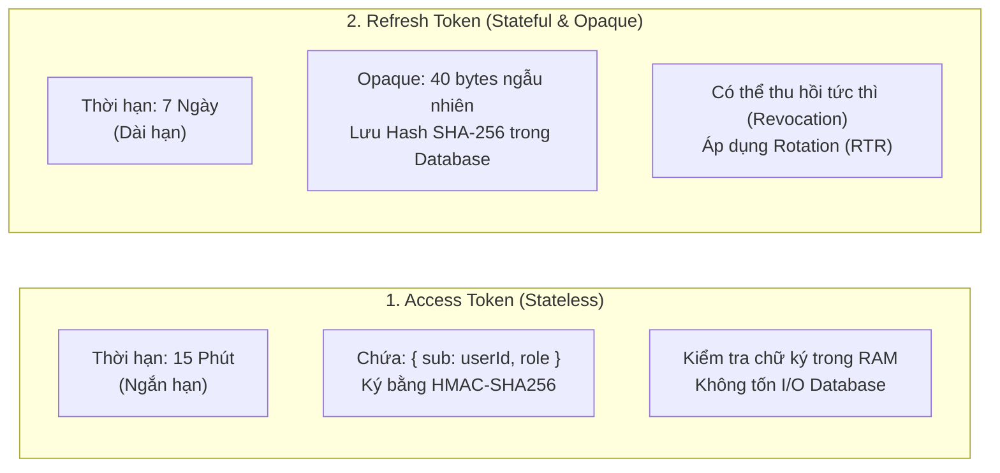
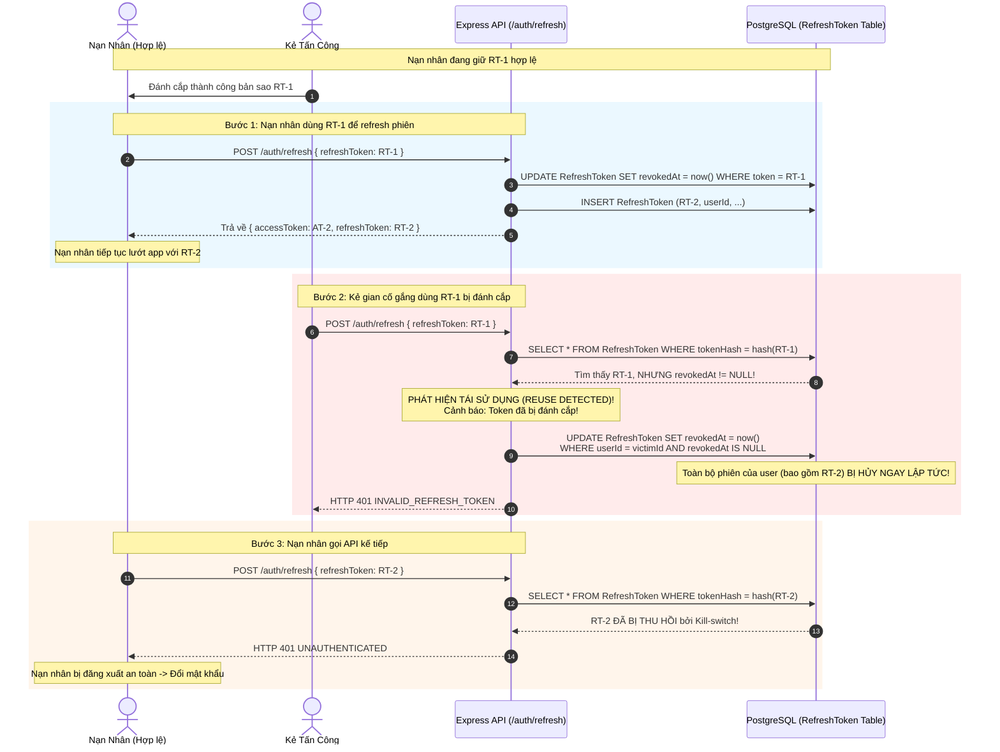

# Bảo Mật Phiên Với Refresh Token Rotation & Reuse Detection (Trụ Cột 4)

> **Dự án:** Petshop E-Commerce (Express 5 + PostgreSQL 15+ / Prisma 7 + Next.js 14 App Router)  
> **Trụ Cột 4:** Bảo mật phiên làm việc với mô hình Hybrid Tokens (Stateless JWT + Stateful Opaque Refresh Token), Xoay vòng token (RTR), Tự động phát hiện tái sử dụng (Reuse Detection) và Lưu trữ Cookie chuẩn Doanh nghiệp.

---

## Mục Lục
1. [Bản Chất Vấn Đề: Lỗ Hổng Của Stateless JWT & Phiên Dài Hạn](#1-bản-chất-vấn-đề-lỗ-hổng-của-stateless-jwt--phiên-dài-hạn)
   - [3 Lỗ hổng chí mạng của kiến trúc JWT truyền thống](#3-lỗ-hổng-chí-mạng-của-kiến-trúc-jwt-truyền-thống)
   - [Nghịch lý giữa Trải Nghiệm (UX) và Bảo Mật (Security)](#nghịch-lý-giữa-trải-nghiệm-ux-và-bảo-mật-security)
2. [Chiến Lược Token Lai (Hybrid Token Lifecycle)](#2-chiến-lược-token-lai-hybrid-token-lifecycle)
   - [So sánh Access Token vs Refresh Token](#so-sánh-access-token-vs-refresh-token)
   - [Sơ đồ vòng đời và phân định trách nhiệm](#sơ-đồ-vòng-đời-và-phân-định-trách-nhiệm)
3. [Kiến Trúc Refresh Token Rotation (RTR) & Bảo Mật Hash](#3-kiến-trúc-refresh-token-rotation-rtr--bảo-mật-hash)
   - [Lưu trữ băm SHA-256 trước khi chạm CSDL](#lưu-trữ-băm-sha-256-trước-khi-chạm-csdl)
   - [Nguyên tắc sử dụng 1 lần duy nhất (Single-Use Token)](#nguyên-tắc-sử-dụng-1-lần-duy-nhất-single-use-token)
4. [Cơ Chế Phát Hiện Tái Sử Dụng Trái Phép (Automatic Reuse Detection)](#4-cơ-chế-phát-hiện-tái-sử-dụng-trái-phép-automatic-reuse-detection)
   - [Kịch bản 1: Kẻ gian dùng token sau khi nạn nhân đã refresh](#kịch-bản-1-kẻ-gian-dùng-token-sau-khi-nạn-nhân-đã-refresh)
   - [Kịch bản 2: Kẻ gian dùng token trước khi nạn nhân kịp refresh](#kịch-bản-2-kẻ-gian-dùng-token-trước-khi-nạn-nhân-kịp-refresh)
   - [Công tắc hủy diệt toàn bộ phiên (Family Revocation Kill-Switch)](#công-tắc-hủy-diệt-toàn-bộ-phiên-family-revocation-kill-switch)
5. [Phòng Ngừa Race Condition Bằng Conditional Atomic Update](#5-phòng-ngừa-race-condition-bằng-conditional-atomic-update)
   - [Hiểm họa nhân bản phiên khi refresh đồng thời](#hiểm-họa-nhân-bản-phiên-khi-refresh-đồng-thời)
   - [Giải pháp `updateMany` có điều kiện tại database](#giải-pháp-updatemany-có-điều-kiện-tại-database)
6. [Lớp Phòng Thủ Frontend & Next.js BFF (Session Cookie An Toàn)](#6-lớp-phòng-thủ-frontend--nextjs-bff-session-cookie-an-toàn)
   - [Bảo vệ chống XSS/CSRF với `httpOnly`, `SameSite=Lax`, `secure`](#bảo-vệ-chống-xsscsrf-với-httponly-samesitelax-secure)
   - [Tiền tố Cookie `__Host-` chuẩn RFC 6265bis](#tiền-tố-cookie-__host--chuẩn-rfc-6265bis)
   - [Khử trùng lặp đa tab (Multi-Tab Refresh Deduplication)](#khử-trùng-lặp-đa-tab-multi-tab-refresh-deduplication)
7. [Minh Chứng Thực Nghiệm Từ Bộ Kiểm Thử Vitest (`auth.test.ts`)](#7-minh-chứng-thực-nghiệm-từ-bộ-kiểm-thử-vitest-authtestts)
8. [Bảng Tra Cứu Mã Nguồn Thành Phần Xác Thực](#8-bảng-tra-cứu-mã-nguồn-thành-phần-xác-thực)

---

## 1. Bản Chất Vấn Đề: Lỗ Hổng Của Stateless JWT & Phiên Dài Hạn

Một trong những sai lầm phổ biến nhất trong các ứng dụng Web/Mobile hiện đại là **phát hành JSON Web Token (JWT) có thời hạn dài (ví dụ: 7 ngày hoặc 30 ngày)** và để phía client lưu trực tiếp vào `localStorage`.

### 3 Lỗ hổng chí mạng của kiến trúc JWT truyền thống:
1. **Stateless nên không thể thu hồi (No Immediate Revocation):**  
   Một khi Access Token JWT đã được ký (sign), nó hoàn toàn hợp lệ cho đến giây cuối cùng của hạn sử dụng (`exp`). Nếu token bị lộ (qua lỗ hổng XSS, rò rỉ log, bắt gói tin qua mạng công cộng hoặc người dùng bị mất thiết bị), **backend hoàn toàn bất lực**. Không có cách nào ngắt phiên làm việc đó nếu không đổi secret key của toàn bộ hệ thống (làm tất cả người dùng bị văng ra).
2. **Nguy cơ XSS đánh cắp phiên vĩnh viễn:**  
   Lưu token trong `localStorage` hay `sessionStorage` khiến bất kỳ đoạn mã JavaScript độc hại nào (từ thư viện npm bên thứ ba hoặc tấn công XSS) cũng có thể đọc trộm và gửi về máy chủ của kẻ tấn công.
3. **Nghịch lý giữa Trải Nghiệm (UX) và Bảo Mật (Security):**  
   - Nếu đặt thời hạn token ngắn (15 phút): Người dùng liên tục bị văng ra bắt đăng nhập lại, trải nghiệm rất tệ.
   - Nếu đặt thời hạn token dài (30 ngày): Lỗ hổng bảo mật bị kéo dài tới 1 tháng.

---

## 2. Chiến Lược Token Lai (Hybrid Token Lifecycle)

Hệ thống Petshop giải quyết triệt để bài toán này bằng mô hình **Xác thực lai (Hybrid Authentication)**:



### So sánh Access Token vs Refresh Token trong dự án:

| Tiêu chí | Access Token ([`jwt.service.ts`](file:///Users/tanghuynhtuantu/Programming/Project/Petshop-express-nextjs/backend/services/jwt.service.ts)) | Refresh Token ([`token.service.ts`](file:///Users/tanghuynhtuantu/Programming/Project/Petshop-express-nextjs/backend/services/token.service.ts)) |
| :--- | :--- | :--- |
| **Bản chất** | JWT (JSON Web Token), mang chữ ký điện tử | Opaque Token (Chuỗi 40 bytes ngẫu nhiên hex) |
| **Thời gian sống (TTL)**| **15 phút** (Rất ngắn, thu hẹp cửa sổ rủi ro) | **7 ngày** (Đủ dài cho trải nghiệm mượt mà) |
| **Trạng thái lưu trữ** | **Stateless:** Không lưu trong database | **Stateful:** Lưu bản băm SHA-256 trong PostgreSQL |
| **Chi phí xác thực** | Siêu nhanh: Verify chữ ký bằng CPU, 0 I/O DB | Cần đọc DB khi xoay vòng token |
| **Payload dữ liệu** | Mang `{ sub, role }` phục vụ phân quyền RBAC tức thì | Không mang dữ liệu, chỉ là khóa định danh phiên |
| **Khả năng thu hồi** | Hết hạn tự nhiên sau 15 phút | Có thể thu hồi ngay lập tức (`revokedAt`) |

---

## 3. Kiến Trúc Refresh Token Rotation (RTR) & Bảo Mật Hash

### Lưu trữ băm SHA-256 trước khi chạm CSDL
Mã nguồn tại [`backend/services/token.service.ts`](file:///Users/tanghuynhtuantu/Programming/Project/Petshop-express-nextjs/backend/services/token.service.ts#L10-L36):

```typescript
function hashToken(rawToken: string): string {
  return crypto.createHash('sha256').update(rawToken).digest('hex');
}

export async function issueRefreshToken(userId: string): Promise<string> {
  // Sinh 40 bytes ngẫu nhiên cryptographically secure = 80 ký tự hex
  const rawToken = crypto.randomBytes(40).toString('hex');

  await prisma.refreshToken.create({
    data: {
      userId,
      tokenHash: hashToken(rawToken),
      expiresAt: new Date(Date.now() + REFRESH_TOKEN_TTL_MS) // 7 ngày
    }
  });

  return rawToken;
}
```

- **Nguyên tắc cốt lõi:** Chuỗi token gốc (`rawToken`) **chỉ tồn tại dưới dạng cleartext đúng 1 lần duy nhất** khi gửi về cho client.
- Cơ sở dữ liệu **chỉ lưu trữ giá trị băm `tokenHash`**.
- *Ý nghĩa an ninh:* Nếu database của Petshop bị lộ (Data Dump Leak), kẻ tấn công **hoàn toàn không thể dùng dữ liệu hash để giả lập phiên đăng nhập** (tương tự như nguyên tắc băm mật khẩu).

---

### Nguyên tắc sử dụng 1 lần duy nhất (Single-Use Token)
- Mỗi Refresh Token được cấp phát là **độc nhất và chỉ sử dụng đúng 1 lần**.
- Khi client gửi yêu cầu cấp mới Access Token tại endpoint `POST /api/v1/auth/refresh`:
  1. Refresh Token hiện tại lập tức bị đánh dấu là **đã thu hồi** (`revokedAt = new Date()`).
  2. Hệ thống phát hành **một cặp token hoàn toàn mới** (Access Token mới + Refresh Token mới).
  3. Chuỗi xích token (Token Chain) liên tục tiến về phía trước. Một token cũ không bao giờ được phép sử dụng lại lần thứ hai.

---

## 4. Cơ Chế Phát Hiện Tái Sử Dụng Trái Phép (Automatic Reuse Detection)

Khi một Refresh Token đã bị thu hồi (`revokedAt !== null`) mà vẫn được ai đó gửi lên server, hệ thống nhận diện đây là **Tín hiệu Bị Tấn Công / Đánh Cắp Token (Theft Signal)**.



---

### Kịch bản 1: Kẻ gian dùng token sau khi nạn nhân đã refresh
1. Nạn nhân đăng nhập, nhận $RT_1$.
2. Kẻ gian đánh cắp được bản sao $RT_1$.
3. Nạn nhân tiếp tục dùng app, gọi `/auth/refresh` với $RT_1$. Hệ thống thu hồi $RT_1$ và cấp cho nạn nhân $RT_2$.
4. Một lúc sau, kẻ gian mang $RT_1$ gửi lên server:
   - Server tra cứu thấy $RT_1$ đã có `revokedAt !== null`.
   - **Reuse Detection lập tức kích hoạt!**
   - **Kill-Switch:** Lập tức thu hồi TOÀN BỘ các refresh token đang hoạt động của User:
     ```typescript
     await prisma.refreshToken.updateMany({
       where: { userId: record.userId, revokedAt: null },
       data: { revokedAt: new Date() }
     });
     ```
   - **Kết quả:** Phiên của nạn nhân ($RT_2$) và mọi thiết bị khác đều bị ngắt ngay lập tức, vô hiệu hóa hoàn toàn cơ hội đột nhập của hacker. Nạn nhân được yêu cầu đăng nhập lại.

---

### Kịch bản 2: Kẻ gian dùng token trước khi nạn nhân kịp refresh
1. Kẻ gian đánh cắp được $RT_1$ và lập tức gọi `/auth/refresh` trước nạn nhân.
2. Server chưa thấy $RT_1$ bị thu hồi nên cấp cho kẻ gian $RT_{\text{hacker}}$ và đánh dấu $RT_1$ là `revoked`.
3. Vài phút sau, nạn nhân mở app, gửi $RT_1$ lên để refresh:
   - Server nhận $RT_1$, thấy `revokedAt !== null`.
   - **Reuse Detection kích hoạt!**
   - Server phát lệnh thu hồi **toàn bộ token của User**, trong đó bao gồm chính $RT_{\text{hacker}}$ mà kẻ gian vừa nhận!
   - **Kết quả:** Kẻ gian lập tức bị đá văng khỏi hệ thống ở lần gọi API tiếp theo. Cửa xâm nhập bị đóng chặt hoàn toàn.

---

## 5. Phòng Ngừa Race Condition Bằng Conditional Atomic Update

### Hiểm họa nhân bản phiên khi refresh đồng thời
Nếu logic kiểm tra và cập nhật token được viết theo kiểu đọc-rồi-ghi thông thường:
```typescript
// ❌ SAI: Dễ bị race condition nhân bản phiên
const record = await prisma.refreshToken.findFirst({ where: { tokenHash } });
if (record.revokedAt !== null) return triggerReuseDetection();

// KHOẢNG TRỐNG VI GIÂY NẰM Ở ĐÂY!
await prisma.refreshToken.update({ where: { id: record.id }, data: { revokedAt: new Date() } });
await issueRefreshToken(record.userId);
```
Nếu có 10 request refresh gửi tới cùng một mili-giây:
- Cả 10 request đều chạy `findFirst` và thấy `revokedAt === null`.
- Cả 10 request đều tưởng mình là người đầu tiên, cùng update và cùng sinh ra 10 Refresh Token mới!
- **Hậu quả:** 1 token bị lộ lập tức biến thành 10 phiên độc lập sống song song và cơ chế Reuse Detection không bao giờ được kích hoạt!

### Giải pháp `updateMany` có điều kiện tại database
Tại [`backend/services/token.service.ts`](file:///Users/tanghuynhtuantu/Programming/Project/Petshop-express-nextjs/backend/services/token.service.ts#L68-L86):

```typescript
// Thu hồi bằng câu lệnh UPDATE có điều kiện và kiểm tra số dòng bị ảnh hưởng
const { count } = await prisma.refreshToken.updateMany({
  where: { id: record.id, revokedAt: null },
  data: { revokedAt: new Date() },
});

// Nếu count !== 1, nghĩa là một request khác đã vừa thu hồi token này trước ta vài microsecond!
if (count !== 1) {
  // Coi việc thua cuộc đua này chính là tín hiệu Replay Attack -> Hủy toàn bộ family!
  await prisma.refreshToken.updateMany({
    where: { userId: record.userId, revokedAt: null },
    data: { revokedAt: new Date() }
  });
  return null;
}

const newRawToken = await issueRefreshToken(record.userId);
return { userId: record.userId, rawToken: newRawToken };
```

Nhờ câu lệnh `updateMany` có điều kiện `revokedAt: null`:
- Chỉ có duy nhất **1 request duy nhất** nhận được `count === 1`.
- 9 request còn lại nhận `count === 0` $\rightarrow$ Ngay lập tức kích hoạt cơ chế phòng vệ thu hồi toàn bộ phiên, triệt tiêu hoàn toàn khả năng nhân bản token.

---

## 6. Lớp Phòng Thủ Frontend & Next.js BFF (Session Cookie An Toàn)

Tokens hoàn toàn không được tiếp xúc với JavaScript của trình duyệt (tránh 100% rủi ro XSS). Thay vào đó, tầng Next.js BFF quản lý session thông qua HTTP Cookies siêu bảo mật.

Mã nguồn tại [`frontend-petshop/lib/bff/cookies.ts`](file:///Users/tanghuynhtuantu/Programming/Project/Petshop-express-nextjs/frontend-petshop/lib/bff/cookies.ts):

```typescript
export const ACCESS_MAX_AGE = 14 * 60;              // 14 phút (ngắn hơn 15m của JWT)
export const REFRESH_MAX_AGE = 7 * 24 * 60 * 60;     // 7 ngày

export function cookieNames(production = isProduction()): { access: string; refresh: string } {
  // Tiền tố __Host- bảo vệ tuyệt đối ở môi trường Production
  const prefix = production ? '__Host-' : '';
  return { access: `${prefix}sc_at`, refresh: `${prefix}sc_rt` };
}

export function cookieOptions(production: boolean, maxAge: number): CookieOptions {
  return { 
    httpOnly: true,        // Chặn hoàn toàn document.cookie (chống XSS)
    secure: production,    // Chỉ truyền qua HTTPS
    sameSite: 'lax',       // Chống tấn công giả mạo yêu cầu (chống CSRF)
    path: '/',             // Giới hạn phạm vi
    maxAge 
  };
}
```

### Các ưu điểm vượt trội:
1. **Tiền tố `__Host-` Cookie:**  
   Ở chế độ Production, cookie được đặt tên là `__Host-sc_at` và `__Host-sc_rt`. Theo tiêu chuẩn RFC 6265bis, trình duyệt sẽ từ chối nếu cookie này bị set từ subdomain (ngăn chặn tấn công Subdomain Cookie Tossing / Poisoning).
2. **Khử trùng lặp đa tab (Multi-Tab Deduplication):**  
   Tại [`frontend-petshop/lib/bff/session.ts#L123`](file:///Users/tanghuynhtuantu/Programming/Project/Petshop-express-nextjs/frontend-petshop/lib/bff/session.ts#L123):
   ```typescript
   export async function refresh(jar: CookieJar, ctx: RequestContext): Promise<BffResult> {
     const names = cookieNames();
     // Nếu cookie access vẫn còn hạn (do tab bên cạnh vừa refresh xong), không refresh lại!
     if (jar.get(names.access)) return ok({ refreshed: false });
     ...
   ```
   Nếu người dùng mở cùng lúc 5 tab, tab đầu tiên gọi refresh sẽ nhận cặp token mới và lưu vào cookie chung. 4 tab còn lại khi chạy tới hàm này thấy cookie access đã có sẵn thì **lập tức dừng lại**, không gọi backend nữa. Điều này ngăn chặn việc các tab tự "giẫm chân lên nhau" vô tình kích hoạt Reuse Detection.

---

## 7. Minh Chứng Thực Nghiệm Từ Bộ Kiểm Thử Vitest (`auth.test.ts`)

Mọi cơ chế trên được chứng minh thông qua bộ kiểm thử tự động tại [`backend/test/db/auth.test.ts`](file:///Users/tanghuynhtuantu/Programming/Project/Petshop-express-nextjs/backend/test/db/auth.test.ts#L117-L178):

### 1. Test Xoay vòng & Phát hiện Tái sử dụng (Dòng 124 - 136):
```typescript
it('L0 exchanges a refresh token for a new pair and the old one stops working', async () => {
  const { refreshToken } = await session();
  const first = await refresh(refreshToken);
  expect(first.status).toBe(200);
  expect(first.body.data.refreshToken).not.toBe(refreshToken);

  // Gửi lại token CŨ (giả lập kẻ trộm gửi token đã dùng)
  const replay = await refresh(refreshToken);
  expect(replay.status).toBe(401);

  // Kiểm tra Kill-switch: Toàn bộ họ token bị khai tử, token mới cấp cũng bị hủy!
  const afterTheft = await refresh(first.body.data.refreshToken);
  expect(afterTheft.status).toBe(401);
});
```

### 2. Test Đua xe 10 request refresh đồng thời (Dòng 152 - 168):
```typescript
it(`L6 the same refresh token used 10 times at once yields exactly ONE new session — ${ITER}x`, async () => {
  for (let i = 0; i < ITER; i += 1) {
    const { user, refreshToken } = await session();
    
    // Bắn 10 request refresh cùng một microsecond
    const responses = await Promise.all(Array.from({ length: 10 }, () => refresh(refreshToken)));
    
    const hist = statusHistogram(responses);
    const live = await countRows('RefreshToken', `"userId" = $1 AND "revokedAt" IS NULL`, [user.id]);
    
    // Bất biến tuyệt đối: Đúng 1 request được 200, và chỉ có duy nhất 1 token live trong DB
    expect(hist[200]).toBe(1);
    expect(live).toBe(1);
  }
});
```

---

## 8. Bảng Tra Cứu Mã Nguồn Thành Phần Xác Thực

| Thành phần | Đường dẫn file | Nhiệm vụ kỹ thuật chính |
|:---|:---|:---|
| **JWT Service** | [`backend/services/jwt.service.ts`](file:///Users/tanghuynhtuantu/Programming/Project/Petshop-express-nextjs/backend/services/jwt.service.ts) | Ký và xác thực Access Token 15 phút mang `{ sub, role }`. |
| **Token Service** | [`backend/services/token.service.ts`](file:///Users/tanghuynhtuantu/Programming/Project/Petshop-express-nextjs/backend/services/token.service.ts) | Sinh Opaque Token 40 bytes, băm SHA-256, Rotation và Reuse Detection. |
| **Auth Controller** | [`backend/controllers/auth.controller.ts`](file:///Users/tanghuynhtuantu/Programming/Project/Petshop-express-nextjs/backend/controllers/auth.controller.ts) | Xử lý logic đăng ký, đăng nhập, refresh, me, reset mật khẩu, logout. |
| **BFF Session Client** | [`frontend-petshop/lib/bff/session.ts`](file:///Users/tanghuynhtuantu/Programming/Project/Petshop-express-nextjs/frontend-petshop/lib/bff/session.ts) | Quản lý Cookie jar, khử trùng lặp refresh đa tab, gọi proxy backend. |
| **BFF Cookie Config** | [`frontend-petshop/lib/bff/cookies.ts`](file:///Users/tanghuynhtuantu/Programming/Project/Petshop-express-nextjs/frontend-petshop/lib/bff/cookies.ts) | Cấu hình cờ `httpOnly`, `SameSite=Lax`, `secure`, tiền tố `__Host-`. |
| **Database Schema** | [`backend/prisma/schema.prisma`](file:///Users/tanghuynhtuantu/Programming/Project/Petshop-express-nextjs/backend/prisma/schema.prisma#L135) | Định nghĩa bảng `RefreshToken` (`tokenHash`, `revokedAt`, `expiresAt`). |
| **Test Suite Tự Động** | [`backend/test/db/auth.test.ts`](file:///Users/tanghuynhtuantu/Programming/Project/Petshop-express-nextjs/backend/test/db/auth.test.ts) | Kiểm thử toàn diện rotation, reuse detection, race condition. |
